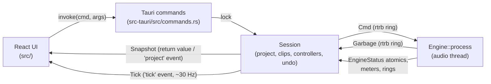
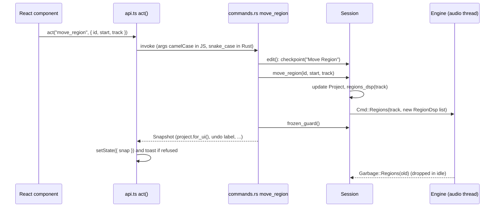
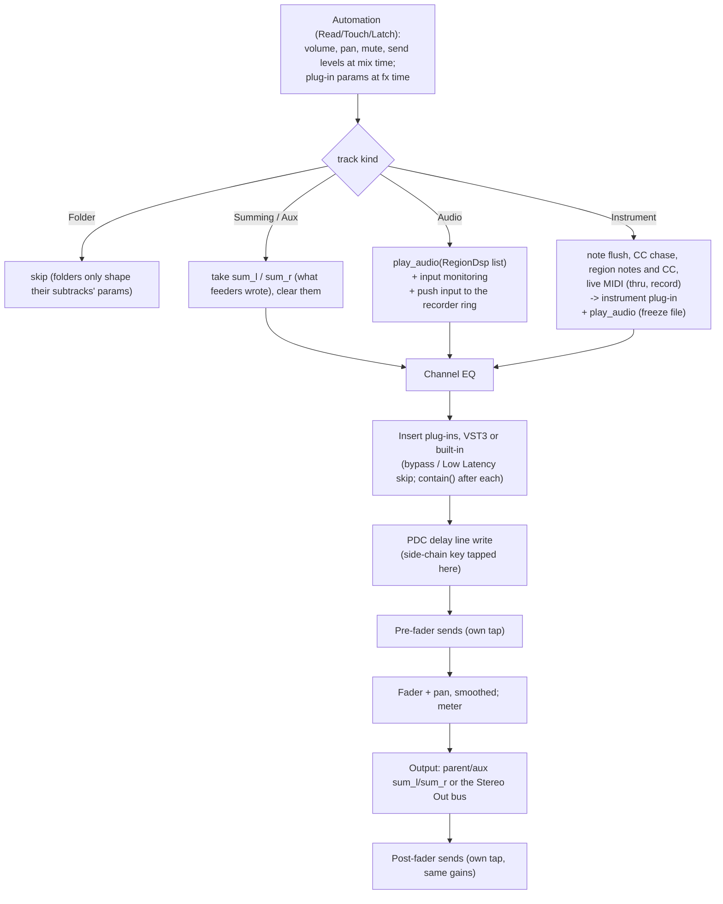

# Fermata architecture

This document is for developers who are new to the code. It explains how the pieces fit
together, which rules keep the audio thread safe, and where to find things. For building,
testing and step-by-step recipes see [DEVELOPING.md](DEVELOPING.md); for what the program
does from the user's side see [USER_GUIDE.md](USER_GUIDE.md). The Logic Pro research behind
the layout and behaviour is in [logic-reference.md](logic-reference.md), and the feature scope
is in [LOGIC_FEATURES.md](../LOGIC_FEATURES.md).

Contents:

1. [Overview](#1-overview)
2. [Processes and threads](#2-processes-and-threads)
3. [Real-time rules](#3-real-time-rules)
4. [How an edit flows](#4-how-an-edit-flows)
5. [The project model](#5-the-project-model)
6. [The engine graph, block by block](#6-the-engine-graph-block-by-block)
7. [Undo](#7-undo)
8. [Persistence](#8-persistence)
9. [The VST3 host](#9-the-vst3-host)
10. [Audio I/O and latency](#10-audio-io-and-latency)
11. [The frontend](#11-the-frontend)
12. [Tempo map](#12-tempo-map)
13. [Built-in effects and presets](#13-built-in-effects-and-presets)
14. [Cross-cutting patterns](#14-cross-cutting-patterns)
15. [Module map](#15-module-map)

## 1. Overview

Fermata is a Cargo workspace with three crates plus a React frontend:

| Part | Path | Role |
|---|---|---|
| `vst3-host` | `crates/vst3-host` | VST3 hosting on the `vst3` bindings: module loading, scanning, host COM objects, the real-time processing wrapper, editor windows. |
| `daw-engine` | `crates/engine` | The audio engine: the project model, the real-time graph, the session controller, device I/O, recording, MIDI, rendering. No UI code. |
| `daw` | `src-tauri` | The Tauri 2 application: commands, the native menu, settings and recent files, the timers that drive plug-in idle and UI ticks. The binary is called `daw`; packages also install it as `fermata`. |
| frontend | `src` | React 19 + TypeScript, built with Vite. Canvas for the tracks area, ruler, editors and meters. |

The engine is split into two halves that never share mutable data directly:

- **`Session`** (`crates/engine/src/session.rs` and `session/`) is the non-real-time
  controller. It owns the `Project` document, the loaded audio clips, the plug-in
  controllers, the undo history and the recorder. Every edit goes through it.
- **`Engine`** (`crates/engine/src/dsp.rs` and `dsp/`) is the real-time graph. It owns one
  `TrackDsp` per track and runs `Engine::process` on the audio thread. It learns about edits
  only through `Cmd` messages.



## 2. Processes and threads

| Thread or process | Created in | What it does | What it may not do |
|---|---|---|---|
| **Main / UI thread** | Tauri | Runs synchronous Tauri commands (most edits, including audio import with its decoding and resampling), the native menu, the GTK main loop on Linux, the 30 ms idle timer (`Session::idle`: plug-in controller idle, latency changes, draining `Garbage`, automation follow and writes), and taking autosaves. All VST3 *controllers* and editor windows live here. | Block for long. Renders are async commands for that reason. |
| **`audio-io`** | `audio_io::start` | Builds and owns the cpal streams, then waits until the device is closed. | |
| **Audio callback** | cpal (output stream) | Calls `Engine::process` once per device buffer, inside `catch_unwind`; the input stream's callback only fills the input ring. Runs with real-time priority (rtkit on Linux). | Allocate, lock, block, do I/O. See [Real-time rules](#3-real-time-rules). |
| **`fermata-dsp-N`** | `dsp/pool.rs`, started by `Session::sync_parallel` | Plays strips alongside the audio callback when Settings › Audio › Processing Threads allows it and a project is heavy enough, then blocks until the next block. Real-time like the callback. See [Multi-core processing](#multi-core-processing). | The same as the audio callback. |
| **`recorder`** | `recorder.rs` | Every 10 ms, drains the ring buffer of each armed track into its WAV file and an in-memory copy, and keeps a peak preview for the UI. | Touch the engine or the project. |
| **`ui-tick`** | `src-tauri/src/main.rs` | Every 33 ms: locks the session, builds a `Tick` (playhead, meters, input levels, recording previews, CPU, latency, analyzer spectrum, warnings, meters of open built-in effect panels, the clip indicators' held peaks, each strip's gain reduction) and emits it as the `tick` event. | Edit anything. |
| **MIDI refresh** | `main.rs` | Every 3 s: `Session::refresh_midi`, so devices plugged in later get connected. | |
| **MIDI input callbacks** | midir, in `midi_io.rs` (one per port) | Drop system messages, take assigned controllers (all of them while learning) into a queue for `Session::idle` (controller assignments), apply the velocity curve, push the rest into the `live_midi` ring the engine reads, and log the message for Settings › MIDI. | |
| **Async command workers** | Tauri's async runtime (`#[tauri::command(async)]`) | Offline renders (bounce, export, Bounce in Place, Freeze), plug-in rescans, waveform and transient requests, device lists, recent projects, the input level check, folder listings. Renders hold the session lock and the engine lock for their whole length; the parts that edit tracks or plug-ins are handed back to the main thread with `run_on_main_thread`. | Touch plug-in controllers. |
| **Autosave writer** | `main.rs::autosave` | Writes an `AutosaveJob` (already serialized on the main thread) to disk, atomically. | |
| **Plug-in scan subprocess** | `plugin_db.rs` | `fermata --scan-vst3 <bundle>` loads one bundle in a child process and prints its descriptors, so a crashing plug-in can't take the app down. Four scan worker threads start the children and wait for them (at first launch before the window opens, otherwise from Rescan). | Load plug-ins in the app's own process. |

On non-Linux platforms there is no GTK timer; a helper thread posts the idle work to the main
thread with `run_on_main_thread` every 30 ms instead (`main.rs`).

The session is behind a `parking_lot::Mutex` in `AppState`. The engine is behind its own
`Mutex`, but the audio callback only ever `try_lock`s it: while an offline render holds the
engine lock, the device outputs silence (see `dsp/offline.rs`).

## 3. Real-time rules

`Engine::process` and everything it calls run on the audio thread. They must:

- **not allocate or free memory.** Buffers are allocated up front (`MAX_BLOCK` = 1024 frames,
  `MAX_INPUTS` = 32, `MAX_MIDI` = 512 events per track per block). Device buffers larger than
  `MAX_BLOCK` are processed in sub-blocks.
- **not lock or block.** Communication is through wait-free `rtrb` single-producer,
  single-consumer rings (commands in and garbage out, 4096 entries each; live MIDI, recorded
  MIDI, recorded audio, the analyzer feed) and atomics (`EngineStatus`, `Meter`, `FxShared`).
  The command and garbage queues used to be `crossbeam_channel`s. Those can make a receiver
  spin while a preempted sender finishes a write; with real-time priority the audio thread then
  starved the sender and the kernel killed the app with SIGXCPU (`RLIMIT_RTTIME`). `rtrb` never
  waits. `Session::send` drops a command rather than block if the ring is ever full.
- **not do I/O or call into plug-in controllers.** Only the processor half of a plug-in
  (`PluginProcessor`) is moved into the engine.

The pattern that makes this work is **Cmd in, Garbage out**:

1. The session builds whatever the engine needs (a `TrackDsp`, an `Arc<Vec<RegionDsp>>`, an
   `InsertDsp`, a `DelayLine`) on its own thread and sends it in a `Cmd`.
2. At the start of the next callback, `Engine::apply` swaps the new object in.
3. The object it replaced is sent back as a `Garbage` value. `Session::idle` drains the
   garbage channel on the main thread, where dropping (and freeing) is safe.
4. If the garbage ring were ever full, `Engine::discard` leaks the object rather than
   block.

`Session::send` counts commands; `wait_for_engine` spins (up to 1 s) until
`EngineStatus::cmds_done` catches up, for the few places that need the engine to have applied
something (stopping a recording). With no audio device running, `send` drains the queue by
calling `process` with no buffers, so the graph stays current and headless tests work.

Failures on the audio thread are contained rather than fatal:

- **Denormals.** `Engine::process` holds a `NoDenormals` guard (`denormals.rs`) for its whole
  run: flush-to-zero, plus denormals-are-zero on x86_64 (FPCR.FZ on aarch64), restored when
  the guard drops, since the callback thread belongs to the driver. The pool's workers set it for
  their whole life. Decaying tails in filters,
  reverbs and the tuner would otherwise fall into the denormal range, where arithmetic is
  about a hundred times slower.
- **Overload.** When callbacks take longer than the audio they produce, back to back for more
  than `OVERLOAD_SECS` (60 ms), the engine flushes notes and *sheds* load: for `SHED_SECS`
  (250 ms) `process` outputs silence without processing (`shedding` counts the remaining
  callbacks), so the thread can sleep again. Left alone, a real-time thread that never sleeps
  hits `RLIMIT_RTTIME` (about 200 ms) and the kernel kills the app with SIGXCPU.
  `EngineStatus::overloads` counts these; `Session::check_overload` (run with each tick) stops
  playback or recording and shows "System overload: …". Offline renders (`offline`) are
  exempt, since they are meant to run flat out.

- **Panics.** `audio_io::build_output` runs `Engine::process` inside `catch_unwind`, because a
  panic unwinding into the driver's C callback would abort the process. On the worker pool each
  strip has a `catch_unwind` of its own (`pool.rs`), whichever thread runs it. Either way a
  panicking block is silenced and counted in `EngineStatus::engine_errors`; `Session::engine_error_warning` turns
  new errors into a tick `warning` (a toast), at most every 5 s. The panic message goes to the
  log.
- **Bad plug-in output.** After every instrument, insert and Stereo Out plug-in, `contain()`
  in `dsp.rs` silences NaNs and clamps anything beyond ±1000 (+60 dBFS), so one unstable
  plug-in can't poison the filters after it or reach the device. `check_output` records the
  plug-in's uid in `EngineStatus::bad_audio_uid`, counts `bad_audio`, and resets a built-in
  effect so it recovers. `Session::bad_audio_warning` names the plug-in and track in a toast,
  at most every 5 s. The final mix bus goes through `contain()` once more before the output
  buffer, and the callback clamps to ±4 when converting.

Other conventions inside the engine:

- Gains are smoothed with a one-pole filter of about 5 ms (`smooth` in `process_block`), so
  fader moves, mutes and send changes don't click. `snap_gains` jumps straight to the target at
  the start of a render.
- A muted send keeps its slot with gain 0, so it fades out instead of clicking.
- `Meter::feed` uses `fetch_max` on the float bits (non-negative floats order like their bit
  patterns), and `take` swaps in zero, so the UI reads the peak since its last tick. The
  session folds those peaks into the clip indicators' holds (`session/strip_meters.rs`), so
  none is missed between ticks; `Engine::render` empties the meters afterwards, so a bounce
  doesn't light them.

## 4. How an edit flows

Every user edit is one Tauri command and one undo step. Taking "move a region" as an example:



The pieces:

- **`act(cmd, args)`** in `src/api.ts` invokes a command that returns a `Snapshot` (or a
  `Made`, which wraps one) and stores it in the global store. Errors become a toast.
  `actMade` returns the ids an edit created, so the caller can select them. `call` is the
  plain form for commands that return other data.
- **Argument names**: JavaScript passes camelCase keys (`fadeIn`), which Tauri maps to the
  Rust parameter `fade_in`. Fields *inside* a struct argument (a `TrackPatch`, a `Region`)
  keep the serde names, which are snake_case.
- **Command wrappers** in `src-tauri/src/commands.rs`:

  | Wrapper | Undo step | Returns |
  |---|---|---|
  | `snap(f)` | no | `Snapshot` |
  | `try_snap(f)` | no | `Result<Snapshot>` |
  | `edit(label, key, plugins, f)` | yes, then `frozen_guard` | `Snapshot` with `refused` set when the edit touched a frozen track |
  | `try_edit(label, key, plugins, f)` | yes, then `frozen_guard` | `Result<Snapshot>` |
  | `edit_made(label, plugins, f)` | yes, then `frozen_guard` | `Result<Made>` (snapshot plus new ids) |

  `key` coalesces a burst of edits into one step (see [Undo](#7-undo)); `plugins` makes the
  checkpoint capture plug-in states, for edits that remove plug-ins.
- **Not undoable on purpose**: mute, solo, track on/off, record enable and input monitoring (performance
  switches, as in Logic; `update_track` gives them no label), transport, cycle and Autopunch
  range changes, track selection, the metronome and count-in switches.
- **The `Snapshot`** (`commands.rs`) carries the project without plug-in state blobs
  (`Project::for_ui`), the selected track, project path, saved/dirty flags, audio status, MIDI
  inputs, open plug-in editors, the MIDI target name, undo/redo labels and the PDC report.
  `Session::idle` also emits a fresh snapshot as the `project` event when editors open or
  close, automation was written, or a plug-in's latency changed.
- **Ticks** are separate and much lighter (see [The frontend](#11-the-frontend)).

## 5. The project model

`crates/engine/src/model.rs` holds the saved document. `src/api.ts` mirrors it in TypeScript.
Every field added after the first release has `#[serde(default)]`, so older projects load.

### Ids

- `Id` is a `u64`. `Project::alloc_id` hands out `next_id` and increments it; the counter is
  saved, so ids are unique within a project and never reused. Tracks, regions, clips, plug-in
  instances (`PluginSlot::uid`), groups, markers and takes all draw from it.
- `MASTER_ID` = 0 is reserved for Stereo Out (the `Master` struct, not a `Track`).
- Plug-in instance ids restart in every project, which is why `open` clears all controllers
  before loading.

### Tracks and the track tree

`Track::kind` is one of `Audio`, `Instrument`, `Folder` (folder stack), `Summing` (summing
stack) or `Aux`. Stacks are expressed with `Track::parent`, pointing at the stack's main
track; `collapsed` hides a stack's subtracks in the views.

Invariants, maintained by `Project::normalize_tree` and `prune_routes`:

- `project.tracks` is in display order, and every stack's subtracks sit directly below it
  (depth first). `normalize_tree` re-sorts the list that way, drops `parent` links to tracks
  that aren't stacks (or to the track itself) and breaks cycles.
- Auxes are never inside stacks; `move_tracks` refuses it and `prune_routes` clears it.
- Every track has `SEND_SLOTS` (8) send slots and `INSERT_SLOTS` (8) insert slots.

`Session::sync_tracks` is the one call to make after tracks are added, removed, moved or
restacked: it runs `prune_routes`, `normalize_tree`, sends `Cmd::Order(process_order())` and
then every track's parameters.

**Processing order** (`Project::process_order`) is different from display order: every track
comes before whatever it plays into (its summing stack, its output aux, the auxes it sends
to). The base order is the tree with subtracks before their stack; a depth-first walk over the
"who feeds me" graph then moves receivers after their senders. The engine processes tracks in
exactly this order, so a bus's input (`sum_l`/`sum_r`) is complete by the time the bus runs.

**What the engine plays for a track** is worked out by `Session::track_params`, which applies
the stacks above it: a folder's fader adds to its subtracks' volume (`stack_gain`), a muted
stack mutes them (`stack_mute`), solo reaches down from a soloed stack and up from a soloed
subtrack, and solo follows routing (a soloed track keeps the auxes it feeds audible; a soloed
aux keeps its feeders audible). Because one track's change can reach others, stack members and
solo changes resend every track (`push_all_params`).

**VCA faders** (`Project::vcas`, `Track::vca`; rules in `vca.rs`, edits in `session/vca.rs`)
never reach the engine as objects. `track_params` adds the VCA chain's offset (levels add up
through nested VCAs; one at -96 dB silences) to the volume and to `stack_gain`, and its mute to
`mute` and `stack_mute`, exactly like a folder's fader. So the fader smoothing covers VCA moves,
volume and mute automation of a member combine with the VCA (the engine multiplies the
automated value by `stack_gain`), and every render path (bounce, export, Bounce in Place with
the fader on) follows it. A freeze is rendered before the fader, so a frozen track's VCA keeps
working. VCA edits resend all tracks' parameters without re-solving delay compensation
(`push_vca_params`); undo needs nothing extra, since `restore()` ends with `push_all_params`.
VCA levels can't be automated: automation lanes belong to tracks, and a VCA has none.

### Routing and loop prevention

`session/routing.rs` and `model.rs`:

- `Track::output`: `None` is the default route (the nearest summing stack the track sits in,
  else Stereo Out), `Some(MASTER_ID)` forces Stereo Out (skipping the stack), `Some(aux)` plays
  into an aux. `Project::output_of` resolves it.
- `Track::sends`: up to 8 `TrackSend { bus, level_db, pre_fader, muted }`. `bus` is an aux's
  track id. Auxes are fed by "Bus N" (`Track::bus`), assigned by `free_bus`.
- `Project::feeds(id)` is the set of tracks `id` plays into directly; `reaches(from, to)` is
  its transitive closure.
- **Loops are refused at edit time**: `check_route` rejects a send or output to a non-aux, to
  itself, or to an aux that already reaches the track. `prune_routes` also drops dangling
  routes, routing on folders, and any edge that closes a loop in a loaded file, so
  `process_order` always terminates.
- The engine re-resolves routes (`Engine::resolve_routes`) whenever the order or a track's
  routing changes, storing the *index* of each destination (`out_idx`, `send_idx`). A route
  that points backwards in the list is ignored, and that track plays to Stereo Out.

### Regions

`Region { id, name, start, length, muted, color, content, loop_end, takes, params, pattern }`.
Times are in samples at the project rate.

- `content` is `Audio { clip, offset, gain_db, fade_in, fade_out, fade_shape }` or
  `Midi { notes, cc }`. `offset` is the clip frame at the region's start; fades are frame
  lengths (their curves and types are in `fade_shape`, see
  [Fades and crossfades](#6-the-engine-graph-block-by-block)); region gain is clamped to
  -96..+30 dB.
- **Loops**: `loop_end` is the timeline sample where a looping region stops repeating; the
  region's own `start..start+length` is what repeats. `Region::end()` clamps it (at most
  `MAX_LOOP_PASSES` = 4096 repetitions), `passes()` lists every pass, and `move_to` takes the
  loop end along. `real_copies` implements Convert Loops to Real Copies.
- **Take folders**: `takes: Some(TakeFolder)` makes the region play a comp. See below.
- Order matters: within a track, a region later in `regions` is *newer* and wins where audio
  overlaps. Moving a region pushes it to the end of the list.
- **Playback parameters**: `params: RegionParams` (`region_params.rs`, session side in
  `session/region_params.rs`) holds the Region inspector's Quantize, Q-Swing, Transpose,
  Velocity, Dynamics, Gate Time and Delay; the defaults change nothing and aren't saved. They
  are applied when `regions_dsp` builds the playback list, so the audio thread does nothing
  new: a MIDI region with parameters becomes one `RegionDsp::Midi` per pass with transformed
  notes and a window widened (`lead`, `tail`) to cover notes a negative delay or quantize moved
  before its start and the end a positive delay moved later (`region_params::pass`); an audio
  region's delay moves it (`bake`). Quantize and tick delays read the tempo map, so
  `sync_globals` rebuilds the lists of tracks whose parameters follow it
  (`push_tempo_regions`). `bake` writes the parameters into a region so it plays the same (Apply
  Region Parameters, Join, MIDI file export), and `bounds` gives render ranges (Bounce in
  Place, Export Region, Freeze, the project end). The snapshot's `played` list carries the
  notes as they play for the Tracks area; the Piano Roll edits the stored notes.
- **Pattern regions** (the Step Sequencer): `pattern: Some(Pattern)` on a MIDI region
  (`pattern.rs`, session side in `session/patterns.rs`). A `Pattern` has a length in steps, a
  step rate, swing, a loop switch and `PatternRow`s (pitch, mute, solo, an optional rate and
  length of its own, and `Step`s: on, velocity, gate, tie; off steps with default values save
  as `{}`). `regions_dsp` turns each pattern region into the plain MIDI region it plays
  (`pattern::realize`, through the tempo map from the region's start) before anything else,
  so playback parameters, loops, chase and every render work unchanged; `bake` realizes first,
  so Join and MIDI export do too, and `push_tempo_regions` rebuilds pattern tracks on tempo
  changes. The region's stored notes stay empty. The Step Sequencer sends the whole edited
  pattern with `set_pattern` (keyed per drag, so a painted run is one undo step).

### Take folders and comps

`TakeFolder { takes, comp, comps, current, offset }` (types in `model.rs`, logic in
`takes.rs`, session edits in `session/takes.rs`; the folder menu's labels in `src/comps.ts`):

- Everything inside a folder is in **take time**: frames from the start of the recorded
  passes. The folder region's `content` is still `Audio`, but its `offset` is the take time at
  the region's start (so moving, trimming and splitting work as for any audio region), its
  `clip` is the newest take's file, and its gain and fades apply to the whole comp.
- Each `Take` has its own clip and `offset` (clip frame at take time 0) and the take-time range
  it has audio for. `takes` is oldest first.
- `comp` is a sorted, non-overlapping list of `CompSegment { start, end, take }`. Gaps are
  silent. `default_comp` starts with the newest take, older ones filling in where it has no
  audio.
- **Several comps**: `comps` holds every `Comp { name, comp }` and `current` the one heard;
  `comp` is the one being heard and edited, and `store_comp` copies it back into
  `comps[current]` after every edit, so playback and the swipe edits only touch `comp`. An empty `comps` is the single "Comp 1", so
  older projects load unchanged. `create_comp`, `duplicate_comp`, `switch_comp`,
  `rename_comp` and `delete_comp` are the menu's commands.
- Playback expands the comp into `CompPiece`s (`pass_pieces_edged`), crossfading over
  Settings › Editing › Crossfade Time (`EditingPrefs::crossfade_ms`, 20 ms by default) with
  the Crossfade Curve, centred on each boundary. A folder crossfades with its neighbours like
  any audio region (`PassEdges` carries the crossfades at its ends into the pieces).
- **MIDI take folders**: a folder on a MIDI region. Each `Take` keeps its own `notes` and `cc`
  in take time, and `offset` is the take time at the region's start. A MIDI folder plays one
  whole take (`midi_take`), and the region's `content` always holds that take's notes inside
  the region (`load_midi_take`; edits are written back with `save_midi_take` before anything
  reads the takes), so the playback list, the Piano Roll and every render treat it as a plain
  MIDI region. `MidiOverlap::TakeFolders` (Settings › Recording) makes MIDI cycle passes into
  takes, split at the `PASS_MARK`s the engine puts in the recorded stream (`midi_passes`).
- Recording: `RecPlan` (`takes.rs`) describes how a cycle or Autopunch recording is cut into
  takes; `Session::record_plan` builds it before recording, and `shape_take` applies it to each
  finished file.

### Notes and controllers

- `Note { start, length, pitch, velocity, muted }`, `start` relative to the region.
- `CcEvent { start, kind, value }` with `CcKind::Controller(n)`, `PitchBend` (0..16383, 8192
  centred) or `Aftertouch`. `cc` is kept sorted by start. `CcKind::index` gives a dense index
  (0..130) used for per-kind tables on the audio thread.
- `crates/engine/src/midi.rs` has the pure helpers for split, trim and join that keep
  controllers consistent: the later part of a split starts with the values in effect at the
  cut.
- The Piano Roll edits content wholesale: it sends `set_midi_content` with the region's new
  notes and controllers (and new bounds when the region grew), as one undo step.

### Automation

- `Track::automation: Vec<AutoLane>`; each lane has an `AutoParam` (`Volume`, `Pan`, `Mute`,
  `Send(slot)`, or `Plugin { uid, param, name }`) and sorted `AutoPoint { pos, value, curve }`.
  Values are in native units: dB for volume and sends (-96..+6), -1..1 for pan, 0/1 for mute,
  0..1 normalized for plug-in parameters.
- `automation::value_at` interpolates between points, holds the first value before the first
  point and the last after the last; two points at one position make a step. A point's `curve`
  (-1..1, 0 straight, saved only when set) bends the segment after it: `automation::shape` is
  `t^(2^(-3·curve))`. A straight segment takes exactly the old arithmetic, so projects without
  curves play bit for bit as before. The frontend's `autoLanes.ts` mirrors it for drawing.
- `Track::auto_mode` is Logic's Off / Read / Touch / Latch / Write (`AutoMode`).
- The engine gets lanes as `Arc<Vec<LaneDsp>>` (empty lanes left out) and compares targets
  with the cheap `AutoTarget` (no names).
- Stereo Out has lanes too (`Master::automation`, `auto_mode`): every automation command and
  `Cmd` takes `MASTER_ID` for it (`session/auto_lanes.rs` has `strip_lanes`), and the engine
  plays them in `dsp/auto.rs` (volume and plug-ins, read `pdc.total` back).
- Folder stacks automate their volume and mute. A track whose nearest folder
  (`TrackParams::folder`) has automation playing works out the folder's `FoldState` (`fold_at`,
  through the folders above it) at its own fader time, so the lanes line up with its
  delay-compensated audio, and rebuilds its volume and mute from `own_gain`, `own_mute`,
  `bus_mute` and its VCA's `vca_gain` and `vca_mute` with the folder's gain and mute. Without
  folder automation the session's static stack values apply as before.
- Which lanes the UI shows: the main lane's parameter is UI state (`autoLane` in the store);
  the extra lanes below a track are `Track::auto_lanes` (`Master::auto_lanes` for the Output
  track), set with `set_auto_lanes` (one undo step). `layout.ts` gives them `autoRows` after
  the track's `heights`, and the Output track an `output` row below `total`.
- Writing is in `session/auto_write.rs`: a *pass* collects points while a control moves (and
  about 30 times a second from `idle`), and goes into its lane in one undo step when it ends
  (on release in Touch, at Stop otherwise). `automation::splice` inserts it and `thin` removes
  points within a per-parameter tolerance (Ramer-Douglas-Peucker on the vertical error).

### Markers and Autopunch

- `Project::markers` is the Marker track, sorted by position (`session/markers.rs`). Markers
  are pure project data; the engine never sees them. `Marker::length` is a marker's own length;
  None means it reaches the next marker (`markerEnd` in `markers.ts`).
- `Project::arrangement` is the Arrangement track: `ArrangementMarker { id, name, start,
  length, color }` sections, sorted and tiling the timeline (each starts where the one before
  ends), in samples like markers (they don't follow tempo changes). `arrangement.rs` holds the
  pure arithmetic: tiling, resize (ripples the later sections only), and the plans for moving,
  copying and deleting a section with its content. A plan is a time map (see
  [Time maps for section edits](#time-maps-for-section-edits)): time before the arrangement
  stays, time after it shifts by the change in length, and neighbouring pieces that stay
  together are merged, so content is only cut where it comes apart. `remap_points` adds the old
  curve's value at each piece's first and last sample (pruning those the curve doesn't need, as
  `auto_move` does). `session/arrangement.rs` applies a plan in one step: a looping region cut
  at a piece edge first becomes real copies, the first piece of a cut region keeps its id, and
  markers in a copied section are copied too.
- `Project::punch: Punch { enabled, start, end }` is the Autopunch range. While recording,
  `Cmd::Autopunch` tells the engine where armed tracks stay silent and where input is
  captured.

### Freeze

`Track::frozen: Option<FreezeInfo { clip, start }>` (`session/freeze.rs`):

- While set, `regions_dsp` returns just the freeze file, `eq_coeffs` returns a flat EQ, the
  plug-ins are unloaded from the engine, and their settings are kept in `PluginSlot::state`.
- Freezing has two steps: `render_freeze` (an isolated render, may run on a worker thread) and
  `place_freeze` (main thread, one undo step capturing plug-ins).
- Edits to a frozen track's regions, plug-ins or Channel EQ are refused twice over:
  `check_unfrozen` errors before the edit where it can, and `frozen_guard` (called by every
  `edit` wrapper) puts back anything that slipped through and reports why.
- Freeze files live in the project's `Freeze Files/` folder. Unfreezing deletes the file but
  keeps the clip in memory, so undo can freeze again; `ensure_freeze_files` writes a missing
  file back before saving.

### Track alternatives

`Track::alternatives: Vec<TrackAlternative { name, regions }>` holds a track's inactive region
sets and `Track::alternative` the active one's name (empty means "A"); `Track::regions` is
always the active set, so nothing else in the engine or the UI needs to know about
alternatives (`session/track_alternatives.rs`). Switching swaps the sets and resends the
regions; every operation is an ordinary undoable edit, and `restore` resends regions that
differ. Frozen tracks refuse these edits up front, since `frozen_guard` only puts regions back.
`Project::for_ui` sends only the inactive alternatives' names. Region ids in inactive sets stay
allocated, and their clips stay in `Project::clips`.

### Other project fields

`name`, `sample_rate`, `tempo` (5..990 BPM), `sig_num`/`sig_den`, `key` (a string such as
"C major"), `master` (Stereo Out: volume, inserts, EQ), `cycle`, `metronome`, `count_in`,
`clips` (id to path, relative to the project folder unless outside it), `groups`, `click`
(metronome settings), `bit_depth` (per-project recording format override), `notes` and
`alternative` (the project alternative's name, see [Persistence](#8-persistence); `restore`
keeps the current one, since renaming isn't an undo step).

## 6. The engine graph, block by block

`Engine::process(input, in_ch, output, out_ch)`:

1. Apply every queued `Cmd` (`apply`), counting them in `cmds_done`.
2. Collect live MIDI from the ring into `live` (delivered with the first sub-block only).
3. Split the device buffer into sub-blocks of at most `MAX_BLOCK` frames, also cutting at the
   cycle end so a loop wraps on the exact sample. For each sub-block run `process_block`,
   copy the stereo bus to the output (mono devices get the average), advance the position and
   wrap at the cycle end.
4. Publish position, play/record state and the CPU load (smoothed ratio of time used to the
   buffer's duration), with the worst recent block's load and the count of blocks over 100%
   (`BlockLoad`; not during offline renders).

`process_block` does this for every track, **in processing order**:



A track that is **off** (`Track::off`, or a stack above it: `Project::is_off`, sent as
`TrackParams::off`) skips all of this. It first fades through its fader like a muted one, then
goes dormant (`dsp/track_off.rs`): its VST3s get `setProcessing(0)` (allowed on the audio
thread, and meant to clear tails; `setActive` stays on and the plug-in loaded), built-in effects
and synths reset, the EQ, delay line and key buffers empty, and each block only empties what
feeders wrote into its bus. Its meter stops being fed, so it falls. A VST3's editor edits still
reach its processor, through one block of silence when any are pending. Back on, the source fades
in over 5 ms before the plug-ins and the delay line, notes are released and chased, and
automation is resent. The session leaves it out of delay compensation (`session/pdc.rs`). A
track in the middle of a take stays on until the take ends; the session refuses the switch while
recording anyway (`session/track_off.rs`), so only an undo can get there.

After every track:

- **Stereo Out**: Channel EQ, its inserts, its volume (smoothed), its meter. Skipped (unity,
  no FX) in an isolated render.
- **The click** is synthesized after the Stereo Out fader, delayed by `pdc.total` so it lines
  up with the compensated music. The count-in always clicks; otherwise the metronome follows
  `ClickParams` (`while_playing`, `while_recording`, `only_count_in`). Subdivisions,
  accent and the four sounds (Classic, Click, Woodblock, Beep) are all generated without
  allocation in `Click::next`.

Details of each stage:

- **RegionDsp and newer-hides-older.** `Session::regions_dsp` flattens a track's regions into a
  sorted list of non-overlapping audio segments (plus MIDI regions). It lays loop repetitions
  first and region bodies second, each one *cutting away* the older audio under it, so a newer
  region hides older audio like Logic's "No Overlap" playback without deleting anything, and a
  region body always wins over a loop repetition. Muted regions are left out. Take folders lay
  their comp pieces side by side so their crossfades overlap. Fades are stored as timeline
  `(start, length)` plus a `FadeLaw` per side, and shaped in `play_audio`.
- **Fades and crossfades** (`fades.rs`, session side in `session/crossfades.rs`). Each audio
  region's `fade_shape: FadeShape` holds the curves and types (Speed Up, Slow Down, and the
  crossfade types X, EqP and X S); the default is the old quarter sine. `fades::crossfades`
  pairs a region whose fade-out type crossfades with the `following` region on the track
  (touching or overlapping) and places the crossfade where both files have audio (sliding and
  shortening it, or falling back to butt fades). `regions_dsp` then stretches both regions over
  the crossfade and lays them without cutting each other (`keep`), so both sound there. A take
  folder takes part like a plain audio region (the comp pieces at its ends carry the
  crossfade), and a looping region crossfades from its last repetition at its loop end. With
  `FadeShape::loop_xfade` (Crossfade Loop Repetitions) `fades::loop_seams` also crossfades each
  repetition into the next. Settings › Editing › Crossfade Time and Curve
  (`EditingPrefs::crossfade_ms`, `crossfade_curve`) set those seams, the comp boundaries, the
  X-Fade mode's crossfades between regions that only touch, and the Crossfade menu's first
  entry; changing them rebuilds the playback lists (`set_prefs`).
  Speed fades carry a table of how far the read position lags (`speed_table`), which
  `play_audio` reads with linear interpolation; no allocation on the audio thread. Every render
  (playback, bounce, export, freeze, bounce in place) goes through `play_audio`, and Join mixes
  through it too (`dsp::mix_regions`). The X-Fade drag mode (`Project::drag_mode`) is applied by
  `auto_crossfade` at the end of `move_region(s)`, `resize_region`, `nudge_regions` and
  `paste_regions`. The snapshot carries `crossfades` for drawing.
- **No Overlap and Shuffle drag modes** are pure functions on a lane of `(id, start, sounding
  length)` spans in `drag_modes.rs` (the rules are written out there; Shuffle R is Shuffle L
  run on mirrored time). `session/drag_modes.rs` applies them on top of the plain edits: the
  Tauri commands for user edits call `drag_move_regions`, `drag_nudge_regions`,
  `drag_resize_region`, `drag_delete_regions` and `drag_paste_regions`, which snapshot the
  lanes, run the plain edit and then rearrange or shorten regions. Internal edits (range
  edits, Bounce in Place, Repeat, Move to New Track) call the plain ones and are left alone.
  `src/dragModes.ts` mirrors the rules so the Tracks area can draw a drag's outcome.
- **Dragging regions past the last track** (`src/newTrackDrag.ts` decides which source lanes get
  a new track, `session/new_track_drag.rs` applies it): `move_regions_to_new_tracks` and
  `copy_regions_to_new_tracks` make the tracks as Move to New Track does (`duplicate_tracks`
  without content), put them last and outside any stack, then run `drag_move_regions` or
  `drag_paste_regions` once with everything, so the drag modes apply and it's one undo step.
- **Move Automation with Regions** (`prefs.editing.move_automation`) is applied by the same
  move and nudge calls: `auto_move.rs` carries each moved region's stretch of every lane on
  its track to the new place, bridging the old one, and the track's lanes are resent with
  `push_automation`; undo restores them through `restore()`'s automation diff. The commands
  take an optional `automation` answer, which the frontend's Ask dialog
  (`src/moveAutomation.ts`) passes.
- **Audio tracks being recorded** are silent (or, with Autopunch, silent only inside the punch
  range, so the old take is heard before and after). Input is heard when the I button is on,
  or on armed tracks when Auto Input Monitoring is on.
- **Mono sources** use a -3 dB compensated sine pan law (unity in the centre); stereo sources
  use balance.
- **Summing stacks and auxes**: a feeder writes into its destination's `sum_l`/`sum_r`
  through `out_idx` (output) and `send_idx` (sends), indices that `resolve_routes` keeps
  current. Because receivers come later in the list, the split borrow
  `tracks.split_at_mut(ti + 1)` gives the current track mutable access to every track after
  it.
- **Instrument outputs**: an aux with `TrackParams::instrument_output` also pulls that output
  bus from its instrument (`dsp/multi_out.rs`), which played earlier in the block because
  `Project::feeds` counts the edge in `process_order`. It reads the plug-in's own buffers, through
  a line of its own (`PdcParams::feed`) if the aux's other feeders arrive later, with a gain that
  fades when the instrument goes off. An instrument that didn't run this block
  (`instrument_ran`), or has no such bus, gives nothing.
- **Sends**: pre-fader sends tap after the inserts; post-fader sends after the fader and pan.
  Mute and solo silence both. With delay compensation, each send reads the track's delay line
  at its own tap (`pdc.sends[k]`); a post-fader send at a different tap than the output
  re-applies the same per-sample fader gains (`gain_l`/`gain_r`).
- **Automation timing**: plug-in lanes are evaluated `pdc.input_time` late and fader, pan and
  send lanes `pdc.output_time` late, so automation follows the compensated audio. Plug-in
  values are sent twice per block (start and end) so the plug-in can ramp; unchanged values
  are not resent (`auto_sent`), except after a jump or mode change. Parameters the user is
  holding (`touched`) are skipped so the live value wins.
- **MIDI**: notes outside regions are cut at the region end; `sounding` tracks held notes so a
  flush (stop, locate, a change of the track's regions or instrument, which chase afterwards)
  can send note-offs. `Cmd::MidiTarget` and `Cmd::MidiThru` are sent after many edits and only act
  on a real change, and then only on the old target with a key down (`live_held`): where live
  MIDI goes is nothing to do with what the regions play. **CC chase**:
  when playback starts or jumps, the latest value of every controller before the playhead (in
  the region that covers it) is sent first, so a region started in the middle sounds right.
  A flush after controllers were played also releases sustain and centres pitch bend.
  **Note chase**: right after, the notes held over the playhead (`midi::sounding_at`, a slice
  of the region's sorted notes, no allocation) are started at offset 0, so a long note sounds
  when playback starts, jumps or wraps a cycle inside it; the region loop sends their note-off
  as usual. Both chases follow Settings › MIDI › Chase (`Cmd::Chase`, sent by `sync_globals`
  and `set_prefs`; offline renders use the same engine, so they follow it too).
- **Live MIDI** goes to `midi_target` (the selected instrument track, else the first armed
  one). With MIDI Thru off it is recorded but not played.
- **Built-in effects and side-chains**: a built-in effect runs in its insert slot like a VST3,
  given its key signal when it has one (see [Built-in effects](#13-built-in-effects-and-presets)).
  A VST3 with an aux input gets the same signal there, as a second input bus in `ProcessData` (a
  mono aux takes a mix-down; see [The VST3 host](#9-the-vst3-host)). `InsertDsp::key` holds the
  route for both.
  A track that keys another (`keyed`) copies its signal as it leaves its plug-ins, before its
  compensation delay, into `key_l`/`key_r` and applies the fader gains to it, so the key is
  post-fader. A pre-fader key (`keyed_pre`) is copied at the same point into
  `pre_key_l`/`pre_key_r`, silenced by mute but not scaled by the fader.

### Plug-in delay compensation

The solver is in `session/pdc.rs`, the delay lines in `dsp/pdc.rs`:

- Each strip's latency is the sum of its instrument and insert plug-ins'
  `getLatencySamples` (a built-in effect's `latency()`, read from its `FxShared`), bypassed
  ones included (the delay line stands in for a bypassed
  plug-in, so switching it doesn't shift the mix).
- `solve` walks the graph in processing order: a bus is due when its latest input arrives;
  each strip's output and each send wait in the strip's delay line until their destination is
  due. Stereo Out is due when its latest input arrives; its own plug-ins add to `total`.
- `update_pdc` sends `Cmd::Pdc` only for tracks whose compensation changed, with a new
  `DelayLine` only when the old one is too short (lines have room for at least 8192 frames).
  `Cmd::PdcGlobal` carries `total` and the Low Latency Mode flag.
- **Changes glide:** the output and each send read the line through a `Tap` (`TrackDsp::
  pdc_taps`). When its delay changes (a new `PdcParams`, or the track going live), a tap
  crossfades from the old read position to the new one over `FADE_SECS` (15 ms, raised
  cosine); a change during a fade waits for it to finish. The line is written whenever it
  exists, read or not, so the position faded to always holds real audio, and a line replaced
  by a longer one takes the old one's audio over (`DelayLine::take_history`). A post-fader send
  whose tap matches the output's shares its read. Side-chain keys leave before the line, so
  they have no compensation to change.
- **Live tracks** (an armed audio track that is recording; in Low Latency Mode any monitored
  track) skip their compensation delay, and in Low Latency Mode the plug-ins over the limit
  (`low_latency_skip` bits) are not run.
- Recordings are moved earlier by `total` as well, since the performer heard the song that
  late.

### Multi-core processing

Settings › Audio › Processing Threads (`AudioConfig::processing_threads`, in `threads.rs`) lets
independent strips play at the same time, on a small pool of real-time threads with the audio
callback working too. Its output is bit for bit the serial loop's, so nothing else in the program
has to know. With the setting at 1 there is no pool: `process_block` runs the plain serial loop.

**One strip, two kinds of route.** `run_strip` in `dsp.rs` is one strip's whole block, and the serial
loop and the workers run that same code. They differ only in `Routes`, how a strip reaches other
strips. The serial `Direct` writes straight into later strips' `sum_l`/`sum_r` and the bus. On the
pool, in `dsp/parallel.rs`, nothing writes across strips: `Deferred` leaves a strip's output in its
own `l`/`r` and renders each send into its own `Outlets`, and a bus adds up its feeders' outlets
when its turn comes.

**Why the sum is bit-identical.** Float addition isn't associative, so the order must be the
serial loop's: feeders by processing order, and within a feeder its pre-fader sends by slot, its
output, its post-fader sends by slot. `Deferred::inputs` reads them in exactly that order (a task's
dependencies in `TaskGraph` are sorted by processing position), and Stereo Out's bus is summed the
same way once the strips are done. A send's product `l[i] * g` is the same bits wherever it is
computed. This is why a switch between serial and parallel at any block boundary is inaudible.

**The graph.** `TaskGraph::of_project` (`dsp/graph.rs`) makes every track a task and every route an
edge: outputs, sends, side-chain keys and multi-output sources, from `Project::feeds` and
`keyed_by`. Tasks are in `process_order`, so edges only point forward and a cycle can't be built
(`TaskGraph::new` refuses one). VCAs and stacks need no edge, since the session folds them into each
track's `TrackParams`. Folder automation doesn't either: a subtrack doesn't wait for its folder,
because `Parallel::run` reads the folder's lanes (`fold_at`) before the strips start.

**Keeping the graph true.** The session builds the graph off the audio thread and sends it in
`Cmd::Graph` (`Session::sync_parallel`, called after every Tauri command and from `idle`, whenever a
route-changing `Cmd` went out). The old one comes back as `Garbage`. The commands of one edit can
straddle blocks, so the engine doesn't take the graph on trust: whenever routes or the graph changed
(`resolve_keys`), `parallel::covers` checks at the next block that every route the engine resolved
has its edge, and until that holds it plays serially. So a route never races and never arrives a
block late; at worst an edit costs a few serial blocks. `Deferred::earlier` also checks the edge on
each read, so a side-chain key whose edge is somehow missing is silence rather than undefined
behaviour. `soak_check` checks after every random edit that the graph fits.

**The pool** (`dsp/pool.rs`) holds no lock or queue. A task is a bit in a few words of atomics;
finishing a task's last dependency sets its bit, and whoever clears a bit owns the task, preferring
tasks "at home" on that thread so a strip tends to stay on one core from block to block. The
guarantees:

- *The callback is never stuck behind a worker for ready work.* A ready task can be seen and taken
  by anyone, so there is no slot a preempted worker could be holding up, and a preempted or late
  worker costs only the one task it has taken. Rarely does the callback have to wait with nothing to
  take: it spins for 300 µs, then naps 50 µs at a time, which also lets a worker at normal priority
  run if it shares this core.
- *A stuck worker can't hang the callback.* After `GIVE_UP_SECS` (0.1 s, or four buffers if that's
  longer) `process` gives the block up: silence, counted as an overload, so the session stops the
  transport and says so. The block stays open (`Parallel::stalled`) and the strips and all it reads
  belong to the threads playing it. Until it ends, each callback plays silence and applies no
  commands; then the engine flushes notes and carries on, shedding as after any overload. Anything
  that changes the graph off the audio thread (`replace_graph`, `render`, dropping the engine) first
  waits for it (`Engine::settle`).
- *A panic stays in its task.* It is caught, counted in `engine_errors`, its dependants still run
  and the block is silenced. The pool isn't poisoned.
- *Workers really sleep.* A real-time thread that never blocks is killed at RLIMIT_RTTIME's hard limit
  (200 ms). A worker with nothing to do spins for 30 µs at most, then parks on a futex. Blocks arriving
  back to back could keep it from ever truly sleeping, so one that hasn't slept for `RT_GUARD` (50 ms)
  naps before its next task; the callback does the work meanwhile, and `OVERLOAD_SECS` sheds load as
  ever when the callback itself falls behind. `survive_slow_blocks` covers workers too, and every
  worker's load counts toward the same block, so the meter and the shedding still see a late block.
  Past that a plug-in that never returns on a worker is what it always was on the callback: the
  kernel's limit applies.

**Real time.** Workers call `audio_thread_priority::promote_current_thread_to_real_time`, as cpal
does for its callback (rtkit, the same priority and limits), and stay at normal priority if refused.
On a machine with performance and efficiency cores they keep to the performance cores
(`Topology::fast`), as the scheduler places real-time threads without regard to a core's speed: measured
at 128 frames, that took 24 CHOWTapeModels from a mean of 340 µs to 270 µs and the 99th percentile of 5
TONE3000s from 1510 µs to about 900 µs, repeatably. They keep to the set, not one core each, so the
kernel still balances them, and the callback, the driver's thread, is left alone. Workers aren't
real time on the null device, as cpal's callback isn't there either. A worker has an 8 MB stack, as
plug-ins expect of an audio thread, and touches the first part of it before its first block.

**When it runs.** `Parallel::wanted`: there are workers, the graph holds, two strips with plug-ins can
overlap (`heavy_width`), and the load has reached 15% of the buffer (`ENGAGE_LOAD`), going back to one
thread once the average load times the threads, the most it could come to alone, is under that. The session doesn't even start the threads for a project with nothing to
gain. Below that a project pays nothing at all for the feature. Automatic is a fast (performance)
physical core count less one, at most 6 (`threads::automatic`); on 1 or 2 cores it is 1, and away from
Linux too, where workers can't get real-time priority yet.

**Offline renders** stay serial: their blocks come back to back with no real-time deadline, and
real-time workers that never sleep would be killed for it. `ParallelTest::renders` sends them through
the pool for `parallel_check` and `soak_check`, so the route is tested for identity.

**What a block touches, and who may:**

| State | Where it's used | How it's kept safe |
|---|---|---|
| Commands, `Garbage`, `cmd_rx` | `process`, before the strips | Calling thread only; the graph and workers change only here, between blocks. |
| `garbage: RefCell` | `discard`, from `apply` | Calling thread only; the strips' context doesn't hold the engine, so the compiler sees to it. |
| `live_midi`, `live` | Filled before the strips | Read-only for the strips. |
| `midi_rec` (recorded MIDI ring) | Also pushed by `process` (cycle marks) | Moved before the strips, for the serial loop too; it comes from one track anyway. |
| `analyzer_tx` (SPSC, several pushers) | A strip's tap, Stereo Out's | On the pool the watched strip fills `Outlets::analysis`, and the calling thread pushes it after the strips. Stereo Out's is on the calling thread. |
| `inputs` | Copied in before the strips | Read-only for the strips. |
| `bus_l`, `bus_r` | Stereo Out | Summed by the calling thread after the strips, in order. |
| `tap_*`, `gain_*` | A strip's scratch | `Scratch`, one per thread. |
| `sum_l`, `sum_r` | Serial loop only | Unused on the pool, where a bus sums into its own `l`/`r`. |
| Strip's own state (`TrackDsp`) | Its task | One task, one thread at a time, handed over by the pool's Acquire/Release. |
| A feeder's `l`, `r`, `outs`, `key_*` | Its receivers | Only read once its task is done (an edge), and by any number of receivers at once. |
| An instrument's output buses, `instrument_ran` | Output auxes | The same: the instrument's task is done. |
| A folder's `params`, `automation` | Its subtracks' faders | Read before the strips start (`fold_now`). |
| `params`, `tempo`, `Isolate`, `chase`, `midi_target`, transport values | Every strip | `BlockCtx`: copied or shared immutably; commands are applied only between blocks. |
| Regions and clips | Their strip | Shared read-only behind `Arc`. |
| `TransportInfo` for plug-ins | Each strip | A copy per strip, moved to its own `input_time`. |
| Plug-in instance | Its strip | Only its strip's task calls it, so one thread at a time; which thread can change from block to block, as VST3 allows. |
| `Gate`, `OutGate` (VST3 bus changes) | `process`, `suspend`, the controller | Atomics, unchanged. `Cmd::VstGate` is applied between blocks; the task holds `OutGate` through the call. |
| Meters (`Meter`) | Each strip's own, Stereo Out's | Atomics, per strip. |
| `EngineStatus` counters (`bad_audio`, `overruns`, `engine_errors`, `midi_activity`) | Any strip | Atomic adds. `bad_audio_uid` is a plain store, so with two bad plug-ins in a block either may be named. |
| Input meters, `cpu_*`, `late_blocks` | Before and after the strips | Calling thread only. |
| `t.rec` (recording ring) | Its strip | One producer per track. |
| Bad-audio containment (`check_output`) | Each plug-in, its strip | Works on the strip's own buffers and effect. |
| Effect ticks (`FxShared`) | Each effect | Atomics, per effect. |
| Global state in plug-ins | Inside third-party code | As in any host that plays instances in parallel, which is their concern. No mutable globals in `fx/`, `instrument/`, `synth_dsp/`, `synth.rs` or `vst3-host`'s processing; an instrument's randomness comes from its slot's seed. |

The `unsafe` is in `parallel.rs` and `pool.rs`, each with its argument beside it: `StripJob::run` and
`Deferred::dep` (who holds which strip), the job cell (only written with no block open), and
extending `BlockCtx`'s lifetime (what it points at is on the heap and unchanged while a block is open).
The parallel tests, `parallel_check` and `soak_check` ran clean under ThreadSanitizer: see
[DEVELOPING.md](DEVELOPING.md#threadsanitizer).

**Plug-ins with threads of their own.** TONE3000 runs its model on its own pool of worker threads, and
the Linear Phase EQ designs filters on a thread. Their output depends on timing, serial or not, which
is why `parallel_check` doesn't use TONE3000, and swaps the EQ out live (a render waits for it).

**The CPU meter** (`Tick.cpu`, `cpu_peak`, `late_blocks`) is still the wall-clock time of the callback
over the buffer's duration, as that is what decides a dropout. `Tick.threads` says how many threads are
playing right now, for its tooltip.

**Measured** on an i7-13700KF (8 performance and 8 efficiency cores, 24 hardware threads), driving
`Engine::process` at real-time pace with real-time workers: block time in µs, mean / worst of about 8 s.
The user's own app was running on the same machine. Real plug-ins: 5 TONE3000s with a real project's
models, 24 CHOWTapeModels, 16 Dragonfly Hall Reverbs, and "buses": 12 CHOWTapeModels in 3 summing
stacks with a shared Dragonfly Plate Reverb on an aux.

| Project | Buffer | 1 thread | 2 | 4 | 8 | Automatic (6) |
|---|---|---|---|---|---|---|
| 5 TONE3000 | 512 | 2822 / 5447 | 1723 / 2714 | 1237 / 2165 | 1060 / 1393 | 1099 / 1833 |
| 24 CHOWTapeModel | 512 | 4822 / 5852 | 2512 / 3009 | 1463 / 1603 | 754 / 859 | 979 / 1086 |
| 16 Dragonfly Hall | 512 | 1686 / 2834 | 891 / 1234 | 622 / 737 | 387 / 495 | 546 / 682 |
| buses | 512 | 2458 / 3033 | 1254 / 1556 | 707 / 885 | 496 / 573 | 778 / 881 |
| 5 TONE3000 | 128 | 1371 / 2729 | 549 / 1700 | 337 / 927 | 331 / 1049 | 350 / 1036 |
| 24 CHOWTapeModel | 128 | 1330 / 1988 | 794 / 1026 | 457 / 582 | 206 / 312 | 269 / 418 |
| 16 Dragonfly Hall | 128 | 430 / 805 | 221 / 400 | 187 / 262 | 110 / 173 | 111 / 174 |
| buses | 128 | 1186 / 1448 | 350 / 547 | 240 / 367 | 142 / 236 | 155 / 235 |

A small project, where threads have nothing to gain, at 128 and 512 frames: mean / worst µs.

| Project | Buffer | 1 thread | Automatic | Forced onto 6 threads | Forced onto 2 threads |
|---|---|---|---|---|---|
| 2 audio tracks | 512 | 8 / 15 | 10 / 24 | 16 / 42 | 12 / 27 |
| 2 tracks with 2 built-in effects each | 512 | 81 / 130 | 134 / 168 | 68 / 93 | 48 / 92 |
| 2 audio tracks | 128 | 3 / 11 | 5 / 16 | 4 / 18 | 4 / 23 |
| 2 tracks with 2 built-in effects each | 128 | 35 / 58 | 20 / 45 | 16 / 29 | 21 / 43 |

Reading it: wide projects scale close to the thread count. The worst block falls with the mean, except
where one plug-in sets it: at 128 frames one of the TONE3000 models takes about 850 µs in some blocks,
so past 4 threads its worst block stops improving. TONE3000's own worker threads did no harm to it or to
ours: no thread count made it worse than the one before beyond the noise. The one-thread column
varies by up to a factor of two from run to run (5 TONE3000s at 128: mean 870 and 1370 µs), probably
from whether the callback lands on an efficiency core. Going to 8 threads helps wide projects another
10 to 25% and does nothing for the 5-track project, and it would leave a performance core for nothing
else, so Automatic stops at 6. Since the gate keeps a light project on the callback, these small
projects pay nothing: without the gate the pool's cost is about 10 µs a block, or none next to any
real plug-in.

### Offline render and `Isolate`

`Engine::render` (`dsp/offline.rs`) runs the real graph on the calling thread with the engine
lock held, faster than real time:

- It saves the transport state, turns off cycle, metronome, count-in, live MIDI, the analyzer
  and Low Latency Mode, clears every delay line and settles its taps, tells built-in effects
  it is offline (`Effect::set_offline`: they may block, so background work lands at the same
  point every render), starts like playback (automation sent afresh, notes and controllers
  chased), plays `[from, to)`, then the frames still in the delay compensation with the
  transport running but nothing new starting (`draining`, so automation follows them to the
  end), then `tail` frames with the transport stopped (so effects ring out), drops the leading
  latency, and restores everything.
- `render_with_edit` (`Session::render_with_edit`) runs an edit partway through a render, for
  checks of changes made while playing (`pdc_glide_check`).
- `Isolate { tracks, tap, fader, effects }` renders one track (with the subtracks feeding it)
  captured before Stereo Out instead of the full mix. `tracks` lists who plays and whether
  each is heard, overriding live mute and solo. Used by Export All Tracks, Export Region,
  Bounce in Place and Freeze (`Session::isolate_track`).
- The bounce, export and freeze code is in `session/bounce.rs` and `session/freeze.rs`.
  `audio_file::write` writes the files: WAV, AIFF (AIFF-C for float) or FLAC, at 16-bit (TPDF
  dither), 24-bit or 32-bit float. One `Quantizer` serves every format, so they all hold the
  same samples.

## 7. Undo

`Session::checkpoint(label, key, plugins)` pushes a full clone of the `Project` (with plug-in
states captured when `plugins` is true) onto `undo_stack` *before* an edit, and clears the redo
stack.

- **Coalescing**: when `key` matches the top entry's key and less than 1.5 s has passed since
  the last edit with that key, no new entry is made (the timer restarts). Fader drags use
  `track:<id>:volume`, the EQ `eq:<id>`, sends `send:<id>:<slot>`, nudges `nudge:<ids>`, the
  tempo `tempo`, and so on.
- **Limit**: `prefs.general.undo_limit` (Settings › General, default 100) trims the oldest
  entries.
- **`undo()` / `redo()`** swap the current project (with plug-in states captured) onto the
  other stack and call `restore(target)`.
- **`restore()` diffs** the target against the current project and touches only what
  differs: removed tracks are sent `RemoveTrack`; returning tracks are rebuilt with their
  plug-ins from the snapshot's state; changed regions, EQ, automation and modes are resent;
  plug-in slots whose instance id changed are reinstantiated, bypass changes are sent; then the
  order, all parameters, Stereo Out's inserts and the globals. Plug-ins that didn't change keep
  running with their state. Freeze transitions go through `restore_freeze`.
- **Clips are never unloaded by undo**: recordings and imports made after a snapshot stay in
  memory, so redo can bring their regions back.
- **VST3 editors**: `restore()` leaves a plug-in that's still there alone, so an edit in a VST3's
  own editor can't undo through the snapshot. Its entry carries the state to load as well
  (`UndoEntry::plugin`), and `step_to` swaps that with the plug-in's present one, as it does the
  project. See [Undo of editor edits](#undo-of-editor-edits).
- **`frozen_guard()`**, called after every checkpointed edit, compares frozen tracks with the
  checkpoint; if their regions, plug-ins or EQ changed it restores them and, when nothing else
  changed, drops the now-empty undo step.
- Opening or creating a project clears both stacks.

Rule for new features: **anything new you send to the engine must also be restored by
`restore()`, and built by `build_track()` / `rebuild_graph()` for project load.**

## 8. Persistence

### The `.fermata` project folder

```
Song.fermata/
  project.json             the Project (the active alternative), pretty-printed, with plug-in states (base64)
  project.autosave.json    only while there are unsaved changes (see below)
  project.json.bak         the previous save, only with Settings › General › Backups at 0
  Audio Files/             recordings, conversions, joins, reverses, bounce-in-place results
  Freeze Files/            freeze renders ("<track> Freeze.wav")
  Alternatives/<name>/project.json   the inactive project alternatives
  Backups/<alternative>/<time>.json  earlier versions of each alternative (File › Revert to)
```

- `ClipRef::path` is relative to the folder, except for files referenced in place (an imported
  WAV already at the project rate stays where it is, with an absolute path).
- **Save As** to a new folder copies every clip inside the old folder (or with a relative
  path) into the new `Audio Files/`.
- Plug-in state is `"<component base64>:<controller base64>"` in `PluginSlot::state`. It is
  filled only when saving, autosaving, checkpointing with `plugins`, or rebuilding; the UI
  never sees it (`for_ui`).
- Recordings go to `Audio Files/` named `<track>#NN.wav` (or `<project> - <track>#NN.wav`),
  unless Settings › Recording names another folder, in which case they go to
  `<folder>/<project name>/`.
- Opening a project whose sample rate differs from the device switches the device to the
  project's rate, as Logic does.

### Project alternatives

`session/alternatives.rs`. The **active** alternative is always the top-level `project.json`,
its name in `Project::alternative` (set to the project's name at the first save), so
autosave, recovery, backups and older builds all treat it as the project and need no changes.
Inactive alternatives are `Alternatives/<name>/project.json`; they reference clips by the same
relative paths, so they share `Audio Files/`.

- **New Alternative** saves, copies `project.json` into `Alternatives/<current>/`, and renames
  the open project (on disk too) to the new name.
- **Switch** reads the target first (a damaged one changes nothing), saves the active one,
  copies `project.json` into its folder, writes the target as `project.json`, removes the
  target's folder and reopens. Each write is atomic; a crash between steps leaves at worst a
  duplicate (`alternatives()` lists a name once), never a lost alternative.
- **Rename** of the active one rewrites the name in `project.json` and the autosave at once,
  unsaved changes or not; of an inactive one, renames its folder. Backups move with the name.
- **Delete** removes the folder and the backups; deleting the active one writes another into
  `project.json` without saving. A project keeps at least one.
- Names are folder names: `check_name` refuses empty names, a leading dot, `/ \ : * ? " < > |`
  and control characters. The UI mirrors it (`alternativesModel.ts`).
- Save As writes only the active alternative into the new folder.

### Backups

`session/backups.rs`. `Session::write_project` is what `save` writes through: with
`Prefs.general.backups` > 0, the `project.json` being replaced (if readable and different) goes
to `Backups/<its alternative>/<time>.json`, where `<time>` is that file's modification time in
UTC (`2026-10-29T143205.123Z`, sortable, valid on every file system; a clash adds a
millisecond), then all but the newest N are deleted, and any `project.json.bak` goes (it is
superseded). With 0, the single `.bak` is kept as before (`recovery::write_project_file`).
Opening falls back from `project.json` to the autosave, the `.bak`, then the newest backup of
the active alternative (`latest_backup`: backups of folders in `Alternatives/` are skipped).
`revert_to_backup` saves, then writes the chosen version through `write_project`, so the state
before the revert becomes a backup; `revert_to_saved` discards the autosave and reopens.

The native **File › Project Alternatives** and **File › Revert to** submenus are rebuilt by the
`set_project_menus` command (`menu.rs`) from the list the frontend reads with `project_files`
and labels in local time (`src/projectFiles.ts`, run whenever the path, saved and dirty flags or
the alternative change). Their ids are `alternative:<name>` and `revert:<file>`.

### Autosave and recovery

- `Session::autosave_job` is polled from the idle timer. When the interval in
  Settings › General has passed, the project is dirty and nothing is recording, it serializes
  the project (with plug-in states, so on the main thread) and returns a job; `main.rs`
  writes it on a new thread to `project.autosave.json` via a temporary file and rename. A hash
  skips writing an unchanged document.
- Saving deletes the autosave (in the new and the old folder); so does Don't Save.
- `recovery_info(dir)` reports an autosave newer than `project.json`.
  `recoverable_projects` checks the recent list plus every `.fermata` folder in the projects
  folder and in `~/Music/Fermata`. Untitled projects autosave into their (not yet saved)
  folder in the projects folder, which is how they are found.
- `open_recovered` loads the autosave and marks the project dirty, so saving writes it back.

### Settings and other files

The config folder is `$XDG_CONFIG_HOME/fermata`, else `%APPDATA%\fermata`, else
`~/.config/fermata` (`plugin_db::config_dir`; macOS uses `~/.config/fermata` too).

| File | Written by | Contents |
|---|---|---|
| `settings.json` | `src-tauri/src/settings.rs` | Sections `audio` (`AudioConfig`), `prefs` (`daw_engine::prefs::Prefs`: general, recording, midi, editing, latency, click defaults), `ui` (`UiPrefs`: startup, confirm_unsaved, snap, nudge, keymap overrides, theme, ui_scale, wave_style, click_locates) and `plugins` (`disabled` ids, extra `folders`). Every field defaults, and a malformed section is replaced by defaults without losing the others. Written atomically. |
| `recent.json` | `src-tauri/src/recent.rs` | Up to 20 canonical project paths, newest first (not written atomically). |
| `plugins.json` | `plugin_db.rs` | The plug-in scan cache. |
| `plugin-scan.json` | `plugin_db.rs` | The last scan's report (bundles, plug-ins, failures with reasons), for Settings › Plug-ins. |
| `presets/<effect>/<name>.json` | `presets.rs` | User presets of the built-in effects and the Channel EQ (see [Presets](#presets)). |
| `channel-strips/<name>.json` | `strip_settings.rs` | Saved channel strip settings (see [Channel strip settings](#channel-strip-settings)). |
| `controller-assignments.json` | `session/controllers.rs` | MIDI Learn's controller assignments: controller (port without ALSA's client:port numbers, channel, CC number or pitch bend), target (track id and parameter, plug-in instance id with its plug-in id, Channel EQ setting, Stereo Out or transport), mode and range. Global, like Logic's; written atomically. |
| `templates/<name>.json` | `session/templates.rs` | User project templates (File › Save as Template…): a `Project` without regions, clips, freeze state or alternatives, with plug-in states. `new_from_template` loads one as a new untitled project at the device's rate, keeping its ids. |

Interface-only state lives in the webview's `localStorage`:

| Key | Module | Contents |
|---|---|---|
| `fermata.theme` | `themes.ts` | Theme id (a copy of `ui.theme`, for the first paint). |
| `fermata.uiScale` | `uiScale.ts` | Interface scale, 0.9 to 2 (a copy of `ui.ui_scale`). |
| `fermata.waveStyle` | `waveform.ts` | Waveform drawing style (a copy of `ui.wave_style`). |
| `fermata.paneSizes` | `components/Splitter.tsx` | Library, Inspector, Browser, Mixer, Editor and header sizes. |
| `fermata.trackHeights:<project path>` | `layout.ts` | `{ base, heights, output }` for one project (`output`: the Output track shown). |
| `fermata.bounce` | `components/Bounce.tsx` | Tail, format, resolution, sample rate and normalize of the bounce and export dialogs. |
| `fermata.bounce-in-place` | `components/Bounce.tsx` | Bounce in Place options. |
| `fermata.pianoRoll` | `components/PianoRoll.tsx` | Piano Roll view and Time Quantize settings. |
| `fermata.eventList` | `components/EventList.tsx` | Event List filters, the type + adds, Catch and MIDI Out. |
| `fermata.stripSilence` | `components/StripSilence.tsx` | The Strip Silence sheet's last settings. |
| `fermata.showOverview` | `components/Overview.tsx` | Whether the overview strip replaces the scroll bar. |
| `fermata.fxPanelSizes` | `fxDockState.ts` | The last size of each effect type's floating panel. |
| `fermata.detachedPanels` | `detach.ts` | Which panels were detached at quit, and each kind's window geometry. |

Appearance settings (theme, size, waveforms) are saved in `settings.json` by `appearance.ts`;
the `localStorage` copies only let the window open in the right theme and size before the
settings have loaded.

## 9. The VST3 host

`crates/vst3-host` wraps the `vst3` 0.3 bindings. Its public surface is
`instantiate(desc, sample_rate, max_block) -> (PluginProcessor, PluginController)`.

### Finding and loading bundles

- **Search paths** (`scan.rs`): `$VST3_PATH` first, then on Linux `~/.vst3`,
  `~/.nix-profile/lib/vst3`, `/usr/lib/vst3`, `/usr/local/lib/vst3`,
  `/run/current-system/sw/lib/vst3`, `/etc/profiles/per-user/$USER/lib/vst3`; on macOS
  `~/Library/Audio/Plug-Ins/VST3` and `/Library/Audio/Plug-Ins/VST3`; on Windows
  `%CommonProgramFiles%\VST3` and `%LOCALAPPDATA%\Programs\Common\VST3`. Settings › Plug-ins
  adds user folders (`plugin_db::search_paths`). `find_bundles` walks up to six levels deep and
  doesn't descend into `.vst3` bundles.
- **Binary inside a bundle** (`module.rs::binary_path`): `Contents/<arch>-linux/<name>.so`,
  `Contents/x86_64-win/<name>.vst3` (or `arm64-win`), or `Contents/MacOS/<name>`.
- **Loading:** `dlopen` plus `ModuleEntry` on Linux, `InitDll` on Windows, `bundleEntry` with a
  `CFBundleRef` on macOS, then `GetPluginFactory` (and `setHostContext` for
  `IPluginFactory3`). Modules are cached and never unloaded, on purpose. On macOS the binary is
  the one Info.plist's `CFBundleExecutable` names, falling back to the bundle's name. Load
  errors carry the loader's reason (`module.rs`); on macOS `macos.rs` shortens dyld's message
  and explains a binary built only for the other architecture, or a signed build refusing it
  under library validation.
- **Descriptors:** only "Audio Module Class" entries. A plug-in's id is
  `"<bundle path>|<class id hex>"`. `Session::find_plugin` looks a slot's id up exactly, then
  falls back to the same class id installed at another path (a project from another computer
  or OS, or a moved bundle); the slot keeps its id. Slots with no plug-in behind them
  (`missing_plugins`, the snapshot's `missing`) keep their saved state untouched, load shows a
  "Not installed" warning, and the Mixer draws them struck through.
- **macOS bundles:** `src-tauri/Entitlements.plist` (library validation off, JIT and unsigned
  executable memory for plug-ins, audio input) applies once the app is signed with the hardened
  runtime; `src-tauri/Info.plist` adds `NSMicrophoneUsageDescription`.

### Scanning out of process

`plugin_db.rs` runs the app binary itself as `fermata --scan-vst3 <bundle>` for every bundle
(`main.rs` checks for the flag before anything else starts). The child prints the descriptors
as one JSON line and exits 0 (1 on error, 2 without a path). The parent polls with a 20 s
timeout and kills a hung child, takes the last stdout line that parses (plug-ins print their own
noise), and records failures with a reason. Four worker threads scan in parallel. The result is
cached in `plugins.json` and the per-bundle report in `plugin-scan.json` (config folder). A scan
runs at startup only when there is no cache; otherwise only from Rescan.

### Instantiation

`plugin.rs::instantiate`:

1. Create the component and `initialize` it with the host context.
2. If the component is also an `IEditController`, use it; otherwise create the controller class,
   `initialize` it, and connect the two `IConnectionPoint`s directly (no host proxy).
3. Sync the controller: `component.getState` → `controller.setComponentState`, then
   `setComponentHandler`.
4. Ask for stereo on the first audio input and output buses and, on the first aux input after the
   main one, for stereo, then mono, then whatever it had. `setBusArrangements`' answer is
   checked and the channel buffers are sized from what `getBusArrangement` reads back. Activate
   audio bus 0 in and out and event input bus 0; the aux input follows the slot's key source,
   and every other extra input is explicitly inactive, whatever the plug-in's default. The extra output buses, which
   plug-ins often mark active by default, are deactivated too (see
   [Extra output buses](#extra-output-buses)).
5. `setupProcessing(kRealtime, kSample32, max_block, rate)` and `setActive(true)`.
6. Read the `IMidiMapping` assignments for controllers 0–129 (CCs, aftertouch, pitch bend) on
   channel 0.

**Side-chain inputs.** A VST3 insert is keyed like a built-in effect (`PluginSlot::sidechain`,
`set_sidechain`, the same routing, loop refusal and renders), through its first aux input.
Activating that bus needs an inactive component, and `setActive` isn't for the audio thread, so
changing it takes a handshake that blocks only the main thread (`session/vst_key.rs`):
`Cmd::VstGate` makes the processor crossfade to dry over 5 ms and stop calling the plug-in
(`Gate` in `plugin.rs`; `parked` says it has), the main thread cycles `setActive` around
`activateBus`, and another `Cmd::VstGate` starts the plug-in again and, after its latency,
crossfades back. A plug-in `process` isn't reaching (bypassed, on an Off track) stops at once.
`update_pdc` calls `sync_vst_keys`, so every way a source can change is covered: choosing one, undo,
a deleted source track. A new instance gets the right bus before its first `setActive`
(`instantiate_keyed`). Without a key source the bus is inactive and filled with silence, flagged in
`silenceFlags`; with a source that has nothing to give (off, skipped by an isolated render) the
same silence reaches an active bus. `Snapshot::key_inputs` tells the UI which inserts can be keyed.

The two halves share an `Arc<Shared>` whose `Drop` deactivates, disconnects and terminates the
plug-in, on whichever thread drops last (in practice the main thread: controllers belong to the
session and processors come back as `Garbage`). `PluginProcessor` moves into the engine;
`PluginController` stays in `Session::controllers`, keyed by the slot's instance id.

### Host objects

`host.rs` implements `IHostApplication` (name "Fermata", creating `IMessage` and
`IAttributeList` objects), `IPlugInterfaceSupport`, and `IComponentHandler`
(`beginEdit`/`performEdit`/`endEdit`/`restartComponent`). `stream.rs` is an in-memory
`IBStream` for state. On Linux the editor's `IPlugFrame` also implements `IRunLoop`; on macOS it is a plain frame.
Not implemented: `IComponentHandler2/3`, `IUnitHandler`, `IPlugViewContentScaleSupport` (no
HiDPI scaling), `IProcessContextRequirements`, context menus.

### Processing

`PluginProcessor::process` runs on the audio thread once per engine sub-block. Everything is
preallocated (`process.rs`: up to 256 parameter queues of 64 points, 1024 events); on overflow
data is dropped rather than allocating. Each block:

1. Clears the parameter and event lists and fills the input parameter changes: edits from the
   plug-in's own editor (drained from a ring, at offset 0), then host values queued with
   `queue_param` (automation; two points per block so the plug-in ramps), then MIDI.
2. Converts MIDI: note-on/off become note events; CCs, channel pressure and pitch bend become
   parameter changes through the `IMidiMapping` table. Unmapped controllers, poly pressure and
   program changes are dropped.
3. Copies the host's stereo buffers into input bus 0 (a mono bus gets L+R/2), runs `process`
   with a `ProcessContext` (tempo, time signature, musical position, bar position, playing,
   recording, cycle), and copies output bus 0 back (mono duplicated).
4. Sends the last value of each output parameter queue to the controller side, which applies
   it with `setParamNormalized` in `idle()`. Plug-in event output is ignored.

`setProcessing(true)` is called lazily on the first block. Offline renders also run in
`kRealtime` mode.

### Extra output buses

`plugin/multi_out.rs`. All buses' buffers are allocated at instantiation, so switching one needs
no allocation, but VST3 only allows it while the component is inactive, and `setActive` belongs
to the main thread. `PluginController::set_active_outputs` therefore keeps the audio thread out
without it ever waiting: each `process` and `suspend` takes `OutGate` with a compare-and-swap. The
controller asks the processor to park; it fades its outputs over 5 ms, calls `setProcessing(0)`
and leaves the gate parked, and `process` then outputs silence. If no block comes within 250 ms
(nothing is calling `process`), or the plug-in isn't processing, the controller takes the gate
itself, waiting only for a block under way. Then `setActive(0)`, `activateBus`, `setActive(1)`, and
the next block starts the plug-in again and fades in. The rest of the graph plays on.
`PluginProcessor::output_bus` reads a bus's last block; the engine's `dsp/multi_out.rs` uses it.

### Parameters and gestures

- Editor → processor: `performEdit` pushes `(id, value)` into the edits ring, which the next
  block drains.
- Automation → processor: the engine calls `queue_param` (see
  [the engine graph](#6-the-engine-graph-block-by-block)).
- Automation → editor display: `Session::idle` → `follow_editors` →
  `PluginController::set_param_value` while playing in Read, Touch or Latch.
- Gestures: `beginEdit`, `performEdit` and `endEdit` also push `Gesture::{Begin, Perform, End}`
  into a ring. `Session::idle` (every 30 ms) turns them into automation touches and pass points
  (`session/auto_write.rs`), so moves in a plug-in's own editor are written as automation. They
  are timestamped with the playhead when `idle` runs, so their resolution is about 30 ms.
- `PluginController::parameters()` lists the automatable, visible, writable parameters for the
  automation parameter pop-up.

### Undo of editor edits

`session/vst_undo.rs` turns the same gestures into undo steps, for plug-ins with an open editor
(`Session::vst_watches`). Nothing else makes these steps, so a plug-in with its editor closed
costs nothing.

- **The state from before an edit** can't be read once the edit has begun, so each `Watch` keeps
  the last known state: read when the editor opens, after each edit, and when the host has
  changed the plug-in (`PluginController::host_changes`: automation following, a controller
  assignment, `load_state`) and that has been quiet for 300 ms, at most once a second and 1 % of
  the time. An open drag calls `getState` not at all, however long it lasts. In
  `vst_undo_check`: 24 µs on TONE3000 without a model (4 KB), 365 µs on the 98 KB of LSP's
  Multi-Sampler.
- **When a step is made**: when the gesture ends, 60 ms later, once the edits have left the ring
  for the processor, whose state `getState` reads; a bypassed plug-in gets them through
  `PluginProcessor::pass_edits`. A gesture starting in those 60 ms joins the step, since a plug-in
  loading a preset by hand sends a run of them. `checkpoint`, `undo` and `redo` make pending steps
  first, keeping the order. The state read then is compared with the known one: no difference, no
  step. So a click that moves nothing doesn't clear the redo stack.
- **Edits without a begin and end** are a burst until they pause for 250 ms, and bursts on one
  parameter merge through the undo key `vst-edit:<uid>:<param>`. Since a plug-in may be moving
  a parameter itself, `Tracker` gives them less rope: read-only parameters are ignored, and a
  parameter is ignored from then on if its burst runs 10 s without a pause, three of its bursts
  leave the state as it was, or the plug-in has made eight such steps in 30 s (a gesture on it
  still counts). `restartComponent(kParamValuesChanged)` is treated as a burst, labelled
  "Parameters", and gets the same cap.
- **Not steps**: what the host sets (`set_param_value`, `edit_param`), and the same value coming
  back from the plug-in within 200 ms (`host_echo`). While the track writes automation during
  playback the move belongs to the pass's step, and the known state just catches up.
- **Restoring** is `load_state` with no parameter messages: the plug-in applies it as it does
  when loading, on the main thread while the audio thread runs (VST3 allows this). Gestures from
  the plug-in for the next 300 ms are its answer to that, and are dropped, also for automation
  write. Edits still in the ring would land on top, so `flush_vst_edits` first waits up to 50 ms
  for them.

### Latency

`PluginController::latency()` calls `getLatencySamples` on the main thread. `restartComponent`
stores its flags; `idle()` reports `kLatencyChanged`, and `Session::idle` then reruns
`update_pdc`. `kParamValuesChanged` goes to [undo](#undo-of-editor-edits). Other restart flags are
ignored, and the component is not reactivated.

### State

`save_state` reads `component.getState` and `controller.getState`; `load_state` calls
`component.setState`, `controller.setComponentState` and `controller.setState`. The session
stores the pair as base64 in `PluginSlot::state` and restores it straight after instantiation.

### Editor windows

- **Linux (`editor_linux.rs`):** the plug-in must support `kPlatformTypeX11EmbedWindowID`.
  Each editor opens its own X11 connection and a top-level window (sized from `getSize`, fixed
  size unless `canResize`), then calls `attached`. `IPlugFrame::resizeView` resizes the window
  and calls `onSize`. Closing the window sets a flag; the next `idle()` closes the view.
- **IRunLoop:** plug-ins register file descriptors and timers through the frame. They are run by
  an `EventLoop` installed once with `set_event_loop`; the app installs `glib_loop::GlibLoop`,
  which adds them to GTK's main loop (`unix_fd_add_local`, `timeout_add_local`). Source ids are
  kept in a thread-local map, so editors must be created and destroyed on the main thread. The
  X connection's own fd is registered the same way.
- **GDK_BACKEND:** GLX-based editors fail when GTK runs natively on Wayland in the same
  process, so `main.rs` sets `GDK_BACKEND=x11` unless the user set it.
- **macOS (`editor_macos.rs`):** the plug-in must support `kPlatformTypeNSView`. Each editor is
  an NSWindow (sized from `getSize` in points, resizable only if `canResize`) whose content view
  the plug-in attaches to. The windows float (`NSFloatingWindowLevel`, `FullScreenAuxiliary`)
  and hide while another app is active (`hidesOnDeactivate`), like Logic's; several cascade. An
  NSWindowDelegate reports the close button (`windowWillClose:`, read by `pump`) and applies
  `checkSizeConstraint` during live resizes, then `onSize`. The window is a small NSWindow
  subclass (`FermataPlugInWindow`) whose `keyDown:`/`keyUp:` get only the keys the plug-in's
  view didn't use; they go to the hook set with `keys::set_key_forwarder` (`keys.rs` maps macOS
  key codes to KeyboardEvent `key`/`code`). The app emits them to the main window as
  `plugin-key`, and `src/pluginKeys.ts` re-dispatches each as a synthetic KeyboardEvent, so key
  commands, the user's keymap and Musical Typing all apply. Menu ⌘-shortcuts are taken by the
  menu first, so nothing runs twice. Linux doesn't forward keys: the plug-in's child window
  takes KeyPress itself. `IPlugFrame::resizeView` resizes the
  content keeping the top-left corner. There is no IRunLoop: plug-ins use the main run loop.
  `open` fails off the main thread; `close` and `raise` called from another thread (an async
  command, a controller dropped elsewhere) are queued on the main queue, and `close` keeps the
  plug-in's `Shared` alive until the view is removed. `set_hide_on_deactivate(false)` is for the
  editor example, which macOS may never make the active app when it's started from a terminal.
- **Windows:** `editor_other.rs` returns an error ("not implemented on this platform yet").
  Plug-ins load and process normally.
- `crates/vst3-host/examples/editor.rs` opens one editor for debugging: on Linux with a small
  `poll()` loop, without GTK; on macOS with an NSApplication event loop.

## 10. Audio I/O and latency

`crates/engine/src/audio_io.rs`, on cpal 0.18.

### Hosts and devices

- On Linux cpal is built with its PipeWire, PulseAudio and JACK hosts and `realtime-dbus`.
  The preference order is PipeWire, PulseAudio, JACK, ALSA; JACK is skipped unless a server is
  running. Windows and macOS use cpal's default host (WASAPI, Core Audio); ASIO is not enabled.
- `list_devices` hides devices that only confuse: on ALSA only `hw:` devices and the
  `pipewire` PCM are listed; PipeWire and PulseAudio hide monitor sources. Device ids are cpal's
  `host:id` strings; `find_device` accepts any id the host knows (headless tests use
  `alsa:null`) and falls back to the default device.
- `AudioConfig` (saved in `settings.json` › `audio`): host, input, output, sample rate
  (48000), buffer size (256), `input_enabled`, `auto_monitor`, `recording_delay_ms`.
  `same_devices` decides whether a change reopens the streams.
- `choose_config` needs the requested rate to be supported (there is no fallback) and a sample
  format of f32, i32 or i16. The buffer size is fixed when the device allows it.

### The duplex stream

`audio_io::start` spawns an `audio-io` thread that builds the streams, reports an
`AudioStatus` back and then owns them until the `AudioIo` handle is dropped.

- **The output callback is the clock.** It records the output latency (playback timestamp
  minus callback timestamp), pulls the input that has arrived, calls `Engine::process` under
  `try_lock` (silence if a render holds the engine) and inside `catch_unwind` (silence and an
  `engine_errors` count if it panics), clamps to ±4 and converts to the device format.
- **Input** arrives through an `rtrb` ring of one second. The input callback records the
  input latency (callback minus capture timestamp) and writes what fits.
- **Drift control:** when the ring holds more than three output blocks, the excess is dropped;
  an underflow is padded with zeros. There is no resampling between the two devices.
- `ring_frames` (how much input is waiting) is published for latency compensation.
- Errors are only logged; after an interface is unplugged or a driver error, use Settings ›
  Audio › Reset Audio Engine (`restart_audio`), which reopens the devices and rebuilds the graph
  when the rate changed.
- **Real-time priority** comes from cpal (`realtime-dbus`, through rtkit) for its ALSA and
  PipeWire callback threads; JACK threads are real-time through the JACK server.

### Latency compensation for recordings

`Session::record_latency_frames` = (input latency + output latency) + `ring_frames` +
Recording Delay + the PDC total. `finish_recording` moves each audio take earlier by that
amount (trimming anything before zero into the region offset). Recorded MIDI is moved by the
output latency plus the PDC total only, since MIDI travels one way. Cycle and Autopunch shaping
use the value in the `RecPlan`, computed when recording starts.

Live MIDI is delivered at offset 0 of the next callback, and recorded MIDI is stamped with the
block's start position, so both have up to one buffer of timing granularity.

### Recording

`Recorder::begin` (`recorder.rs`) creates the WAV file (24-bit integer or 32-bit float) and a
ring of four seconds, and returns the producer, which the session hands to the engine with
`Cmd::RecordSink`. The audio thread pushes the armed track's input samples inside the capture
window; a full ring counts an overrun (`EngineStatus::overruns`). The `recorder` thread drains
every ring every 10 ms into the file, an in-memory copy (so the take plays straight away) and
peak previews for the UI (`Tick::previews`). `finish_all` finalizes the files.

Where a finished take goes over existing regions follows Settings › Recording › Overlapping
Recordings, read through `RecordingPrefs::audio_mode` / `midi_mode`: the control bar's Replace
button (`RecordingPrefs::replace`) turns both into Replace. Audio is placed by `place_take`
(Replace trims the regions underneath). MIDI (`place_recording`) makes a new region, or merges
into the newest MIDI region it overlaps (`merge_midi_take`, notes and controllers), or with
Replace first clears the recorded range, `MidiWindow::lo..hi` (punch-in or record start to the
stop, or the cycle window), from every MIDI region on the track (`replace_midi_take`, with
`midi::erase_range` restoring changed controllers after the range) and then merges.

Step Input hears hardware MIDI through the ticks: `Tick::midi_in` carries the messages the
inputs' activity log got since the last tick.

### Without a device

When no output device is running, `Session::send` processes the command queue inline, so the
project stays consistent. The ALSA `null` device has no clock and runs as fast as the CPU
allows, which the headless examples rely on.

## 11. The frontend

### State

- `src/store.ts` is a tiny external store (`getState`, `setState`, `useStore(selector)` on
  `useSyncExternalStore`). It holds the latest `Snapshot` (`snap`), plus UI state: which panes
  are shown, zoom (`pxPerBeat`), track heights, snap mode, selection (`selectedRegions`,
  `selectedTracks`, `focus`), the clipboard, the open dialog, theme, UI scale, the automation
  and take-folder view state, and toasts.
- The snapshot is replaced wholesale on every edit (`act`) and on the `project` event. Treat it
  as read-only; never mutate it in place.
- Components select narrowly (`useStore((s) => s.snap?.project.tracks)`) so they re-render only
  when what they show changes. `App` only subscribes to layout-level flags. A selector must
  return the same value while nothing changed: one that builds a new array or object on each
  call re-renders forever and blanks the window (`tests/storeSelectors.test.ts` catches it).
  Use a shared empty constant, or select the parts separately.

### Ticks and the frame loop

- The `tick` event (~30 Hz) is kept **outside React state**: `pushTick` stores it, rebuilds a
  meter map (track id, -1 for Stereo Out, -100-n for input n) and calls `onTick` listeners.
  The clip indicators' holds (`peakHold`) and gain reductions (`gainReduction`) use the same
  keys. Recording previews go into `liveTakes`.
- `src/frame.ts` runs one `requestAnimationFrame` loop for everything that animates (playhead,
  meters, LCD). `framePos` extrapolates the playhead from the last tick by the time since it
  arrived (capped at 100 ms) and wraps at the cycle end, so motion is smooth at display rate.
  `coalesced(f)` schedules a redraw once per frame however often it is requested.

### Canvas views

The tracks area (`Arrange.tsx`), ruler, Piano Roll, Audio Track Editor and meters are canvas
drawings. The common pattern:

- Draw functions read the store with `getState()` and the canvas theme from `src/theme.ts`
  (a mutable object that `applyTheme` overwrites), and subscribe to `themeId` so they redraw on
  a theme switch.
- Backing stores are sized with `pixelRatio()` (`uiScale.ts`), which accounts for both the
  display density and the interface zoom.
- Redraws are triggered by store changes, ticks and viewport changes, coalesced to one per
  frame.
- Waveforms (`waveform.ts`) are fetched once per clip as binary (`clip_waveform` returns raw
  bytes: a signed min/max pair per 32 frames) and cached.

### Layout and viewport

- `src/layout.ts`: `trackLayout` computes every track's top, height (0 for tracks hidden or
  inside a collapsed stack, plus open take-folder rows) and stack depth. `indexAt` maps a y
  coordinate to a track, `stepVisible` steps over hidden ones. Heights are stored per project
  in `localStorage`.
- `src/view.ts` shares the tracks area's scroll position (`viewport`, `onViewport`) between
  the ruler, the headers and the canvas without React state, and holds layout constants
  (`RULER_H`, `HEADER_W`, the track colour palette).
- `src/time.ts` converts between samples and bars/beats (1-based, like Logic's LCD).

### Themes

- `src/themes.ts` defines each theme as a map of CSS custom properties (applied to `:root`)
  plus a `CanvasTheme` for canvas drawing. Flat, Midnight, Light and High Contrast spread the
  previous theme's maps and override what differs, so a new variable only needs a value in
  Studio to exist everywhere.
- `src/styles.css` uses only the variables, never literal theme colours.

### Key commands

- `src/keymap.ts` lists every rebindable command (`KEY_COMMANDS`: id, label, group, default
  keys) and, read-only, the native menu's accelerators (`MENU_SHORTCUTS`).
- A key string is modifiers then key: `Mod` is ⌘ on macOS and Ctrl elsewhere, `Ctrl` is the
  Control key on macOS (folded into `Mod` elsewhere by `normalizeKey`), then `Alt`, `Shift`.
  `eventKey` names the physical letter or punctuation for Alt/⌘ chords, since macOS Option
  changes the character.
- `App.tsx` installs one `keydown` listener (`onKey`). It ignores events in inputs, while a
  dialog is open and while an open sheet holds the command back (`sheetBlocks`, see
  [Sheets and key commands](#sheets-and-key-commands)), looks the key up with `commandForEvent`
  (which honours the overrides in `settings.json` › `ui.keymap`) and runs the matching entry in
  `KEY_ACTIONS`.
- Editors with their own keys (Piano Roll, Event List, Step Sequencer, Audio Track Editor,
  Musical Typing, Step Input, automation selection) handle them in their own listeners when
  they have focus. Edit › Select's key commands act on notes and events while the Piano Roll or
  the Event List has focus (`src/noteSelect.ts`).
- `tests/commands.test.ts` reads `keymap.ts`, `App.tsx` and `menu.rs` and fails when a key
  command or menu id has no handler, or two commands share a default key.

### Menus and dialogs

- The native menu bar is built in `src-tauri/src/menu.rs`. Each item emits a `menu` event with
  its id; `handleMenu` in `App.tsx` dispatches it. Editors get the first look: the Audio Track
  Editor (`editorMenuCommand`) and the Piano Roll (`pianoRollMenu`) take Split, Cut, Copy,
  Delete and similar when they have focus or a selection. Menu commands are ignored while a
  render is running (`isBouncing`).
- In-window menus (right-click menus, local menus, slot menus) are rendered by
  `components/Menu.tsx` (`MenuHost`); `src/ops.ts` builds the track, region and lane menus.
- Dialogs are chosen by `state.dialog` (`new-tracks`, `settings`, `chooser`, `bounce`,
  `bounce-in-place`, `project-settings`, `recovery`, `alternatives`), plus separately flagged
  sheets (group settings, Marker List, Channel EQ, Musical Typing, Controller Assignments,
  Strip Silence).
- `askName` (`components/NameSheet.tsx`) asks for a name or a value in a small sheet above
  everything else, the Project Chooser included, and resolves with it or null. Never use
  `window.prompt`, `confirm` or `alert`: macOS's web view doesn't implement them (prompt
  returns null), and `tests/browserDialogs.test.ts` fails if they appear in `src/`. Detached
  windows show the name sheet too.
- Native file dialogs and confirmations use `@tauri-apps/plugin-dialog` (`src/files.ts`).

### Detached windows

A detachable panel (the Mixer, the Editors, the Event List, the Step Sequencer, a Channel EQ, a
built-in effect panel) can be shown in an OS window of its own, labelled `panel-<key>` (keys:
`mixer`, `editor`, `list`, `steps`, `eq:<track>`, `fx:<uid>`, the last two shared with
`fxDock.ts`). Every window loads the same frontend;
`main.tsx` renders `DetachedWindow` instead of `App` when the label is a panel's.

- **Authority.** The main window decides what is detached (`state.detached`), remembers it with
  each kind's window geometry (localStorage `fermata.detachedPanels`), and opens, focuses and
  closes the windows (`windows.rs`: `open_panel_window`, `focus_panel_window`,
  `close_panel_window`). Panel windows ask it with `panel-msg` events (`hello`, `attach`,
  `detach`, `close`, `key`, `geometry`), and key commands pressed in them run in the main
  window's `KEY_ACTIONS`.
- **Kinds.** `src/panelKinds.tsx` registers each kind with `src/detach.ts`: its title, what its
  window renders, whether a window's state shows it, and the state changes that hide and show
  it (`bottom` for the Mixer, Editors, Event List and Step Sequencer, `fxDock` for effect
  panels). Each window hides a
  detached panel its own state tries to show (X, a slot click) and brings that panel's window
  to the front instead, so a panel is never shown twice. The main window closes the windows of
  panels whose track or effect has gone.
- **Sync.** Each window keeps its own store. The fields in `detachModel.ts` `SYNCED_FIELDS`
  (the region, track and note selection, focus, the region, channel strip, plug-in and Channel
  EQ clipboards, snap, Catch, hide mode, open take folders, the automation lane shown, theme,
  interface size, waveform style, the plug-in lists, `detached`) go to the other windows as
  `ui-sync` patches (`syncPatch` compares by identity), settings as `ui-settings`. Snapshots don't travel through
  the frontend: after a window's `act()` changes its `snap`, it calls `broadcast_snapshot`
  (throttled to one every 30 ms), and Rust sends the session's snapshot to every other window as
  `project-sync`. The engine's `tick` and `project` events reach every window anyway. Applying
  another window's change is marked remote, so it isn't sent back. With nothing detached, the
  main window sends nothing.
- **Event targets.** Tauri delivers an event to every listener registered for any target,
  whatever target it was sent to, and a plain `listen()` registers for any target. So the
  events meant for one window (`menu`, `panel-msg`, `ui-sync`, `ui-settings`, `project-sync`)
  are listened for with `getCurrentWebviewWindow().listen`.
- **Menu bar.** `windows.rs` `route_menu` sends a native menu item to the focused panel window,
  else to the main window. On macOS the menu bar is the app's, so this is what decides which
  window an item acts on. A panel window handles the editor's Edit items itself and passes the
  rest to the main window.
- **Geometry.** Kept per kind, as the outer position and inner size, in physical pixels; on
  macOS in points, since the screens share one coordinate space in points there and a physical
  position would be converted with the scale of the screen the window is on now. It is fitted
  to the monitors' work areas when a window opens (`fitToMonitors`).
- **Closing.** A panel window's close button attaches the panel. When the main window is
  destroyed, `windows.rs` destroys the panel windows without asking them, so the detached
  Mixer and Editors reopen at the next launch.

## 12. Tempo map

**Model.** `Project.tempo_map: Vec<TempoEvent { pos, bpm, ramp }>` (positions in samples) and
`Project.signatures: Vec<SigEvent { bar, num, den }>` (1-based bars). Empty lists mean the
constant `tempo` / `sig_num` / `sig_den`, which are kept equal to the values at position 0, so
old projects behave and save exactly as before; the session stores a one-event map as empty.

**`crates/engine/src/tempo.rs`** builds a `TempoMap` from the project: `beats_at` (quarter
notes at a sample), `sample_at` (the inverse), `bpm_at`, `sig_at_bar` / `sig_at`, `bar_at`,
`bar_start`, `bar_beat_at`, next/previous beat and bar, grid snapping counted from the bar line
(`snap_q`), and `bars()` / `grid()` iterators. Linear ramps use the closed form of
∫ bpm/60 dt, and its inverse a numerically stable quadratic. `src/tempo.ts` mirrors it and is
cached per project snapshot; the `src/time.ts` helpers (`toBbt`, `snapPos`, bar stepping) go
through it, and `samplesPerBeat` / `samplesPerBar` remain only as a zoom scale at position 0.

**Engine.** `Cmd::Tempo(Arc<TempoMap>)` carries the map; the old map returns as
`Garbage::Tempo`. `sync_globals()` sends it, so undo/`restore()`, project load, sample-rate
rebuilds and offline renders all have it. The click, its subdivisions and accents, the count-in
(computed at the punch's tempo and signature) and `TransportInfo` for plug-ins (tempo at the
block start, position and bar start in quarters, signature, with the PDC offset) are all read
from the map.

**Regions stay in samples**, so tempo edits never move audio. `move_midi_with_tempo(old, new)`
(and the `moveMidi` flag on `set_tempo_map` / `set_tempo_at`) rescales MIDI regions, notes and
CC to keep their bar/beat positions. Commands: `set_tempo_map`, `set_signatures`,
`set_tempo_at`, `set_signature_at`, `move_midi_with_tempo`; `set_tempo` / `set_signature` edit
the base values. MIDI files (`smf.rs`) read and write tempo (0x51) and time signature (0x58)
events, converting ticks through the file's own map. The UI is
`src/components/GlobalTracks.tsx` (Tempo and Signature lanes) and the LCD in `ControlBar.tsx`.

## 13. Built-in effects and presets

### The effect framework

`crates/engine/src/fx/mod.rs` defines what every built-in effect implements:

- **`Effect`**: `set_param`, `param`, `process(l, r, key, ctx)` (in place, at most `MAX_BLOCK`
  frames, `key` being the side-chain signal or `None`; `ctx` has the sample rate, tempo,
  whether the transport plays and the song position in beats, which tempo-synced LFOs lock
  to), `reset`, and optionally `latency`
  (lookahead, for PDC), `tail_secs` (for freeze and render tails), `meters` and `set_offline`
  (an offline render is running, so `process` may block). Every buffer is
  allocated in the constructor; `process`, `set_param` and `reset` must not allocate, lock or
  block.
- **`EffectInfo`**: the registry entry: the plug-in id (`builtin:compressor`, ...), name,
  category, `ParamSpec`s, meter names, whether it takes a side-chain, and a constructor.
  `fx::registry()` lists them all, `fx::find(id)` looks one up, `fx::factory_presets(id)`
  returns its `PRESETS`.
- **Parameters** are in plain units (dB, ms, Hz, ratio, 0..1 for percentages and toggles, a
  choice index). Ids are stable forever, because projects and automation lanes store them.
- Shared building blocks: `fx/biquad.rs` (an f64 RBJ biquad), `fx/dyn_common.rs` (smoothing,
  gain computers, side-chain filter, saturators, true-peak estimation for the Compressor and
  Limiter), the delay line and note values in `fx/delay.rs`, which the Reverb and the
  modulation effects reuse, `fx/lfo.rs` (LFO, smoother, feedback guard) and `fx/oversample.rs`
  (4× half-band oversampling for the distortion effects, with a fixed latency they report).
- **Linear Phase EQ** (`fx/linear_phase_eq.rs`, `fx/fir.rs`): the Channel EQ's bands
  (`eq::coefficients`, `EqCoeffs::magnitude`) realized as a linear-phase FIR designed by
  frequency sampling (magnitude on a grid 4× the kernel, zero phase, inverse FFT, Blackman
  window, odd length so the delay is a whole `(taps - 1) / 2` frames) and run by uniformly
  partitioned FFT convolution with a 128-tap direct head, so it adds no latency of its own.
  Each instance has a worker thread: parameter changes reach it through atomics, it designs at
  most every 25 ms and passes `Kernel`s over `rtrb` queues (used ones go back to it to be
  freed); the `Convolver` crossfades old and new kernel outputs over 20 ms, sharing the input
  spectra. Offline it waits for the worker instead. The panel reuses the Channel EQ editor
  (`EqEditor` in `Eq.tsx`) through `src/linearPhaseEq.ts`.

To add an effect: write `fx/<name>.rs` with `pub fn info() -> EffectInfo` and
`pub const PRESETS`, list it in `registry()` and `factory_presets()`, and optionally add a panel
in `src/components/fx/` registered in `FX_PANELS` (`src/fx.ts`); without one, `FxPanel.tsx`
shows a generic panel. `fx_check` covers new registry entries without changes.

### In the engine

`dsp/builtin.rs`: `Plugin::Builtin(Box<BuiltinDsp>)` sits next to `Plugin::Vst` and
`Plugin::Instrument` in a slot, so bypass, Low Latency Mode, `contain()` and reordering treat
it like any plug-in.

- `BuiltinDsp` clamps values to their spec, and converts automation's normalized 0..1 values
  with `to_plain` / `to_normalized` (logarithmic for `log` specs, whole steps for toggles and
  choices). `src/fxFormat.ts` mirrors the mapping for the panels.
- After a `reset`, it is `fresh` until it processes: automation applied then snaps instead of
  gliding, so a render's first block already has the automated value.
- `FxShared` (behind an `Arc`, shared with the session) holds atomics: meters and the values the
  effect runs with, copied after each block only while the panel is `watched`, and the latency
  and tail, republished on every parameter change. A dynamics effect (one with a meter named
  "Gain Reduction" or "Reduction") also keeps its largest gain reduction since the last tick,
  panel or not, for the strip's gain-reduction meter (`take_gain_reduction`).
- `Cmd::FxParam` sets a value; `Cmd::Sidechain` sets the key source (`InsertDsp::key`, for a VST3
  insert too), and `resolve_keys` keeps its `idx` (the source's index in the track list) current.
- `Cmd::SidechainPre` (`PluginSlot::sidechain_pre`) makes the key pre-fader: the source keeps a
  second buffer (`keyed_pre`, `pre_key_l`/`pre_key_r`) copied at the same point as the
  post-fader key but gated only by mute and solo, not scaled by the fader and pan. Both taps are
  before the source's compensation delay, so the key path's delay compensation doesn't change.

### On the session side

`session/builtin.rs`:

- A slot's values live in the project (`PluginSlot::params`, plain units; missing ids are
  defaults) and its key source in `PluginSlot::sidechain`, so saving, undo, duplicating,
  freezing and copy and paste carry them with no plug-in state blob.
- Edits go out as `Cmd::FxParam`; moving a control while writing automation records a pass as
  for VST3 parameters (`auto_write.rs`).
- Latency is re-read after every parameter change and polled from `idle`, and feeds
  `update_pdc`.
- Side-chain: `Project::process_order` treats a key like a send (the source plays first), loops
  are refused, and `key_sources` adds the sources to an isolated render, where they play but
  aren't heard (`Role::Key`).
- `list_builtin_effects` describes the registry to the UI (`BuiltinInfo`, `FxInfo` in
  `src/fx.ts`). `watch_builtin(uid, on)` is called when a panel opens or closes, and the tick's
  `fx` list carries `FxTick { uid, meters, values }` for watched instances only.

### Presets

`presets.rs` stores them; `session/presets.rs` applies them.

- **Factory** presets ship in the code: each effect's `PRESETS`, and `eq_factory()` for the
  Channel EQ (preset id `builtin:channel-eq`). A "Default" preset ("Flat" for the EQ) comes
  first.
- **User** presets are global, not part of a project: `<config dir>/presets/<effect>/<name>.json`,
  with characters that file systems refuse replaced in the effect id (`builtin_deesser`).
  Each file is a `Preset { name, effect, version, values | eq }`, written to a temporary file
  and renamed into place. `clean_name` trims names and limits them to 64 characters.
- Commands: `list_presets`, `get_preset`, `load_preset` (one undo step), `save_preset`,
  `rename_preset`, `delete_preset`. The Channel EQ is addressed as slot `EQ_SLOT`
  (`usize::MAX - 1`). The pop-up is `src/components/fx/Presets.tsx`.

### Built-in instruments

`crates/engine/src/instrument/mod.rs` is the instrument counterpart of `fx/mod.rs`, and shares what it
can: `ParamSpec`, `FactoryPreset`, `FxContext`, presets, `FxShared`, the panels' host.

- **`Instrument`**: `set_param`, `param`, `process(l, r, midi, ctx)` (overwrites the block, with MIDI
  sorted by sample offset, and `Midi::parse` to decode it), `all_notes_off` (tails ring on; the engine
  calls it when the transport stops or jumps), `reset` (everything played is forgotten, MIDI
  controllers and random generators included, as a new instance would be), and optionally `tail_secs`
  and `meters`. The real-time rules are the effects': nothing that allocates, locks or blocks in any of
  these. Parameter ids are stable forever. There is no latency: instruments have none to report.
- **`swap_data`**, also optional: takes over data that isn't numeric, built off the audio thread, and gives
  back what it replaced. It arrives by `Cmd::InstrumentData` and what it replaced leaves as
  `Garbage::InstrumentData`, which the session keeps until it holds the last reference, so notes still
  reading the old data through clones never free it on the audio thread. The settings behind the data live
  in `PluginSlot::state`, carried by saving, undo, copying and Freeze, and a `Preset` has a `state` field
  for them. A preset without one leaves what's there alone.
- **`InstrumentInfo`**: the registry entry: id (`builtin:tre`), name, menu `group`, `about`, `params`,
  `sections` (the panel's layout), `meters`, `presets` and `new(sample_rate, seed)`. `seed` is the slot's
  id, saved in the project, so an instance's analog differences stay with it across reopening, and a
  duplicate gets its own.
- **In the engine**: `Plugin::Instrument(Box<InstrumentDsp>)` (`dsp/builtin.rs`), `BuiltinDsp`'s
  sibling. `Cmd::FxParam` and automation reach it the same way. `silence_instruments` calls `reset`
  around offline renders; Track Off calls it through `Plugin::sleep`; bypassing one lets go of its
  notes, since it won't hear their note-offs.
- **In the session** (`session/builtin.rs`): an instrument slot is addressed as slot `usize::MAX` (`-1`
  in the UI's `INSTRUMENT_SLOT`) in `set_builtin_param`, `load_preset`, `save_preset` and the rest.
  `find_builtin` and `builtin_spec` find instruments and effects alike, so automation, MIDI learn, undo,
  presets, panels and copy and paste share one path. `is_builtin` is what keeps a built-in from counting as
  a missing plug-in. `builtin_tail_secs` includes the instrument, for Freeze.
- **Multi-core**: a track with an instrument counts toward `heavy_width`, the same whichever kind it
  holds. An instrument touches nothing but itself, and runs under its strip's task.
- **In the UI**: `list_builtin_instruments` fills `instList` (`src/store.ts`). `fxInfo` looks through
  both lists; `isBuiltinFx` is true for what has parameters, so Fermata Synth still has no panel.
  `InstrumentPanel` (`src/components/fx/Instrument.tsx`) shows the sections and a keyboard, unless
  `FX_PANELS` has a custom panel for that id. The keyboard selects the track and plays through
  `midi_event`, the Musical Typing path.

**Fermata Synth** stays as it was: `basic.rs` wraps `BasicSynth` without changing it. Old projects
render bit for bit as before. It has a quirk the contract forbids for new instruments: `silence` keeps
the mod wheel, expression and vibrato LFO, the LFO running free even while stopped, so with the wheel
up its renders differ from one to the next.

#### Shared DSP (`synth_dsp/`)

Measured by the tests in each file, at 48 kHz unless it says otherwise.

| Part | What it is | Measured |
|---|---|---|
| `osc::Osc` | Saw, reverse saw, pulse with PWM, triangle of any symmetry, sine; hard sync. A naive wave with 4-point B-spline polyBLEP and polyBLAMP residuals over a 2-sample delay, so an event the oscillator couldn't foresee (sync, PWM) corrects the same way. f64 phase. | Aliasing in the audio band, against the fundamental, run at 2x through `resample`: saw -87 dB at 1 kHz, -83 at 2 kHz, -82 at 4 kHz, -87 at 8 kHz. Pulse -90, -87, -82, -105. Triangle -124, -115, -107, -119. A naive saw at 4 kHz is -17 dB; polyBLEP at 1x is -41 dB. Hard sync at 1 kHz, ratio 2.37: -75 dB. Tuning: under 0.001 cents in every test (a note-to-Hz accuracy of 0.002 cents). |
| `osc::Noise` | White, and pink by Paul Kellet's filter, from a seed. | |
| `filter::Ladder` | A 4-pole transistor ladder, ZDF, Mystran's linearized tanh per stage, per-stage tolerances, behind the `ZdfFilter` trait a 2-pole state-variable or a diode ladder would implement. Trimmed so self-oscillation stays in tune as it saturates, by a fit to measurements here. | Self-oscillation at k = 5, 2x: within 3.4 cents from note 24 to 96 (after the trim; it would be 70 cents flat). 24 dB/octave, -12 dB at the cutoff, flat below. No NaN or runaway at any setting, at 1000 times full scale with the cutoff modulated at the audio rate. |
| `env::Envelope`, `EnvShape` | RC curves: attack charging toward 1.3 and stopping at 1, decay and release exponential, times to 95 %. Retrigger from the current level. | Times within 2 to 3 % from 1 ms to 10 s. |
| `lfo::Lfo` | Sine, triangle, saw, square, sample-and-hold. Hz, or per beat locked to the song position while playing. | Locks on the beat, same values for any block size at a steady tempo. |
| `alloc::VoiceAllocator` | Poly with stealing (free, then the same note ringing, then longest released, then oldest held). Mono with low, last or high priority, single or multi trigger. Unison in whole groups. The sustain pedal. | State-machine tests, in the file. |
| `analog` | `Rng`, `Drift` (a slow random walk), `Tolerance` (one voice's fixed differences), `sub_seed`. All from seeds: no global, no clock. | The same seed gives the same stream. |
| `resample::Decimator2x` | An 8-coefficient polyphase allpass half-band, no latency to report (about 2.6 output samples at low frequencies with the oscillator's delay, 54 µs at 48 kHz). | Flat to 0.225 of the high rate within 0.05 dB, stop band -86.7 dB. |
| `smooth` | `Smoothed` (a one-pole lag that lands exactly on its target), `Glide`. | |

Stealing: the allocator says `stolen` and the voice decides. A voice with free-running oscillators
needs nothing (`env.rs` retriggers from the current level, and the oscillators' and filter's state carry
on). A voice whose phase jumps, like a sampler's, should keep spare voices and fade the stolen one.

#### Fermata Tre

`instrument/tre/`: modelled on the Minimoog Model D. Fermata isn't affiliated with Moog Music or any
maker, and nothing in the product uses their names. **It hasn't been compared with the hardware, nor
heard: everything below is from documented behaviour and measured here on its own terms.**

Modelled from what's documented about the instrument:

- Three oscillators with the 32', 16', 8', 4', 2' and Lo ranges and the panel's waves (osc 3's list
  has reverse saw instead of the narrow pulse), osc 2 and 3 tunable ±7 semitones, and osc 3 off the
  keyboard as a modulator.
- The mixer: levels and switches, white or pink noise, and an overdriving sum.
- The feedback trick, patching the output back into the external input.
- A 24 dB ladder that loses bass as emphasis rises, self-oscillates at high emphasis, and two
  keyboard-tracking switches of 1/3 and 2/3.
- Two contours sharing the Decay switch: release at the Decay time, or at once.
- Mod Mix between osc 3 and noise, through the wheel to the two routing switches, at the audio rate.
- Glide as an RC lag on the keyboard voltage.
- Low-note priority, single trigger. Free-running oscillators.

Guesses, since what's documented doesn't say, all named constants in `tre/mod.rs` and `voice.rs`: the
shark wave's proportions (its peak at 80 %) and the pulse widths (30 % and 10 %); the Lo range (6 octaves
below 8', a frequency knob 4 times as wide); the modulation's reach (±12 semitones at the oscillators,
±30 at the filter) and the wheel's squared response; the contour attack's target (1.3); how hard the
mixer's sum and the feedback drive (`MIX_GAIN`, `FEEDBACK_GAIN`); the size of drift and tolerances;
the fast release (12 ms, a figure chosen not to click); Emphasis reaching self-oscillation at 8. Contour
ranges are the commonly cited 1 ms to 10 s and 4 ms to 24 s.

Added to the instrument: Unison and Poly (up to 8 voices), note priority and multi trigger, velocity
and aftertouch routings, Mod Amount (where the wheel rests, so a preset can have its modulation on). All
off by default, except what a preset turns on.

**Measured:**

- **Per voice** (`instrument_bench`, release build, i7-13700KF, block time against the buffer's
  duration): one voice with all three oscillators, noise and resonance is 87 µs at 512 samples and 21.5 µs at
  128, 0.8 % of one core; the same with audio-rate modulation; 8 voices 600 µs and 150 µs, 5.6 %; the
  worst block at 128 samples with 8 voices 161 to 351 µs from run to run, with other work on the machine. At rest (no notes): nothing. Fermata Synth's one
  voice, for scale, is 0.05 %. So 16 voices of this kind would be about 11 % of one core: a polyphonic model
  is plausible, and multi-core shares several of them out. Per sample it's about 85 ns a voice tick at 96 kHz.
- **Block size:** the same MIDI gives the same bits at 1, 37, 128, 512 and 1024 frames. Parameter edits land
  at the start of the block they arrive in, and automation takes each block's first value, so those two
  differ with the buffer size, inaudibly and by the smoothing's lag.
- **Determinism:** renders repeat bit for bit, also after reopening, and `parallel_check` plays two with
  drift on, serial against 2, 3, 4 and 8 threads, identical. `rt_alloc_check` plays one through parameter
  and preset changes and Track Off: 0 allocations.
- **No clicks**, by the largest sample-to-sample step against the steady note's: 0.85 times at a note-off
  with the Decay switch off, 1.33 times at a voice steal to a higher note (whose own slope is steeper), 1.4
  times with volume, cutoff and a mixer level stepping every block.
- **Aliasing end to end:** a saw at note 96 (2 kHz), filter open, through the saturators: -61 dB.

#### Fermata Sampler

`instrument/sampler/`, and `session/sampler.rs` on the session's side. **Nothing here has been heard,
and its panel hasn't been opened.** Everything below is measured against generated audio.

- **Zones** (`state.rs`) are JSON in the slot's `PluginSlot::state`: file, key and velocity ranges, root,
  fine, gain, pan, start, end, loop, crossfade, one-shot, reverse, round-robin group, and an amp envelope of
  their own from an SFZ. Positions are the file's frames, whatever the project's rate. The numeric
  parameters (`params.rs`) are the whole instrument's. A slot's state reaches the UI only as a fingerprint
  (`Project::for_ui`), which tells the panel when to fetch `sampler_view` again.
- **Files** are copied into the project's `Samples` folder when they arrive and named relative to the project.
  A take records straight into it. Save As copies the whole folder, including files only an undo step uses.
  Files are copied as they are; nothing is converted.
- **Loading is synchronous from the engine's point of view.** `SamplerMap::build` makes a complete, immutable
  map (`map.rs`) from the state and the `SamplePool` (`sample.rs`) before it's sent, so **an offline render has
  nothing to wait for and `Instrument` needed no `set_offline`**: a render hears whichever map the last edit
  sent, since `render` drains the commands first. The UI's commands decode on a worker into the pool first
  (`prepare_files`, without the session's lock), so the edit on the main thread finds the files ready and a big
  drop doesn't hold the window. Opening a project decodes on the opening thread, as its audio clips do.
- **Swapping.** Voices hold the map they started with by a clone of its `Arc`, so an edit doesn't touch notes
  in progress: they finish on the old one, and new notes use the new. Dropping a clone on the audio thread is a
  decrement, since the instance holds the current map and `SamplerHost::retired` holds the old ones.
  `sampler_idle` frees those at a strong count of 1, on the session's thread.
- **Memory:** samples are decoded whole, 4 bytes per frame and channel, at the file's rate, with no disk
  streaming. The pool's limit is 4 GiB (`MEMORY_LIMIT`), about 6 hours of 48 kHz stereo. Past it, unused files go
  first; if that isn't enough the file refuses to load, its zone says so in the panel and on opening, and the
  rest play. A reversed zone holds a backwards copy, and a loop holds a copy of its span, the second counted in
  no limit.
- **Interpolation** (`kernel.rs`): Kaiser-windowed sinc (β 9), 256 phases with linear blending between them,
  in 25 banks a quarter octave apart. Bank 0 is the plain sinc over 32 taps, so a sample at its root and own rate comes
  out bit for bit (a test). Above that the cutoff follows the ratio and the kernel stretches at 32 taps per unit
  of ratio, up to 512 taps at 4 octaves. From there to 6 octaves the kernel stays 512 taps and its cutoff comes down
  early, trading the sound's top for no aliases. **No mipmaps:** stretching costs no memory, leaves no seam in a loop
  (a decimated loop isn't a whole number of samples long), and costs only the voices playing high. The tables are
  7 MB, once per process, built in 60 ms on first use.
- **Loops** (`LoopBuf`): each is baked to its own circular buffer of one period, crossfaded from the audio before
  its start, with its own continuation on each side, so a kernel anywhere in it reads the loop going round. A voice
  moves over once well inside the loop. Equal gain by default (correlated audio stays level; a loop of a periodic
  wave comes out unchanged), equal power as an option. A loop too near the sample's start gets a shorter crossfade,
  down to none at frame 0, where the seam is only as clean as the audio is. Baked loops are cached by what they
  depend on, so moving one zone doesn't bake the others.
- **Stealing:** the allocator hands out notes up to the polyphony (64 at most). Behind them are 144 voices, for
  two layers per note and 16 kept spare. A stolen voice fades over 4 ms while the note starts on another.
- **Determinism:** round robin counts per group and resets with `reset`. The only randomness is the LFO's Random
  wave, from the slot's seed. The control tick (pitch, filter coefficients, LFO, every 32 samples) runs on the
  instrument's own sample count, so block size doesn't move it. For the same MIDI, output is bit-identical at 1, 37,
  128, 512 and 1024 frames. **Two things do differ with block size,** as for Tre: parameter edits land at the start of
  the block they arrive in, and a tempo-synced LFO re-locks to the song position at the start of each block.
- **Recording** reuses the engine's input and `Recorder`. `Cmd::InputTap` copies an input to a recorder's ring whatever the
  transport does, only when there is real input, and the file lands in `Samples`. A second `Recorder` instance keeps
  its take out of `finish_all` for a song's recording. There's no crash journal for it, no monitoring (the engine doesn't
  play the input back for this) and no latency compensation (trimming makes that moot for a sample).
- **Reusable instruments** (`presets.rs`): the sampler's user presets are folders, `~/Music/Fermata Instruments/<name>/`
  with `instrument.json` and `Samples/`, listed in the ordinary preset menu. Loading one copies its samples into the
  project. Renaming and deleting move or remove the folder. Factory presets only shape the parameters and keep the zones.
- **Name parsing** (`mapping.rs`): note names read as C3 = 60, as Fermata shows them, so a library named with C4 = 60 lands an
  octave off (its SFZ, if it has one, reads C4 = 60, as SFZ defines). A file's `smpl` chunk outranks its name.
- **SFZ** (`sfz.rs`). Read: `<control>` (`default_path`, `note_offset`, `octave_offset`), `<global>`, `<master>`, `<group>`, `<region>`,
  `#define`, `#include`, `sample`, `key`, `lokey`, `hikey`, `lovel`, `hivel`, `pitch_keycenter`, `tune` or `pitch`, `transpose`, `volume`, `pan`,
  `offset`, `end`, `direction`, `loop_mode`, `loop_start`, `loop_end`, `seq_length`, `seq_position`, and `ampeg_attack`, `_decay`, `_sustain`,
  `_release`. A WAV's own loop and root apply where the file says nothing, and sample paths match loosely on case. **Everything else is
  ignored and listed to the user with a count**, including filters, `amp_veltrack`, key switches, CC modulation, `group`/`off_by` and `ampeg_hold`.
  `loop_sustain` loops on through the release, and is listed. Regions with `trigger=` anything but `attack`, and generators (`*sine`), are
  left out and listed. SoundFont (.sf2) isn't read.
- **Filters:** Off, 12 dB low, band and high (a clean state-variable filter in `voice.rs`), and `Ladder` at 24 dB. The filter runs at the
  output rate, without oversampling, and its coefficients update at the control rate.

**Measured** (release build, i7-13700KF, `sampler_bench` at 48 kHz, with another agent's builds running beside it, so the worst blocks are pessimistic):

| Case | 512 samples, mean (worst) | 128 samples, mean (worst) |
|---|---|---|
| 1 stereo voice, pitched | 0.13 % (0.16 %) | 0.13 % (0.23 %) |
| 64 stereo voices, 44.1 kHz files, across 5 octaves | 9.7 % (17.8 %) | 9.7 % (51 %) |
| 64 mono voices | 7.6 % (13.8 %) | 7.5 % (37 %) |
| 64 stereo with the 12 dB filter | 10.6 % (16.3 %) | 10.6 % (19.9 %) |
| 64 stereo with the ladder | 27.1 % (34.7 %) | 27.2 % (60.8 %) |
| 64 stereo, 96 kHz files | 15.4 % (20.8 %) | 15.2 % (28.3 %) |
| 8 stereo voices, 4 octaves up (512 taps) | 5.5 % (12.9 %) | 5.5 % (36 %) |

Percentages are of the block's time on one core. Decoding a 5-minute stereo 24-bit WAV (86 MB) took 412 ms, baking a 2-minute loop 25 ms, and an
edit to an instrument of 2000 zones 2.1 ms.

- **Aliasing:** a band-limited saw at 750 Hz with harmonics up to Nyquist, played up by 1, 7, 12, 19, 24, 31 and 36 semitones: everything non-harmonic below 18 kHz
  is -107 dB or lower against its fundamental. Sines at awkward ratios, including ones sent above Nyquist: -115.8 dB or lower below 19 kHz. A low saw of 500
  harmonics up 47, 59 and 71 semitones: -132, -122 and -109 dB. Those come from a measurement with a Kaiser window of β 16. Above 19 kHz some folds back by design. Past 6 octaves up aliasing rises.
- **Tuning:** worst 0.0002 cents, for notes from 3 octaves below the root to 2 above, at project rates of 44.1, 48 and 96 kHz and files at those rates; 16, 24 and 32-bit
  integer and 32-bit float files under 0.02 cents.
- **No clicks**, by the largest sample-to-sample step against the steady note's: a steal 1.03 times, a note-off at the shortest release 1.0 times, a looped sine through
  its seam at most 1.01 times (a fifth up, 1.02), vibrato over a kernel change under 1.05 times.
- **Real time:** `rt_alloc_check` plays one stealing voices, through zones and samples replaced under held notes, a parameter change and Track Off, at 1 and 4 threads: 0 allocations or frees.
  `parallel_check` plays one with round robin, loops and the Random LFO, serial against 2, 3, 4 and 8 threads.

#### To add a model

1. Write `instrument/<name>.rs` (or a folder, as `tre/`): `pub const PARAMS`, `SECTIONS`, `PRESETS`; a
   struct implementing `Instrument`; `pub fn info() -> InstrumentInfo`. Build voices from `synth_dsp`.
2. List `info()` in `instrument::registry()`. That is all: the menus, New Tracks, the Library, panel,
   presets, automation, MIDI learn, undo, saving, Freeze and copy and paste work from the entry. The
   `instrument` registry test checks the spec (unique ids, defaults in range, every parameter in a
   section, presets in range) and that it runs.
3. Copy `tre/tests.rs` for what yours must hold: tuning, no NaN, block-size independence, reset.
4. **Naming:** an original name, in the product and presets, with no maker's trademark. The docs may say
   what it's modelled on, and that it isn't affiliated. `tests/builtinInstruments.test.ts` scans Tre's files
   for it; add yours.
5. If it needs a custom layout, register a panel in `FX_PANELS` (`src/fx.ts`). Otherwise `sections` will do.

### Clipboard and moving plug-ins

- **Copy and paste** (`session/presets.rs`): the clipboard lives in the UI (`src/fxHost.ts`), so
  it survives opening another project. `copy_plugin` returns the `PluginSlot` with a VST3's
  state captured from its controller; `paste_plugin` makes new instances (new uids) on each
  target track, keeping a side-chain only where its source exists and causes no loop.
  `paste_eq` replaces Channel EQ settings.
- **Reordering** (`session/insert_order.rs`): `move_insert` permutes the project's slots and
  sends `Cmd::ReorderInserts { track, order }`; the engine moves the running `InsertDsp`s through
  a fixed array, so nothing is allocated or reloaded and each plug-in keeps its state, editor and
  tail. On undo, `restore_insert_order` recognises a pure permutation and reorders instead of
  reinstantiating.
- **Moving to another strip** (`move_plugin`) goes through copy, `make_room` (shifts the target
  slot's plug-in to the nearest free slot) and paste, then removes the original unless copying.
  The new instance has a new uid, so `carry_automation` re-keys the plug-in's automation lanes
  to it and moves them to the target strip (`automation::take_plugin_lanes`; Stereo Out
  included); a copy starts without lanes. `src/laneFollow.ts` keeps the lane the UI shows on
  the moved plug-in.
- The UI side is `src/slotDrag.ts`: a drag from a slot's name, Alt to copy, Esc to cancel, and
  the `move_plugin` command on drop.

### Channel strip settings

- A `StripSetting` (`strip_settings.rs`) is a strip's instrument, Audio FX slots and Channel
  EQ. `copy_strip` captures one, VST3 states included, like `copy_plugin`; the clipboard lives
  in the UI (`src/stripSettings.ts`).
- `paste_strip` (`session/strip_settings.rs`) replaces every Audio FX slot and the EQ of each
  target, and the instrument of an instrument track when the setting has one, with new
  instances (new uids; side-chains filtered as in `paste_plugin`). A VST3 that fails to
  instantiate stays in its slot with its state, as a missing plug-in. `reset_strip` applies an
  empty setting (instrument included) and resets volume and pan. Both are one undo step with
  plug-in states captured, so `restore()` reinstantiates what changed.
- Saved settings go through `strip_settings::{list, read, write, delete}` in a root folder
  (`user_root()` for the app, a scratch folder in tests); saving drops side-chain sources and
  trailing empty slots (`portable`).
- Commands: `copy_strip`, `paste_strip`, `reset_strip`, `list_strip_settings`,
  `save_strip_setting`, `load_strip_setting`, `delete_strip_setting`, and, for the clip
  indicators, `reset_clip_indicators`.

## 14. Cross-cutting patterns

A few patterns recur across features. Follow them when adding one.

### Playback-list transforms

The project stores what the user edited; what plays is derived from it when the session
builds a track's playback list (`Session::regions_dsp`), never on the audio thread. The engine
only ever sees plain `RegionDsp::Audio` segments and `RegionDsp::Midi` regions, so a feature
built this way needs no new `Cmd` and plays the same in every render. `regions_dsp` applies,
in order:

1. **Freeze** (`freeze_dsp`): a frozen track plays only its freeze file.
2. **Region playback parameters** (`params_map`, `delay_audio` in `session/region_params.rs`;
   the transforms in `region_params.rs`): an audio region's delay moves it, and a MIDI region
   with parameters becomes one transformed `RegionDsp::Midi` per pass (`region_params::pass`).
3. **Pattern regions** (`realize_patterns` in `session/patterns.rs`, `pattern::realize`): each
   becomes the plain MIDI region its pattern plays.
4. **Comps and crossfades**: take folders expand into comp pieces
   (`takes::pass_pieces_edged`), and `fades::crossfades` and `fades::loop_seams` place the
   crossfades between neighbours and loop repetitions.

MIDI take folders need no step of their own: the region's content always holds the notes of
the take it plays (see [Take folders and comps](#take-folders-and-comps)). Code that reads
regions directly instead of the playback list (Join, MIDI file export, render ranges) calls
`region_params::bake` (which realizes a pattern first) or `region_params::bounds`. Transforms
that read the tempo map are rebuilt on tempo edits by `push_tempo_regions`, and the snapshot's
`played` list (`played_notes`) gives the Tracks area the notes as they play, while the Piano
Roll and Event List edit the stored ones. A new transform goes into `regions_dsp` and `bake`,
and into `push_tempo_regions` if it follows the tempo.

### Time maps for section edits

Edits that move whole stretches of the timeline, the Arrangement track's moves, copies and
deletes and Edit › Section Between Locators, are described as a **time map**: a list of
`arrangement::Piece { start, end, dst, copy }` saying where each stretch of the old timeline
lands. The pure side builds it (`arrangement::move_section`, `copy_section` and
`delete_section` return a `Plan` of pieces plus the new sections; `arrange_cmds::section_pieces`
for Insert Silence, Cut and Repeat Section), and one apply step maps everything through it:
regions with `session/arrangement.rs` `remap_regions` (a region inside one piece moves whole,
one across a piece edge is cut with `range_edit::sub_region`), automation lanes with
`arrangement::remap_points`, markers with `arrangement::map_pos`, and, for the section edits,
the arrangement sections with `arrange_cmds::remap_sections`. The
tempo and signature tracks never move. With a marquee, the section edits map only its tracks
(`session/arrange_cmds.rs` `section_edit` takes a `scope`). Every apply refuses, changing
nothing, when a frozen track's regions would change.

### Sheets and key commands

Sheets (anything modal drawn over the window: `Sheet` in `Dialogs.tsx`, the Settings frame,
the name sheet, the Project Chooser) register with `useSheetKeys` (`src/sheetKeys.ts`).
`installSheetKeys`, called in `main.tsx` before any other listener, applies one rule
(`sheetKeysModel.ts`, `heldBack` and `outsideKey`): keys typed in a sheet's fields stay there
(`sheetKey` in `Form.tsx` stops them); keys pressed with the focus outside it never reach the
app, except that Esc closes the top sheet, Return presses its default button and Tab moves the
focus. A `"non-modal"` sheet (Controller Assignments, a window in Logic) lets the transport and
Control Surfaces commands through (`NON_MODAL_COMMANDS`) and holds back the rest. `onKey` and
keys passed on from panel windows ask `sheetBlocks(id)`. A new sheet should use `Sheet` or call
`useSheetKeys`; `tests/sheetKeys.test.ts` checks that every sheet does.

### State shared between windows

Each window has its own store, and [detached windows](#detached-windows) agree only on what is
listed in `SYNCED_FIELDS` (`detachModel.ts`), sent as `ui-sync` patches, plus the settings
(`ui-settings`) and the session's snapshot (`project-sync`). Anything a user would expect to
be the same everywhere, such as a selection or a clipboard, belongs in the store as a synced
field rather than in a module variable: the region, channel strip, plug-in and Channel EQ
clipboards (`clipboard`, `stripClip`, `pluginClip`, `eqClip`) are store fields for that reason.
Synced values are compared by identity, so replace them, never mutate them. View state that is
per window (which bottom pane shows, zoom, scroll) stays out.

### Guard tests

Some rules are enforced by tests that read the sources rather than import them:
`tests/storeSelectors.test.ts` (a `useStore` selector must not build a new array or object,
or React re-renders forever and the window goes blank), `tests/commands.test.ts` (every key
command and menu id is handled, no two default keys clash), `tests/tauriCommands.test.ts`
(every command the frontend calls is registered, with its required arguments in camelCase),
`tests/browserDialogs.test.ts` (no `window.prompt`, `confirm` or `alert`) and
`tests/sheetKeys.test.ts`.

## 15. Module map

### `crates/engine/src`

| File | Contents |
|---|---|
| `lib.rs` | Module list; re-exports `Session` and `vst3_host`. |
| `model.rs` | The project document (serde): tracks, regions, take folders, markers, punch, EQ, sends, automation, groups, freeze info. Tree and routing helpers: `normalize_tree`, `process_order`, `output_of`, `feeds`, `reaches`, `prune_routes`. |
| `dsp.rs` | The real-time graph: `Engine`, `TrackDsp`, `RegionDsp`, `TrackParams`, `Cmd`, `Garbage`, `EngineStatus`, meters, the click. |
| `dsp/offline.rs` | `Engine::render` and `Isolate`: offline rendering of the full mix or one track. |
| `dsp/graph.rs` | `TaskGraph`: which strips wait for which, built from the project off the audio thread. |
| `dsp/pool.rs` | `Pool`: the worker threads, running a graph's tasks with no lock or queue. Knows nothing of audio. |
| `dsp/parallel.rs` | Strips on the pool: `Parallel`, `Workers`, `Deferred` (a strip's routes there), `covers`. |
| `dsp/pdc.rs` | `DelayLine` (power-of-two ring with read taps), `PdcParams`, `PdcGlobal`. |
| `dsp/multi_out.rs` | `OutputFeed`: an aux reading its instrument's output bus. |
| `dsp/builtin.rs` | `BuiltinDsp` (a built-in effect in an insert slot), `FxShared`, parameter normalization. |
| `dsp/auto.rs` | Automation past a track's own strip: folder stacks' volume and mute (`FoldState`) and Stereo Out's lanes. |
| `fx/mod.rs` | The `Effect` trait, `EffectInfo`, `ParamSpec`, the registry and factory presets. |
| `fx/compressor.rs`, `limiter.rs`, `gate.rs`, `deesser.rs` | Compressor (five circuits), Limiter, Noise Gate, De-Esser. |
| `fx/reverb.rs`, `delay.rs` | Reverb (Dattorro plate and a 16-line FDN) and Delay (Stereo, Ping-Pong, Tape, Digital). |
| `fx/tuner.rs`, `loudness.rs` | Tuner (McLeod pitch method) and Loudness Meter (BS.1770 / EBU R128). |
| `fx/chorus.rs`, `flanger.rs`, `phaser.rs`, `tremolo.rs` | Modulation: Chorus and Flanger (one swept delay, `ModDelay`, in `chorus.rs`), Phaser (all-pass chain), Tremolo (synced to the song position). |
| `fx/overdrive.rs`, `distortion.rs`, `gain.rs` | Overdrive and Distortion (`DriveCore` in `distortion.rs`: 4× oversampled waveshaper, compensated drive, tone, mix), Gain (a smoothed 2×2 channel matrix). |
| `fx/linear_phase_eq.rs`, `fir.rs` | Linear Phase EQ (the Channel EQ's bands as one linear-phase FIR, designed on a worker thread); FIR design and partitioned FFT convolution. |
| `fx/lfo.rs`, `oversample.rs` | LFO and smoothing for the modulation effects; half-band FIR oversampling. |
| `fx/biquad.rs`, `dyn_common.rs` | Shared filter and dynamics building blocks. |
| `presets.rs` | Factory presets of the Channel EQ, user preset files. |
| `strip_settings.rs` | `StripSetting` and the saved channel strip setting files. |
| `tempo.rs` | `TempoMap`: samples to beats and bars and back, tempo ramps, signatures, grid. |
| `session.rs` | `Session`: engine plumbing, `track_params`, `regions_dsp`, building tracks, undo (`checkpoint`, `undo`, `redo`, `restore`), transport and recording, track and region edits, import, plug-in slots, `idle`, `tick`, new/save/open. |
| `session/routing.rs` | Auxes, sends and outputs; feedback-loop checks. |
| `session/threads.rs` | Processing Threads: starting and stopping the workers, sending the task graph (`sync_parallel`). |
| `session/multi_out.rs` | Multi-output instruments: the instruments' outputs for the UI, `add_output_aux`, `sync_output_buses` (called from `update_pdc`), what Freeze and Bounce in Place refuse. The design notes are at its top. |
| `session/crossfades.rs` | Fade shapes and types from the inspector, the Crossfade command, the X-Fade drag mode (`auto_crossfade`), Crossfade Time (`crossfade_frames`). |
| `session/drag_modes.rs` | Region edits as the Tracks area makes them: `drag_move_regions`, `drag_nudge_regions`, `drag_resize_region`, `drag_delete_regions`, `drag_paste_regions`, in the drag mode and with Move Automation with Regions. |
| `session/auto_lanes.rs` | Stereo Out's lanes (`strip_lanes`), folder stacks' volume and mute automation, the extra lanes shown under a track (`set_auto_lanes`). |
| `session/recovery.rs` | Crash safety: atomic project writes (`write_atomic`), recording journals, recovering interrupted takes, the fallback from a damaged project.json. |
| `session/bounce.rs` | Bounce, Export All (or Selected) Tracks, Export Region, Bounce in Place (render and place), normalize. |
| `session/range_edit.rs` | Audio Track Editor range edits (`RangeEdit`) and multi-point splits; clip info. |
| `session/marquee.rs` | The Tracks area's marquee: split, delete (in the drag mode) and copy the parts of regions in a time range across tracks. |
| `session/arrange_cmds.rs` | Logic's arranging commands: section edits between the locators or in the marquee (a time map applied to regions, automation, markers and arrangement sections, as `session/arrangement.rs` does), Insert Cut Section, the Trim commands, Remove Gaps, Delete and Shuffle, Paste Replace, Move to Playhead, Strip Silence, names and colours between tracks and regions. |
| `session/options.rs` | Applying `Prefs`, recording folder, default fades, overlapping-recording placement, MIDI merge, project options, nudge, autosave and recovery. |
| `session/midi_content.rs` | `set_midi_content` (Piano Roll edits) and Standard MIDI File import/export. |
| `session/pdc.rs` | Plug-in latency, the compensation solver, the PDC report. |
| `session/freeze.rs` | Track Freeze and `frozen_guard`. |
| `session/markers.rs` | Marker edits and the Autopunch range. |
| `session/arrangement.rs` | Arrangement track edits: add, rename, colour, resize, and moving, copying or deleting a section with its content. |
| `session/takes.rs` | Recording into take folders, Autopunch trimming, comp edits, Flatten, Merge, Pack, Unpack. |
| `session/auto_write.rs` | Automation writing (Touch, Latch, Write), plug-in editors following automation, lane edit commands. |
| `session/controllers.rs` | Controller assignments: the last touched parameter, learning, the saved list, applying controller moves through the normal edit paths (undo steps, automation touches that let go 0.5 s after the controller stops). Run from `idle`. |
| `session/builtin.rs` | Built-in effects in slots: instantiation, parameters, side-chains, meters for open panels. |
| `session/vst_key.rs` | VST3 side-chain inputs: keeping each plug-in's aux bus in line with its slot's key source. |
| `session/vst_undo.rs` | Undo steps for edits in a VST3's own editor: the last known states, which edits make a step and when, and putting a plug-in back. |
| `session/presets.rs` | Copy and paste of plug-ins and Channel EQ; loading and saving presets. |
| `session/insert_order.rs` | Reordering Audio FX inserts; moving or copying a plug-in to another strip. |
| `session/strip_settings.rs` | Copy, paste, reset, save and load channel strip settings. |
| `session/strip_meters.rs` | The clip indicators' peak holds (`PeakHolds`) and each strip's gain reduction for the tick. |
| `session/vca.rs` | VCA edits: create, delete, level, mute, name, colour, assigning strips, nesting. |
| `session/region_moves.rs` | Moving several regions as one edit. |
| `session/musical_moves.rs` | Moves in bars and beats through the tempo map (`musical_shift`, nudges by a bar, beat or note value). |
| `session/zero_crossings.rs` | Snap Edits to Zero Crossings: where splits, trims and range edits of audio regions land. |
| `session/region_gain.rs` | Per-region gains from a gain drag (`set_region_gains`). |
| `session/tempo.rs` | Tempo and Signature track edits, Move MIDI Regions with Tempo. |
| `session/region_params.rs` | Region inspector parameter edits, Apply Region Parameters, the playback list entries of regions with parameters, the snapshot's played notes. |
| `session/alternatives.rs` | Project alternatives: new, switch, rename, delete; name checks. |
| `session/backups.rs` | Backups on save, pruning, Revert to, Revert to Saved, the fallback on open. |
| `session/templates.rs` | User project templates: save, list, rename, delete, new project from one. |
| `session/track_alternatives.rs` | Track alternatives: new, duplicate, switch, rename, delete. |
| `session/patterns.rs` | Pattern regions: create, `set_pattern`, convert to and from MIDI regions, realizing them for `regions_dsp`. |
| `takes.rs` | Pure take-folder logic: comp editing, playback pieces and crossfades, `RecPlan`. |
| `arrangement.rs` | The Arrangement track's arithmetic: tiling sections and the time maps (`Piece`, `Plan`) for moving, copying and deleting them; automation through a time map. Pure. |
| `arrange_cmds.rs` | The arranging commands' arithmetic: section edits as time maps, edges and sections through them, Remove Gaps and Remove Overlaps on a lane. Pure. |
| `strip_silence.rs` | Strip Silence: the parts of a stretch of audio above a threshold, with minimum silence, pre-attack and post-release. Pure. |
| `automation.rs` | `AutoTarget`, `LaneDsp`, `value_at`, curves (`shape`), `splice`, `thin`, plug-in id remapping and `take_plugin_lanes`. |
| `auto_move.rs` | Move Automation with Regions on one lane: carrying a region's stretch of automation to where it lands. Pure. |
| `drag_modes.rs` | The No Overlap, Shuffle L and Shuffle R drag modes on one track's lane of spans. Pure. |
| `fades.rs` | Fade curves, Speed Up and Slow Down tables, the crossfade types, where crossfades go (`crossfades`, `loop_seams`). |
| `midi.rs` | Pure MIDI content helpers: split, trim, join with controller chasing; the notes held over a position (note chase); clearing a range (Record in Replace mode). |
| `region_params.rs` | Region playback parameters: the transforms (quantize with swing, gate, delay, transpose, dynamics, velocity), playback windows, `bake` for Apply. |
| `pattern.rs` | Step Sequencer patterns: the model, the notes a pattern plays (swing, ties, gates, per-row rates and lengths), `realize` and `from_notes`. |
| `smf.rs` | Standard MIDI File reader and writer. |
| `audio_io.rs` | Device enumeration and the duplex stream that drives the engine. |
| `denormals.rs` | `NoDenormals`: flush-to-zero on the audio thread (x86_64 and aarch64). |
| `recorder.rs` | The recording disk-writer thread and live previews. |
| `midi_io.rs` | MIDI inputs (midir), velocity curves, the MIDI activity log, assigned controllers taken off the live path (`inject_from` feeds a message in as a port would, for tests). |
| `plugin_db.rs` | Out-of-process plug-in scanning, the cache, the scan report, the config folder. |
| `prefs.rs` | `Prefs` (Settings) and the metronome and bit-depth types saved in projects. |
| `clip.rs` | Audio held in memory, the waveform overview, and the zero-crossing search. |
| `controllers.rs` | Controller assignments, the pure part: targets, reading CC and pitch bend, port names without ALSA's numbers, the fader taper, ranges, Jump and Pickup. |
| `decode.rs` | Decoding audio files in any supported format, resampling, WAV writing. |
| `decode/gapless.rs` | MP4/M4A encoder delay and padding (`iTunSMPB` tag or edit list), trimmed after decoding. |
| `audio_file.rs` | Writing bounces: `AudioFormat`, `BitDepth`, the shared dithering `Quantizer`. |
| `audio_file/wav.rs`, `aiff.rs`, `flac.rs` | The writers: WAV through hound, AIFF and AIFF-C by hand, FLAC through `flacenc`. |
| `eq.rs` | Channel EQ biquads (f64), coefficient computation, the analyzer spectrum. |
| `synth.rs` | Fermata Synth, the original small polyphonic instrument. Unchanged since it was written: old projects depend on its every sample. |
| `instrument/` | Built-in instruments: the `Instrument` contract and registry (`mod.rs`), Fermata Synth in the registry (`basic.rs`), Fermata Tre (`tre/`). See [Built-in instruments](#built-in-instruments). |
| `synth_dsp/` | Parts for synth models: `osc`, `filter`, `env`, `lfo`, `alloc`, `analog`, `resample`, `smooth`. |
| `transients.rs` | Onset detection for transient markers and Split at Transients. |
| `vca.rs` | VCA faders: the offset and mute a strip gets from its VCA chain, loop checks. |
| `sysvol.rs` | Linux only: the sound server's input volume for the recording device (input level check). |
| `wav_repair.rs` | Repairing the headers of WAV files a crash left mid-recording. |

### `crates/vst3-host/src`

| File | Contents |
|---|---|
| `lib.rs` | Public API: `instantiate`, `PluginProcessor`, `PluginController`, `PluginState`, `ParamInfo`, `MidiEvent`, `TransportInfo`, `Gesture`. |
| `module.rs` | Loading bundles and talking to the plug-in factory; `PluginDescriptor`. |
| `scan.rs` | Finding VST3 bundles on disk. |
| `plugin.rs` | Instantiation and the split into an audio-thread processor and a main-thread controller. |
| `process.rs` | Preallocated audio-thread COM objects: parameter change queues and event lists. |
| `host.rs` | Host-side COM objects: IHostApplication, IComponentHandler, messages and attribute lists. |
| `stream.rs` | In-memory IBStream for state save and restore. |
| `editor_linux.rs` | X11 editor windows and the IRunLoop bridge. |
| `editor_macos.rs` | macOS editor windows (NSWindow, its delegate, main-queue hops). |
| `editor_other.rs` | Placeholder editor for Windows. |
| `macos.rs` | CFBundle handling for loading bundles on macOS, and dyld error messages. |
| `keys.rs` | Keys a plug-in editor doesn't use, passed on to the app (`set_key_forwarder`; macOS key codes to KeyboardEvent names). |
| `util.rs` | String helpers. |

### `src-tauri/src`

| File | Contents |
|---|---|
| `main.rs` | Startup (scan subprocess mode, `GDK_BACKEND`, plug-in cache, settings, CLI project path), the tick thread, the idle timer, MIDI refresh, autosave, command registration. |
| `commands.rs` | Every Tauri command, the `Snapshot`, and the `edit` / `try_edit` / `edit_made` wrappers. |
| `menu.rs` | The native menu bar. |
| `settings.rs` | `settings.json`: `Settings`, `UiPrefs`, `PluginPrefs`, tolerant parsing. |
| `recent.rs` | `recent.json` and the Project Chooser's recent list. |
| `glib_loop.rs` | Linux: runs plug-in editor file descriptors and timers on GTK's main loop. |
| `windows.rs` | Detached panel windows: opening, focusing and closing them, `broadcast_snapshot`, menu routing to the focused window. |
| `crash.rs` | A last autosave when the app panics on the main thread. |

### `src` (frontend)

| File | Contents |
|---|---|
| `main.tsx` | React entry: installs the sheet key listener first, applies the saved theme and size before the first render, renders `App` or a panel's `DetachedWindow`. |
| `App.tsx` | Layout, `handleMenu`, `KEY_ACTIONS`, `onKey`, status line, toasts, event listeners, startup. |
| `api.ts` | TypeScript mirror of the model and snapshot; `act`, `actMade`, `call`, `api`. |
| `store.ts` | The global UI store and the tick channel (`pushTick`, `onTick`, `meterLevels`, `liveTakes`). |
| `frame.ts` | The shared animation-frame loop, `framePos`, `coalesced`. |
| `view.ts` | Shared tracks-area viewport, layout constants, the colour palette. |
| `layout.ts` | Track heights, depth and positions; per-project height persistence; vertical zoom. |
| `time.ts` | Samples to bars/beats and back. |
| `transport.ts` | Cycle, Autopunch and locate helpers. |
| `keymap.ts` | `KEY_COMMANDS`, `MENU_SHORTCUTS`, key normalisation. |
| `sheetKeys.ts`, `sheetKeysModel.ts` | Key commands while a sheet is open (`useSheetKeys`, `installSheetKeys`, `sheetBlocks`); the rule itself, pure and tested. See [Sheets and key commands](#sheets-and-key-commands). |
| `pluginKeys.ts` | Keys a plug-in's editor window passes on (macOS), dispatched as if pressed in the main window; pure, tested. |
| `wheel.ts` | What the mouse wheel scrolls in the time views (Settings › Editing › Mouse Wheel Scrolls). |
| `controllers.ts` | Controller assignment types and labels, strip and lane targets; pure, tested. |
| `learn.ts` | MIDI Learn: Learn Assignment, the right-click Learn menus, `FxLearnContext` for effect panels. |
| `keyFormat.ts` | Shortcuts written the way each platform does ("Ctrl+Shift+Z", "⇧⌘Z"); pure, tested. |
| `tempo.ts` | The UI's mirror of `tempo.rs`, cached per snapshot. |
| `prefs.ts` | Mirror of the settings, startup behaviour (`runStartup`), recovery offers, nudge sizes. |
| `ops.ts` | Track and region operations and the right-click menus (`trackMenu`, `regionMenu`, `laneMenu`). |
| `files.ts` | Open, save, import dialogs, unsaved-changes confirmation, undo/redo with toasts. |
| `dnd.ts` | Dropping files from the desktop or the Browser into the tracks area. |
| `routing.ts` | Send and output menus, New Aux. |
| `multiOut.ts` | An instrument's next free output and what an aux on an output shows as its input; pure, tested. |
| `automation.ts` | Automation lanes in the tracks area: values, scales, drawing, editing, point selection. |
| `autoLanes.ts` | The extra lanes under a track, the Output track's lanes and automation curves (mirrors `automation::shape`); pure, tested. |
| `laneFollow.ts` | The shown automation lane following a plug-in moved to another track; pure, tested. |
| `moveAutomation.ts` | Move Automation with Regions: the Ask setting's question before a move. |
| `loops.ts` | Looping regions in the tracks area. |
| `takes.ts` | Take folders in the tracks area: take rows, comp drawing, swipes, the take folder menu. |
| `comps.ts` | Comp names, MIDI take folders and the folder's name bar label; pure, tested. |
| `fades.ts` | Fade curves and crossfades for drawing (mirrors `fades.rs`), the inspector's fade types, the handles' places; pure, tested. |
| `dragModes.ts` | The drag modes' rules for drawing a drag's outcome (mirrors `drag_modes.rs`); pure, tested. |
| `regionBar.ts` | A region's name bar and body at a given track height; pure, tested. |
| `trackHeader.ts` | Track header layouts by height and the volume slider's meter scale; pure, tested. |
| `regionParams.ts` | The Region inspector's playback parameter values and how they show; pure, tested. |
| `tools.ts`, `marquee.ts` | Tracks-area tools (list, Tool menu keys, Scissors and Fade tool geometry) and the marquee's geometry; pure. |
| `trackTools.ts` | The tools at work: the Tool menu (T), presses with each tool, the marquee's commands, tool cursors and overlay drawing. |
| `arrangeCmds.ts`, `regionSelect.ts` | The arranging commands (Edit › Select, Section Between Locators, Trim, Move, Paste Replace…) by menu and key-command id, and their menus; `regionSelect.ts` holds the selection criteria (pure). `components/StripSilence.tsx` is the Strip Silence sheet. |
| `markers.ts` | The marker lane (bars over each marker's length, selection, length drags) and marker commands. |
| `arrangement.ts` | The Arrangement track's names, colours, drop slots and resize preview; pure. `components/ArrangementTrack.tsx` draws the lane (in `GlobalTracks`) and handles its menus and drags. |
| `freeze.ts` | Freeze and Unfreeze from the UI. |
| `bounce.ts` | Bounce and export option types; opening the dialogs. |
| `bounceFormat.ts` | Bounce formats and resolutions each offers, and the file names; pure, tested. |
| `projectFiles.ts` | File › Project Alternatives, Revert to Saved, Revert to and Save as Template, and rebuilding their native menus (`set_project_menus`). |
| `alternativesModel.ts` | Backup labels, name checks (mirroring `check_name`) and free names, track alternatives' names; pure, tested. |
| `trackAlternatives.ts` | Track › Track Alternatives commands and the header pop-up's menu. |
| `midiEdit.ts` | The Piano Roll's editing functions, pure and unit-tested. |
| `ccCurves.ts` | Controller lane curves: curve shapes, ramps, Create Ramp, Thin Out; pure, tested. |
| `musicalMove.ts` | Region moves and nudges in bars and beats through the tempo map; pure, tested. |
| `regionGain.ts`, `regionGainDrag.ts` | The Tracks area's region gain handle: geometry and arithmetic (pure, tested), and drawing and dragging it. |
| `zeroCrossings.ts` | The Snap Edits to Zero Crossings toggle and its menu item. |
| `pianoRollDraw.ts` | Piano Roll canvas drawing. |
| `eventList.ts` | The Event List's positions, lengths, typed values and edits; pure, tested. |
| `noteSelect.ts` | Edit › Select on notes and events while the Piano Roll or the Event List has focus; pure, tested. |
| `stepInput.ts` | Step Input: step lengths through the tempo map, the chord/advance state machine (Rest, Back, Chord, Sustain, Quantize) and the region edits it makes; pure, tested. Also the hook Musical Typing reports its notes through. |
| `stepSeq.ts` | The Step Sequencer's pattern edits, edit modes, General MIDI drum names, the playing step of each row and the Tracks-area miniature; pure, tested. |
| `midiFiles.ts` | MIDI file import and export entry points. |
| `audioEdit.ts` | Audio Track Editor state and operations: range selection, zoom, transients, keys. |
| `audioRange.ts` | The Audio Track Editor's range arithmetic; pure, tested. |
| `overview.ts` | The Tracks area overview strip's mapping: time and tracks to strip pixels, the visible-area box, edge-drag zoom; pure, tested. |
| `fx.ts` | Built-in effect descriptions (`FxInfo`, `FxParamSpec`) and `FX_PANELS`. |
| `fxFormat.ts` | Built-in effect value formatting and control mapping; pure, tested. |
| `fxHost.ts` | Built-in effect registry and panel windows, the plug-in and Channel EQ clipboards (store fields, shared between windows), the slot right-click menu. |
| `fxDock.ts`, `fxDockState.ts` | Plug-in panels docked, floating or in separate windows: the pure transitions (tested), and applying them to the store with the floating panels' saved sizes. |
| `fxShapes.ts` | The curves the modulation, distortion and Gain panels draw, mirroring the engine; pure, tested. |
| `linearPhaseEq.ts` | The Linear Phase EQ's parameters as Channel EQ settings, so its panel reuses the EQ editor; pure, tested. |
| `stripSettings.ts` | The channel strip Setting menu: the strip clipboard (a store field), Reset, saving and loading; resetting clip indicators. |
| `cpuMeter.ts` | The CPU meter's tooltip and where its peak tick goes; pure, tested. |
| `stripMeters.ts` | The clip indicator's readout and the gain-reduction meter's scale and fall; pure, tested. |
| `vca.ts` | VCA offsets and loop checks for drawing the Mixer (mirrors `vca.rs`); pure, tested. |
| `slotDrag.ts` | Dragging plug-ins between Audio FX slots. |
| `waveform.ts` | Waveform fetching, caching and the four drawing styles. |
| `eqMath.ts` | Channel EQ frequency response for drawing (mirrors `eq.rs`). |
| `pluginMenu.ts` | Plug-in slot menus grouped by category. |
| `themes.ts` | Themes (CSS variables and canvas colours) and `applyTheme`. |
| `appearance.ts` | Saving and loading theme, interface size and waveform style in `settings.json`. |
| `theme.ts` | `CanvasTheme` and the live canvas colours. |
| `uiScale.ts` | Interface scale and canvas pixel ratio. |
| `icons.tsx` | Hand-drawn control bar glyphs. |
| `styles.css` | All styles, using the theme variables. |
| `detach.ts` | Detached panel windows: the panel kind registry, sharing UI state and snapshots between windows, detaching and attaching, remembered geometry. |
| `detachModel.ts` | Panel keys and window labels, the shared fields, fitting windows to monitors; pure, tested. |
| `panelKinds.tsx` | The detachable panel kinds: Mixer, Editors, Event List, Step Sequencer, Channel EQ, effect panels. |

### `src/components`

| File | Contents |
|---|---|
| `ControlBar.tsx` | Control bar: view buttons, transport, LCD, mode buttons, master volume, CPU. |
| `TracksArea.tsx` | Tracks area frame: local menu bar (Edit, Functions, View), snap, zoom, height slider; `editMenu`. |
| `Ruler.tsx` | Ruler: cycle strip, bar numbers, Autopunch strip, marker lane. |
| `TrackHeaders.tsx` | Track headers: buttons, names, volume, reordering, resizing. |
| `LevelSlider.tsx` | A track header's volume slider with the level meter as its groove. |
| `TrackAlternatives.tsx` | The Track Alternatives pop-up in a track header. |
| `AutoLaneHeaders.tsx` | The headers of a track's extra automation lanes. |
| `Arrange.tsx` | The tracks-area canvas: regions, fades, loops, take rows, automation, drag and drop. |
| `TrackTools.tsx` | The Left-click and Command-click Tool pop-ups and the tools' icons. |
| `Panels.tsx` | Inspector, Mixer, Library, Browser. |
| `FadeRows.tsx`, `RegionParamRows.tsx` | The Region inspector's fade rows and playback parameter rows. |
| `ChannelStrip.tsx` | A mixer channel strip. |
| `Sends.tsx` | The channel strip's Sends section and Output slot. |
| `Vca.tsx` | The Mixer's VCA strips and the channel strip's VCA slot. |
| `Eq.tsx` | Channel EQ thumbnail and editor window. |
| `Latency.tsx` | Plug-in latency options, readouts and the PDC status. |
| `Controls.tsx` | Fader, knob, slider and meter controls, the gain-reduction meter. |
| `Form.tsx` | Themed form controls. |
| `Menu.tsx` | In-window menus. |
| `Splitter.tsx` | Pane dividers and saved pane sizes. |
| `Editor.tsx` | Bottom editor pane: picks the Piano Roll or the Audio Track Editor. |
| `PianoRoll.tsx` | The Piano Roll. |
| `EventList.tsx` | The Event List (bottom pane "list", D), a virtualised table; the Piano Roll / Event List tabs. Shares the note selection with the Piano Roll through the store's `midiSelection`. |
| `AudioEditor.tsx` | The Audio Track Editor. |
| `AutomationHeader.tsx` | The automation mode pop-up. |
| `MusicalTyping.tsx` | Musical Typing window. |
| `StepInput.tsx` | The Step Input Keyboard: feeds `stepInput.ts` from its keyboard, MIDI inputs (`Tick::midi_in`) and Musical Typing, and sends the edits in order. |
| `StepSequencer.tsx` | The Step Sequencer (bottom pane "steps"): the step grid, row headers, edit modes, Learn; edits ahead of the snapshot while they are on their way. |
| `Dialogs.tsx` | New Tracks, the Settings window frame, Group Settings, the input level warning. |
| `Settings.tsx` | Settings panes, Project Settings, the Recovery sheet. |
| `ProjectChooser.tsx` | Project Chooser. |
| `Bounce.tsx` | Bounce, Export and Bounce in Place dialogs. |
| `MarkerList.tsx` | Marker List. |
| `NameSheet.tsx` | The name sheet: `askName` and `NameSheetHost`, in place of `window.prompt`. |
| `AlternativesSheet.tsx` | File › Project Alternatives › Edit Alternatives…. |
| `StripSilence.tsx` | The Strip Silence sheet with its preview. |
| `ControllerAssignments.tsx` | The Controller Assignments window and the learn banner. |
| `GlobalTracks.tsx` | The global tracks: the Arrangement, Tempo and Signature lanes. |
| `ArrangementTrack.tsx` | The Arrangement track's lane: sections, the name pop-up, menus, move, copy and resize drags. |
| `Overview.tsx` | The overview strip under the tracks (in place of the horizontal scroll bar): cached region layer, visible-area box, playhead, scroll and zoom drags. |
| `fx/FxPanel.tsx` | A plug-in panel's content and header controls, wherever it shows, effect or instrument; the generic panel for effects without their own. |
| `fx/FxDock.tsx` | The bottom section's docked panels, a tab each. |
| `fx/FxWindow.tsx` | Floating panel windows for built-in effects and the Channel EQ. |
| `fx/common.tsx` | Shared panel controls: knobs, toggles, choices, meters, the side-chain pop-up. |
| `fx/Presets.tsx` | The preset pop-up (built-in effects, instruments and Channel EQ). |
| `fx/Instrument.tsx` | The panel a built-in instrument gets from its spec: sections and a small keyboard (`pianoKeys.ts`, pure, tested). |
| `fx/Compressor.tsx`, `Limiter.tsx`, `Gate.tsx`, `DeEsser.tsx`, `Reverb.tsx`, `Delay.tsx`, `Tuner.tsx`, `Loudness.tsx`, `Gain.tsx`, `LinearPhaseEq.tsx` | Each effect's panel. |
| `fx/Modulation.tsx`, `Distortion.tsx` | The Chorus, Flanger, Phaser and Tremolo panels; the Distortion and Overdrive panels. |
| `DetachedWindow.tsx` | The root of a detached panel's window. |
| `DetachButton.tsx` | The Open in Separate Window / Attach to Main Window button. |

### Tests, examples and packaging

| Path | Contents |
|---|---|
| `tests/*.test.ts` | `node:test` tests for the pure frontend modules (those marked "tested" above) and the guard tests that read the sources; listed in [DEVELOPING.md](DEVELOPING.md#frontend-tests). |
| `crates/engine/examples/*.rs` | Headless checks against a running engine; see [DEVELOPING.md](DEVELOPING.md#headless-examples). |
| `scripts/headless-checks.sh` | Builds and runs the headless checks that need no plug-ins, as CI does. |
| `crates/vst3-host/examples/probe.rs`, `editor.rs` | Plug-in scanning and editor debugging tools. |
| `flake.nix`, `nix/package.nix`, `nix/shell.nix`, `shell.nix` | Nix package, dev shell, overlay and checks. |
| `src-tauri/tauri.conf.json` | Tauri app and bundle configuration. |
| `.github/workflows/ci.yml`, `release.yml` | CI checks and release builds; see [DEVELOPING.md](DEVELOPING.md#versioning-and-releases). |
