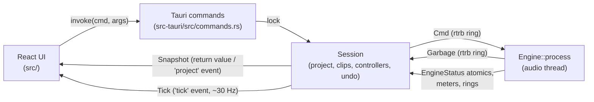
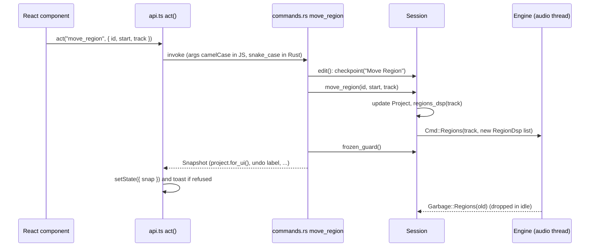
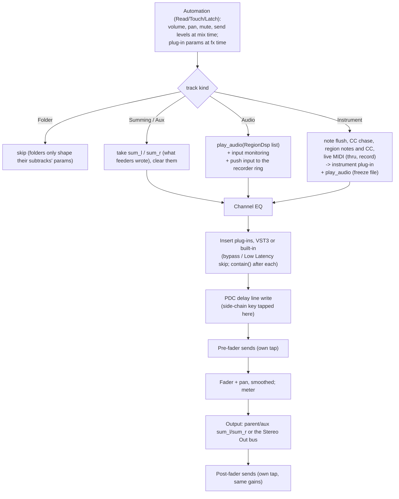

# Fermata architecture

This document is for developers who are new to the code. It explains how the pieces fit
together, which rules keep the audio thread safe, and where to find things. For building,
testing and step-by-step recipes see [DEVELOPING.md](DEVELOPING.md); for what the program
does from the user's side see [USER_GUIDE.md](USER_GUIDE.md). The Logic Pro research behind
the layout and behaviour is in [logic-reference.md](logic-reference.md), and the feature scope
is in [LOGIC_FEATURES.md](../LOGIC_FEATURES.md).

Contents:

1. [Overview](#1-overview)
2. [Processes and threads](#2-processes-and-threads)
3. [Real-time rules](#3-real-time-rules)
4. [How an edit flows](#4-how-an-edit-flows)
5. [The project model](#5-the-project-model)
6. [The engine graph, block by block](#6-the-engine-graph-block-by-block)
7. [Undo](#7-undo)
8. [Persistence](#8-persistence)
9. [The VST3 host](#9-the-vst3-host)
10. [Audio I/O and latency](#10-audio-io-and-latency)
11. [The frontend](#11-the-frontend)
12. [Tempo map](#12-tempo-map)
13. [Built-in effects and presets](#13-built-in-effects-and-presets)
14. [Module map](#14-module-map)

## 1. Overview

Fermata is a Cargo workspace with three crates plus a React frontend:

| Part | Path | Role |
|---|---|---|
| `vst3-host` | `crates/vst3-host` | VST3 hosting on the `vst3` bindings: module loading, scanning, host COM objects, the real-time processing wrapper, editor windows. |
| `daw-engine` | `crates/engine` | The audio engine: the project model, the real-time graph, the session controller, device I/O, recording, MIDI, rendering. No UI code. |
| `daw` | `src-tauri` | The Tauri 2 application: commands, the native menu, settings and recent files, the timers that drive plug-in idle and UI ticks. The binary is called `daw`; packages also install it as `fermata`. |
| frontend | `src` | React 19 + TypeScript, built with Vite. Canvas for the tracks area, ruler, editors and meters. |

The engine is split into two halves that never share mutable data directly:

- **`Session`** (`crates/engine/src/session.rs` and `session/`) is the non-real-time
  controller. It owns the `Project` document, the loaded audio clips, the plug-in
  controllers, the undo history and the recorder. Every edit goes through it.
- **`Engine`** (`crates/engine/src/dsp.rs` and `dsp/`) is the real-time graph. It owns one
  `TrackDsp` per track and runs `Engine::process` on the audio thread. It learns about edits
  only through `Cmd` messages.



## 2. Processes and threads

| Thread or process | Created in | What it does | What it may not do |
|---|---|---|---|
| **Main / UI thread** | Tauri | Runs synchronous Tauri commands (most edits, including audio import with its decoding and resampling), the native menu, the GTK main loop on Linux, the 30 ms idle timer (`Session::idle`: plug-in controller idle, latency changes, draining `Garbage`, automation follow and writes), and taking autosaves. All VST3 *controllers* and editor windows live here. | Block for long. Renders are async commands for that reason. |
| **`audio-io`** | `audio_io::start` | Builds and owns the cpal streams, then waits until the device is closed. | |
| **Audio callback** | cpal (output stream) | Calls `Engine::process` once per device buffer, inside `catch_unwind`; the input stream's callback only fills the input ring. Runs with real-time priority (rtkit on Linux). | Allocate, lock, block, do I/O. See [Real-time rules](#3-real-time-rules). |
| **`recorder`** | `recorder.rs` | Every 10 ms, drains the ring buffer of each armed track into its WAV file and an in-memory copy, and keeps a peak preview for the UI. | Touch the engine or the project. |
| **`ui-tick`** | `src-tauri/src/main.rs` | Every 33 ms: locks the session, builds a `Tick` (playhead, meters, input levels, recording previews, CPU, latency, analyzer spectrum, warnings, meters of open built-in effect panels) and emits it as the `tick` event. | Edit anything. |
| **MIDI refresh** | `main.rs` | Every 3 s: `Session::refresh_midi`, so devices plugged in later get connected. | |
| **MIDI input callbacks** | midir, in `midi_io.rs` (one per port) | Drop system messages, apply the velocity curve, push into the `live_midi` ring the engine reads, and log the message for Settings › MIDI. | |
| **Async command workers** | Tauri's async runtime (`#[tauri::command(async)]`) | Offline renders (bounce, export, Bounce in Place, Freeze), plug-in rescans, waveform and transient requests, device lists, recent projects, the input level check, folder listings. Renders hold the session lock and the engine lock for their whole length; the parts that edit tracks or plug-ins are handed back to the main thread with `run_on_main_thread`. | Touch plug-in controllers. |
| **Autosave writer** | `main.rs::autosave` | Writes an `AutosaveJob` (already serialized on the main thread) to disk, atomically. | |
| **Plug-in scan subprocess** | `plugin_db.rs` | `fermata --scan-vst3 <bundle>` loads one bundle in a child process and prints its descriptors, so a crashing plug-in can't take the app down. Four scan worker threads start the children and wait for them (at first launch before the window opens, otherwise from Rescan). | Load plug-ins in the app's own process. |

On non-Linux platforms there is no GTK timer; a helper thread posts the idle work to the main
thread with `run_on_main_thread` every 30 ms instead (`main.rs`).

The session is behind a `parking_lot::Mutex` in `AppState`. The engine is behind its own
`Mutex`, but the audio callback only ever `try_lock`s it: while an offline render holds the
engine lock, the device outputs silence (see `dsp/offline.rs`).

## 3. Real-time rules

`Engine::process` and everything it calls run on the audio thread. They must:

- **not allocate or free memory.** Buffers are allocated up front (`MAX_BLOCK` = 1024 frames,
  `MAX_INPUTS` = 32, `MAX_MIDI` = 512 events per track per block). Device buffers larger than
  `MAX_BLOCK` are processed in sub-blocks.
- **not lock or block.** Communication is through wait-free `rtrb` single-producer,
  single-consumer rings (commands in and garbage out, 4096 entries each; live MIDI, recorded
  MIDI, recorded audio, the analyzer feed) and atomics (`EngineStatus`, `Meter`, `FxShared`).
  The command and garbage queues used to be `crossbeam_channel`s. Those can make a receiver
  spin while a preempted sender finishes a write; with real-time priority the audio thread then
  starved the sender and the kernel killed the app with SIGXCPU (`RLIMIT_RTTIME`). `rtrb` never
  waits. `Session::send` drops a command rather than block if the ring is ever full.
- **not do I/O or call into plug-in controllers.** Only the processor half of a plug-in
  (`PluginProcessor`) is moved into the engine.

The pattern that makes this work is **Cmd in, Garbage out**:

1. The session builds whatever the engine needs (a `TrackDsp`, an `Arc<Vec<RegionDsp>>`, an
   `InsertDsp`, a `DelayLine`) on its own thread and sends it in a `Cmd`.
2. At the start of the next callback, `Engine::apply` swaps the new object in.
3. The object it replaced is sent back as a `Garbage` value. `Session::idle` drains the
   garbage channel on the main thread, where dropping (and freeing) is safe.
4. If the garbage ring were ever full, `Engine::discard` leaks the object rather than
   block.

`Session::send` counts commands; `wait_for_engine` spins (up to 1 s) until
`EngineStatus::cmds_done` catches up, for the few places that need the engine to have applied
something (stopping a recording). With no audio device running, `send` drains the queue by
calling `process` with no buffers, so the graph stays current and headless tests work.

Failures on the audio thread are contained rather than fatal:

- **Denormals.** `Engine::process` holds a `NoDenormals` guard (`denormals.rs`) for its whole
  run: flush-to-zero, plus denormals-are-zero on x86_64 (FPCR.FZ on aarch64), restored when
  the guard drops, since the callback thread belongs to the driver. Decaying tails in filters,
  reverbs and the tuner would otherwise fall into the denormal range, where arithmetic is
  about a hundred times slower.
- **Overload.** When callbacks take longer than the audio they produce, back to back for more
  than `OVERLOAD_SECS` (60 ms), the engine flushes notes and *sheds* load: for `SHED_SECS`
  (250 ms) `process` outputs silence without processing (`shedding` counts the remaining
  callbacks), so the thread can sleep again. Left alone, a real-time thread that never sleeps
  hits `RLIMIT_RTTIME` (about 200 ms) and the kernel kills the app with SIGXCPU.
  `EngineStatus::overloads` counts these; `Session::check_overload` (run with each tick) stops
  playback or recording and shows "System overload: …". Offline renders (`offline`) are
  exempt, since they are meant to run flat out.

- **Panics.** `audio_io::build_output` runs `Engine::process` inside `catch_unwind`, because a
  panic unwinding into the driver's C callback would abort the process. A panicking block is
  silenced and counted in `EngineStatus::engine_errors`; `Session::engine_error_warning` turns
  new errors into a tick `warning` (a toast), at most every 5 s. The panic message goes to the
  log.
- **Bad plug-in output.** After every instrument, insert and Stereo Out plug-in, `contain()`
  in `dsp.rs` silences NaNs and clamps anything beyond ±1000 (+60 dBFS), so one unstable
  plug-in can't poison the filters after it or reach the device. `check_output` records the
  plug-in's uid in `EngineStatus::bad_audio_uid`, counts `bad_audio`, and resets a built-in
  effect so it recovers. `Session::bad_audio_warning` names the plug-in and track in a toast,
  at most every 5 s. The final mix bus goes through `contain()` once more before the output
  buffer, and the callback clamps to ±4 when converting.

Other conventions inside the engine:

- Gains are smoothed with a one-pole filter of about 5 ms (`smooth` in `process_block`), so
  fader moves, mutes and send changes don't click. `snap_gains` jumps straight to the target at
  the start of a render.
- A muted send keeps its slot with gain 0, so it fades out instead of clicking.
- `Meter::feed` uses `fetch_max` on the float bits (non-negative floats order like their bit
  patterns), and `take` swaps in zero, so the UI reads the peak since its last tick.

## 4. How an edit flows

Every user edit is one Tauri command and one undo step. Taking "move a region" as an example:



The pieces:

- **`act(cmd, args)`** in `src/api.ts` invokes a command that returns a `Snapshot` (or a
  `Made`, which wraps one) and stores it in the global store. Errors become a toast.
  `actMade` returns the ids an edit created, so the caller can select them. `call` is the
  plain form for commands that return other data.
- **Argument names**: JavaScript passes camelCase keys (`fadeIn`), which Tauri maps to the
  Rust parameter `fade_in`. Fields *inside* a struct argument (a `TrackPatch`, a `Region`)
  keep the serde names, which are snake_case.
- **Command wrappers** in `src-tauri/src/commands.rs`:

  | Wrapper | Undo step | Returns |
  |---|---|---|
  | `snap(f)` | no | `Snapshot` |
  | `try_snap(f)` | no | `Result<Snapshot>` |
  | `edit(label, key, plugins, f)` | yes, then `frozen_guard` | `Snapshot` with `refused` set when the edit touched a frozen track |
  | `try_edit(label, key, plugins, f)` | yes, then `frozen_guard` | `Result<Snapshot>` |
  | `edit_made(label, plugins, f)` | yes, then `frozen_guard` | `Result<Made>` (snapshot plus new ids) |

  `key` coalesces a burst of edits into one step (see [Undo](#7-undo)); `plugins` makes the
  checkpoint capture plug-in states, for edits that remove plug-ins.
- **Not undoable on purpose**: mute, solo, record enable and input monitoring (performance
  switches, as in Logic; `update_track` gives them no label), transport, cycle and Autopunch
  range changes, track selection, the metronome and count-in switches.
- **The `Snapshot`** (`commands.rs`) carries the project without plug-in state blobs
  (`Project::for_ui`), the selected track, project path, saved/dirty flags, audio status, MIDI
  inputs, open plug-in editors, the MIDI target name, undo/redo labels and the PDC report.
  `Session::idle` also emits a fresh snapshot as the `project` event when editors open or
  close, automation was written, or a plug-in's latency changed.
- **Ticks** are separate and much lighter (see [The frontend](#11-the-frontend)).

## 5. The project model

`crates/engine/src/model.rs` holds the saved document. `src/api.ts` mirrors it in TypeScript.
Every field added after the first release has `#[serde(default)]`, so older projects load.

### Ids

- `Id` is a `u64`. `Project::alloc_id` hands out `next_id` and increments it; the counter is
  saved, so ids are unique within a project and never reused. Tracks, regions, clips, plug-in
  instances (`PluginSlot::uid`), groups, markers and takes all draw from it.
- `MASTER_ID` = 0 is reserved for Stereo Out (the `Master` struct, not a `Track`).
- Plug-in instance ids restart in every project, which is why `open` clears all controllers
  before loading.

### Tracks and the track tree

`Track::kind` is one of `Audio`, `Instrument`, `Folder` (folder stack), `Summing` (summing
stack) or `Aux`. Stacks are expressed with `Track::parent`, pointing at the stack's main
track; `collapsed` hides a stack's subtracks in the views.

Invariants, maintained by `Project::normalize_tree` and `prune_routes`:

- `project.tracks` is in display order, and every stack's subtracks sit directly below it
  (depth first). `normalize_tree` re-sorts the list that way, drops `parent` links to tracks
  that aren't stacks (or to the track itself) and breaks cycles.
- Auxes are never inside stacks; `move_tracks` refuses it and `prune_routes` clears it.
- Every track has `SEND_SLOTS` (8) send slots and `INSERT_SLOTS` (8) insert slots.

`Session::sync_tracks` is the one call to make after tracks are added, removed, moved or
restacked: it runs `prune_routes`, `normalize_tree`, sends `Cmd::Order(process_order())` and
then every track's parameters.

**Processing order** (`Project::process_order`) is different from display order: every track
comes before whatever it plays into (its summing stack, its output aux, the auxes it sends
to). The base order is the tree with subtracks before their stack; a depth-first walk over the
"who feeds me" graph then moves receivers after their senders. The engine processes tracks in
exactly this order, so a bus's input (`sum_l`/`sum_r`) is complete by the time the bus runs.

**What the engine plays for a track** is worked out by `Session::track_params`, which applies
the stacks above it: a folder's fader adds to its subtracks' volume (`stack_gain`), a muted
stack mutes them (`stack_mute`), solo reaches down from a soloed stack and up from a soloed
subtrack, and solo follows routing (a soloed track keeps the auxes it feeds audible; a soloed
aux keeps its feeders audible). Because one track's change can reach others, stack members and
solo changes resend every track (`push_all_params`).

### Routing and loop prevention

`session/routing.rs` and `model.rs`:

- `Track::output`: `None` is the default route (the nearest summing stack the track sits in,
  else Stereo Out), `Some(MASTER_ID)` forces Stereo Out (skipping the stack), `Some(aux)` plays
  into an aux. `Project::output_of` resolves it.
- `Track::sends`: up to 8 `TrackSend { bus, level_db, pre_fader, muted }`. `bus` is an aux's
  track id. Auxes are fed by "Bus N" (`Track::bus`), assigned by `free_bus`.
- `Project::feeds(id)` is the set of tracks `id` plays into directly; `reaches(from, to)` is
  its transitive closure.
- **Loops are refused at edit time**: `check_route` rejects a send or output to a non-aux, to
  itself, or to an aux that already reaches the track. `prune_routes` also drops dangling
  routes, routing on folders, and any edge that closes a loop in a loaded file, so
  `process_order` always terminates.
- The engine re-resolves routes (`Engine::resolve_routes`) whenever the order or a track's
  routing changes, storing the *index* of each destination (`out_idx`, `send_idx`). A route
  that points backwards in the list is ignored, and that track plays to Stereo Out.

### Regions

`Region { id, name, start, length, muted, color, content, loop_end, takes }`. Times are in
samples at the project rate.

- `content` is `Audio { clip, offset, gain_db, fade_in, fade_out }` or
  `Midi { notes, cc }`. `offset` is the clip frame at the region's start; fades are frame
  lengths; region gain is clamped to -96..+30 dB.
- **Loops**: `loop_end` is the timeline sample where a looping region stops repeating; the
  region's own `start..start+length` is what repeats. `Region::end()` clamps it (at most
  `MAX_LOOP_PASSES` = 4096 repetitions), `passes()` lists every pass, and `move_to` takes the
  loop end along. `real_copies` implements Convert Loops to Real Copies.
- **Take folders**: `takes: Some(TakeFolder)` makes the region play a comp. See below.
- Order matters: within a track, a region later in `regions` is *newer* and wins where audio
  overlaps. Moving a region pushes it to the end of the list.

### Take folders and comps

`TakeFolder { takes, comp }` (types in `model.rs`, logic in `takes.rs`, session edits in
`session/takes.rs`):

- Everything inside a folder is in **take time**: frames from the start of the recorded
  passes. The folder region's `content` is still `Audio`, but its `offset` is the take time at
  the region's start (so moving, trimming and splitting work as for any audio region), its
  `clip` is the newest take's file, and its gain and fades apply to the whole comp.
- Each `Take` has its own clip and `offset` (clip frame at take time 0) and the take-time range
  it has audio for. `takes` is oldest first.
- `comp` is a sorted, non-overlapping list of `CompSegment { start, end, take }`. Gaps are
  silent. `default_comp` starts with the newest take, older ones filling in where it has no
  audio.
- Playback expands the comp into `CompPiece`s (`pass_pieces`), with 10 ms equal-power
  crossfades (`COMP_XFADE_MS`) centred on each boundary.
- Recording: `RecPlan` (`takes.rs`) describes how a cycle or Autopunch recording is cut into
  takes; `Session::record_plan` builds it before recording, and `shape_take` applies it to each
  finished file.

### Notes and controllers

- `Note { start, length, pitch, velocity, muted }`, `start` relative to the region.
- `CcEvent { start, kind, value }` with `CcKind::Controller(n)`, `PitchBend` (0..16383, 8192
  centred) or `Aftertouch`. `cc` is kept sorted by start. `CcKind::index` gives a dense index
  (0..130) used for per-kind tables on the audio thread.
- `crates/engine/src/midi.rs` has the pure helpers for split, trim and join that keep
  controllers consistent: the later part of a split starts with the values in effect at the
  cut.
- The Piano Roll edits content wholesale: it sends `set_midi_content` with the region's new
  notes and controllers (and new bounds when the region grew), as one undo step.

### Automation

- `Track::automation: Vec<AutoLane>`; each lane has an `AutoParam` (`Volume`, `Pan`, `Mute`,
  `Send(slot)`, or `Plugin { uid, param, name }`) and sorted `AutoPoint { pos, value }`.
  Values are in native units: dB for volume and sends (-96..+6), -1..1 for pan, 0/1 for mute,
  0..1 normalized for plug-in parameters.
- `automation::value_at` interpolates linearly, holds the first value before the first point
  and the last after the last; two points at one position make a step.
- `Track::auto_mode` is Logic's Off / Read / Touch / Latch / Write (`AutoMode`).
- The engine gets lanes as `Arc<Vec<LaneDsp>>` (empty lanes left out) and compares targets
  with the cheap `AutoTarget` (no names).
- Writing is in `session/auto_write.rs`: a *pass* collects points while a control moves (and
  about 30 times a second from `idle`), and goes into its lane in one undo step when it ends
  (on release in Touch, at Stop otherwise). `automation::splice` inserts it and `thin` removes
  points within a per-parameter tolerance (Ramer-Douglas-Peucker on the vertical error).

### Markers and Autopunch

- `Project::markers` is the Marker track, sorted by position (`session/markers.rs`). Markers
  are pure project data; the engine never sees them. `Marker::length` exists in the model but
  the UI treats every marker as reaching the next one.
- `Project::punch: Punch { enabled, start, end }` is the Autopunch range. While recording,
  `Cmd::Autopunch` tells the engine where armed tracks stay silent and where input is
  captured.

### Freeze

`Track::frozen: Option<FreezeInfo { clip, start }>` (`session/freeze.rs`):

- While set, `regions_dsp` returns just the freeze file, `eq_coeffs` returns a flat EQ, the
  plug-ins are unloaded from the engine, and their settings are kept in `PluginSlot::state`.
- Freezing has two steps: `render_freeze` (an isolated render, may run on a worker thread) and
  `place_freeze` (main thread, one undo step capturing plug-ins).
- Edits to a frozen track's regions, plug-ins or Channel EQ are refused twice over:
  `check_unfrozen` errors before the edit where it can, and `frozen_guard` (called by every
  `edit` wrapper) puts back anything that slipped through and reports why.
- Freeze files live in the project's `Freeze Files/` folder. Unfreezing deletes the file but
  keeps the clip in memory, so undo can freeze again; `ensure_freeze_files` writes a missing
  file back before saving.

### Other project fields

`name`, `sample_rate`, `tempo` (5..990 BPM), `sig_num`/`sig_den`, `key` (a string such as
"C major"), `master` (Stereo Out: volume, inserts, EQ), `cycle`, `metronome`, `count_in`,
`clips` (id to path, relative to the project folder unless outside it), `groups`, `click`
(metronome settings), `bit_depth` (per-project recording format override) and `notes`.

## 6. The engine graph, block by block

`Engine::process(input, in_ch, output, out_ch)`:

1. Apply every queued `Cmd` (`apply`), counting them in `cmds_done`.
2. Collect live MIDI from the ring into `live` (delivered with the first sub-block only).
3. Split the device buffer into sub-blocks of at most `MAX_BLOCK` frames, also cutting at the
   cycle end so a loop wraps on the exact sample. For each sub-block run `process_block`,
   copy the stereo bus to the output (mono devices get the average), advance the position and
   wrap at the cycle end.
4. Publish position, play/record state and the CPU load (smoothed ratio of time used to the
   buffer's duration).

`process_block` does this for every track, **in processing order**:



After every track:

- **Stereo Out**: Channel EQ, its inserts, its volume (smoothed), its meter. Skipped (unity,
  no FX) in an isolated render.
- **The click** is synthesized after the Stereo Out fader, delayed by `pdc.total` so it lines
  up with the compensated music. The count-in always clicks; otherwise the metronome follows
  `ClickParams` (`while_playing`, `while_recording`, `only_count_in`). Subdivisions,
  accent and the four sounds (Classic, Click, Woodblock, Beep) are all generated without
  allocation in `Click::next`.

Details of each stage:

- **RegionDsp and newer-hides-older.** `Session::regions_dsp` flattens a track's regions into a
  sorted list of non-overlapping audio segments (plus MIDI regions). It lays loop repetitions
  first and region bodies second, each one *cutting away* the older audio under it, so a newer
  region hides older audio like Logic's "No Overlap" playback without deleting anything, and a
  region body always wins over a loop repetition. Muted regions are left out. Take folders lay
  their comp pieces side by side so their crossfades overlap. Fades are stored as timeline
  `(start, length)` plus a `FadeLaw` per side, and shaped in `play_audio`.
- **Fades and crossfades** (`fades.rs`, session side in `session/crossfades.rs`). Each audio
  region's `fade_shape: FadeShape` holds the curves and types (Speed Up, Slow Down, and the
  crossfade types X, EqP and X S); the default is the old quarter sine. `fades::crossfades`
  pairs a region whose fade-out type crossfades with the `following` region on the track
  (touching or overlapping) and places the crossfade where both files have audio (sliding and
  shortening it, or falling back to butt fades). `regions_dsp` then stretches both regions over
  the crossfade and lays them without cutting each other (`keep`), so both sound there.
  Speed fades carry a table of how far the read position lags (`speed_table`), which
  `play_audio` reads with linear interpolation; no allocation on the audio thread. Every render
  (playback, bounce, export, freeze, bounce in place) goes through `play_audio`, and Join mixes
  through it too (`dsp::mix_regions`). The X-Fade drag mode (`Project::drag_mode`) is applied by
  `auto_crossfade` at the end of `move_region(s)`, `resize_region`, `nudge_regions` and
  `paste_regions`. The snapshot carries `crossfades` for drawing.
- **Audio tracks being recorded** are silent (or, with Autopunch, silent only inside the punch
  range, so the old take is heard before and after). Input is heard when the I button is on,
  or on armed tracks when Auto Input Monitoring is on.
- **Mono sources** use a -3 dB compensated sine pan law (unity in the centre); stereo sources
  use balance.
- **Summing stacks and auxes**: a feeder writes into its destination's `sum_l`/`sum_r`
  through `out_idx` (output) and `send_idx` (sends), indices that `resolve_routes` keeps
  current. Because receivers come later in the list, the split borrow
  `tracks.split_at_mut(ti + 1)` gives the current track mutable access to every track after
  it.
- **Sends**: pre-fader sends tap after the inserts; post-fader sends after the fader and pan.
  Mute and solo silence both. With delay compensation, each send reads the track's delay line
  at its own tap (`pdc.sends[k]`); a post-fader send at a different tap than the output
  re-applies the same per-sample fader gains (`gain_l`/`gain_r`).
- **Automation timing**: plug-in lanes are evaluated `pdc.input_time` late and fader, pan and
  send lanes `pdc.output_time` late, so automation follows the compensated audio. Plug-in
  values are sent twice per block (start and end) so the plug-in can ramp; unchanged values
  are not resent (`auto_sent`), except after a jump or mode change. Parameters the user is
  holding (`touched`) are skipped so the live value wins.
- **MIDI**: notes outside regions are cut at the region end; `sounding` tracks held notes so a
  flush (stop, locate, region change, MIDI target change) can send note-offs. **CC chase**:
  when playback starts or jumps, the latest value of every controller before the playhead (in
  the region that covers it) is sent first, so a region started in the middle sounds right.
  A flush after controllers were played also releases sustain and centres pitch bend.
- **Live MIDI** goes to `midi_target` (the selected instrument track, else the first armed
  one). With MIDI Thru off it is recorded but not played.
- **Built-in effects and side-chains**: a built-in effect runs in its insert slot like a VST3,
  given its key signal when it has one (see [Built-in effects](#13-built-in-effects-and-presets)).
  A track that keys another (`keyed`) copies its signal as it leaves its plug-ins, before its
  compensation delay, into `key_l`/`key_r` and applies the fader gains to it, so the key is
  post-fader.

### Plug-in delay compensation

The solver is in `session/pdc.rs`, the delay lines in `dsp/pdc.rs`:

- Each strip's latency is the sum of its instrument and insert plug-ins'
  `getLatencySamples` (a built-in effect's `latency()`, read from its `FxShared`), bypassed
  ones included (the delay line stands in for a bypassed
  plug-in, so switching it doesn't shift the mix).
- `solve` walks the graph in processing order: a bus is due when its latest input arrives;
  each strip's output and each send wait in the strip's delay line until their destination is
  due. Stereo Out is due when its latest input arrives; its own plug-ins add to `total`.
- `update_pdc` sends `Cmd::Pdc` only for tracks whose compensation changed, with a new
  `DelayLine` only when the old one is too short (lines have room for at least 8192 frames).
  `Cmd::PdcGlobal` carries `total` and the Low Latency Mode flag.
- **Live tracks** (an armed audio track that is recording; in Low Latency Mode any monitored
  track) skip their compensation delay, and in Low Latency Mode the plug-ins over the limit
  (`low_latency_skip` bits) are not run.
- Recordings are moved earlier by `total` as well, since the performer heard the song that
  late.

### Offline render and `Isolate`

`Engine::render` (`dsp/offline.rs`) runs the real graph on the calling thread with the engine
lock held, faster than real time:

- It saves the transport state, turns off cycle, metronome, count-in, live MIDI, the analyzer
  and Low Latency Mode, clears every delay line, plays `[from, to)` and then `tail` frames with
  the transport stopped (so effects ring out), drops the leading latency, and restores
  everything.
- `Isolate { tracks, tap, fader, effects }` renders one track (with the subtracks feeding it)
  captured before Stereo Out instead of the full mix. `tracks` lists who plays and whether
  each is heard, overriding live mute and solo. Used by Export All Tracks, Export Region,
  Bounce in Place and Freeze (`Session::isolate_track`).
- The bounce, export and freeze code is in `session/bounce.rs` and `session/freeze.rs`;
  `write_wav` there writes 16-bit (TPDF dither), 24-bit or 32-bit float WAV.

## 7. Undo

`Session::checkpoint(label, key, plugins)` pushes a full clone of the `Project` (with plug-in
states captured when `plugins` is true) onto `undo_stack` *before* an edit, and clears the redo
stack.

- **Coalescing**: when `key` matches the top entry's key and less than 1.5 s has passed since
  the last edit with that key, no new entry is made (the timer restarts). Fader drags use
  `track:<id>:volume`, the EQ `eq:<id>`, sends `send:<id>:<slot>`, nudges `nudge:<ids>`, the
  tempo `tempo`, and so on.
- **Limit**: `prefs.general.undo_limit` (Settings › General, default 100) trims the oldest
  entries.
- **`undo()` / `redo()`** swap the current project (with plug-in states captured) onto the
  other stack and call `restore(target)`.
- **`restore()` diffs** the target against the current project and touches only what
  differs: removed tracks are sent `RemoveTrack`; returning tracks are rebuilt with their
  plug-ins from the snapshot's state; changed regions, EQ, automation and modes are resent;
  plug-in slots whose instance id changed are reinstantiated, bypass changes are sent; then the
  order, all parameters, Stereo Out's inserts and the globals. Plug-ins that didn't change keep
  running with their state. Freeze transitions go through `restore_freeze`.
- **Clips are never unloaded by undo**: recordings and imports made after a snapshot stay in
  memory, so redo can bring their regions back.
- **`frozen_guard()`**, called after every checkpointed edit, compares frozen tracks with the
  checkpoint; if their regions, plug-ins or EQ changed it restores them and, when nothing else
  changed, drops the now-empty undo step.
- Opening or creating a project clears both stacks.

Rule for new features: **anything new you send to the engine must also be restored by
`restore()`, and built by `build_track()` / `rebuild_graph()` for project load.**

## 8. Persistence

### The `.fermata` project folder

```
Song.fermata/
  project.json             the Project, pretty-printed, with plug-in states (base64)
  project.autosave.json    only while there are unsaved changes (see below)
  Audio Files/             recordings, conversions, joins, reverses, bounce-in-place results
  Freeze Files/            freeze renders ("<track> Freeze.wav")
```

- `ClipRef::path` is relative to the folder, except for files referenced in place (an imported
  WAV already at the project rate stays where it is, with an absolute path).
- **Save As** to a new folder copies every clip inside the old folder (or with a relative
  path) into the new `Audio Files/`.
- Plug-in state is `"<component base64>:<controller base64>"` in `PluginSlot::state`. It is
  filled only when saving, autosaving, checkpointing with `plugins`, or rebuilding; the UI
  never sees it (`for_ui`).
- Recordings go to `Audio Files/` named `<track>#NN.wav` (or `<project> - <track>#NN.wav`),
  unless Settings › Recording names another folder, in which case they go to
  `<folder>/<project name>/`.
- Opening a project whose sample rate differs from the device switches the device to the
  project's rate, as Logic does.

### Autosave and recovery

- `Session::autosave_job` is polled from the idle timer. When the interval in
  Settings › General has passed, the project is dirty and nothing is recording, it serializes
  the project (with plug-in states, so on the main thread) and returns a job; `main.rs`
  writes it on a new thread to `project.autosave.json` via a temporary file and rename. A hash
  skips writing an unchanged document.
- Saving deletes the autosave (in the new and the old folder); so does Don't Save.
- `recovery_info(dir)` reports an autosave newer than `project.json`.
  `recoverable_projects` checks the recent list plus every `.fermata` folder in the projects
  folder and in `~/Music/Fermata`. Untitled projects autosave into their (not yet saved)
  folder in the projects folder, which is how they are found.
- `open_recovered` loads the autosave and marks the project dirty, so saving writes it back.

### Settings and other files

The config folder is `$XDG_CONFIG_HOME/fermata`, else `%APPDATA%\fermata`, else
`~/.config/fermata` (`plugin_db::config_dir`; macOS uses `~/.config/fermata` too).

| File | Written by | Contents |
|---|---|---|
| `settings.json` | `src-tauri/src/settings.rs` | Sections `audio` (`AudioConfig`), `prefs` (`daw_engine::prefs::Prefs`: general, recording, midi, editing, latency, click defaults), `ui` (`UiPrefs`: startup, confirm_unsaved, snap, nudge, keymap overrides, theme, ui_scale, wave_style, click_locates) and `plugins` (`disabled` ids, extra `folders`). Every field defaults, and a malformed section is replaced by defaults without losing the others. Written atomically. |
| `recent.json` | `src-tauri/src/recent.rs` | Up to 20 canonical project paths, newest first (not written atomically). |
| `plugins.json` | `plugin_db.rs` | The plug-in scan cache. |
| `plugin-scan.json` | `plugin_db.rs` | The last scan's report (bundles, plug-ins, failures with reasons), for Settings › Plug-ins. |
| `presets/<effect>/<name>.json` | `presets.rs` | User presets of the built-in effects and the Channel EQ (see [Presets](#presets)). |

Interface-only state lives in the webview's `localStorage`:

| Key | Module | Contents |
|---|---|---|
| `fermata.theme` | `themes.ts` | Theme id (a copy of `ui.theme`, for the first paint). |
| `fermata.uiScale` | `uiScale.ts` | Interface scale, 0.9 to 2 (a copy of `ui.ui_scale`). |
| `fermata.waveStyle` | `waveform.ts` | Waveform drawing style (a copy of `ui.wave_style`). |
| `fermata.paneSizes` | `components/Splitter.tsx` | Library, Inspector, Browser, Mixer, Editor and header sizes. |
| `fermata.trackHeights:<project path>` | `layout.ts` | `{ base, heights }` for one project. |
| `fermata.bounce` | `components/Bounce.tsx` | Tail, resolution, sample rate and normalize of the bounce and export dialogs. |
| `fermata.bounce-in-place` | `components/Bounce.tsx` | Bounce in Place options. |
| `fermata.pianoRoll` | `components/PianoRoll.tsx` | Piano Roll view and Time Quantize settings. |

Appearance settings (theme, size, waveforms) are saved in `settings.json` by `appearance.ts`;
the `localStorage` copies only let the window open in the right theme and size before the
settings have loaded.

## 9. The VST3 host

`crates/vst3-host` wraps the `vst3` 0.3 bindings. Its public surface is
`instantiate(desc, sample_rate, max_block) -> (PluginProcessor, PluginController)`.

### Finding and loading bundles

- **Search paths** (`scan.rs`): `$VST3_PATH` first, then on Linux `~/.vst3`,
  `~/.nix-profile/lib/vst3`, `/usr/lib/vst3`, `/usr/local/lib/vst3`,
  `/run/current-system/sw/lib/vst3`, `/etc/profiles/per-user/$USER/lib/vst3`; on macOS
  `~/Library/Audio/Plug-Ins/VST3` and `/Library/Audio/Plug-Ins/VST3`; on Windows
  `%CommonProgramFiles%\VST3` and `%LOCALAPPDATA%\Programs\Common\VST3`. Settings › Plug-ins
  adds user folders (`plugin_db::search_paths`). `find_bundles` walks up to six levels deep and
  doesn't descend into `.vst3` bundles.
- **Binary inside a bundle** (`module.rs::binary_path`): `Contents/<arch>-linux/<name>.so`,
  `Contents/x86_64-win/<name>.vst3` (or `arm64-win`), or `Contents/MacOS/<name>`.
- **Loading:** `dlopen` plus `ModuleEntry` on Linux, `InitDll` on Windows, `bundleEntry` with a
  `CFBundleRef` on macOS, then `GetPluginFactory` (and `setHostContext` for
  `IPluginFactory3`). Modules are cached and never unloaded, on purpose.
- **Descriptors:** only "Audio Module Class" entries. A plug-in's id is
  `"<bundle path>|<class id hex>"`, and projects find plug-ins by this exact id, so moving a
  bundle orphans the slots that use it.

### Scanning out of process

`plugin_db.rs` runs the app binary itself as `fermata --scan-vst3 <bundle>` for every bundle
(`main.rs` checks for the flag before anything else starts). The child prints the descriptors
as one JSON line and exits 0 (1 on error, 2 without a path). The parent polls with a 20 s
timeout and kills a hung child, takes the last stdout line that parses (plug-ins print their own
noise), and records failures with a reason. Four worker threads scan in parallel. The result is
cached in `plugins.json` and the per-bundle report in `plugin-scan.json` (config folder). A scan
runs at startup only when there is no cache; otherwise only from Rescan.

### Instantiation

`plugin.rs::instantiate`:

1. Create the component and `initialize` it with the host context.
2. If the component is also an `IEditController`, use it; otherwise create the controller class,
   `initialize` it, and connect the two `IConnectionPoint`s directly (no host proxy).
3. Sync the controller: `component.getState` → `controller.setComponentState`, then
   `setComponentHandler`.
4. Force the first audio input and output buses to stereo, allocate the channel buffers, activate
   audio bus 0 in and out and event input bus 0 (side-chain buses stay inactive).
5. `setupProcessing(kRealtime, kSample32, max_block, rate)` and `setActive(true)`.
6. Read the `IMidiMapping` assignments for controllers 0–129 (CCs, aftertouch, pitch bend) on
   channel 0.

The two halves share an `Arc<Shared>` whose `Drop` deactivates, disconnects and terminates the
plug-in, on whichever thread drops last (in practice the main thread: controllers belong to the
session and processors come back as `Garbage`). `PluginProcessor` moves into the engine;
`PluginController` stays in `Session::controllers`, keyed by the slot's instance id.

### Host objects

`host.rs` implements `IHostApplication` (name "Fermata", creating `IMessage` and
`IAttributeList` objects), `IPlugInterfaceSupport`, and `IComponentHandler`
(`beginEdit`/`performEdit`/`endEdit`/`restartComponent`). `stream.rs` is an in-memory
`IBStream` for state. On Linux the editor's `IPlugFrame` also implements `IRunLoop`.
Not implemented: `IComponentHandler2/3`, `IUnitHandler`, `IPlugViewContentScaleSupport` (no
HiDPI scaling), `IProcessContextRequirements`, context menus.

### Processing

`PluginProcessor::process` runs on the audio thread once per engine sub-block. Everything is
preallocated (`process.rs`: up to 256 parameter queues of 64 points, 1024 events); on overflow
data is dropped rather than allocating. Each block:

1. Clears the parameter and event lists and fills the input parameter changes: edits from the
   plug-in's own editor (drained from a ring, at offset 0), then host values queued with
   `queue_param` (automation; two points per block so the plug-in ramps), then MIDI.
2. Converts MIDI: note-on/off become note events; CCs, channel pressure and pitch bend become
   parameter changes through the `IMidiMapping` table. Unmapped controllers, poly pressure and
   program changes are dropped.
3. Copies the host's stereo buffers into input bus 0 (a mono bus gets L+R/2), runs `process`
   with a `ProcessContext` (tempo, time signature, musical position, bar position, playing,
   recording, cycle), and copies output bus 0 back (mono duplicated).
4. Sends the last value of each output parameter queue to the controller side, which applies
   it with `setParamNormalized` in `idle()`. Plug-in event output is ignored.

`setProcessing(true)` is called lazily on the first block. Offline renders also run in
`kRealtime` mode.

### Parameters and gestures

- Editor → processor: `performEdit` pushes `(id, value)` into the edits ring, which the next
  block drains.
- Automation → processor: the engine calls `queue_param` (see
  [the engine graph](#6-the-engine-graph-block-by-block)).
- Automation → editor display: `Session::idle` → `follow_editors` →
  `PluginController::set_param_value` while playing in Read, Touch or Latch.
- Gestures: `beginEdit`, `performEdit` and `endEdit` also push `Gesture::{Begin, Perform, End}`
  into a ring. `Session::idle` (every 30 ms) turns them into automation touches and pass points
  (`session/auto_write.rs`), so moves in a plug-in's own editor are written as automation. They
  are timestamped with the playhead when `idle` runs, so their resolution is about 30 ms.
- `PluginController::parameters()` lists the automatable, visible, writable parameters for the
  automation parameter pop-up.

### Latency

`PluginController::latency()` calls `getLatencySamples` on the main thread. `restartComponent`
stores its flags; `idle()` reports `kLatencyChanged`, and `Session::idle` then reruns
`update_pdc`. Other restart flags are ignored, and the component is not reactivated.

### State

`save_state` reads `component.getState` and `controller.getState`; `load_state` calls
`component.setState`, `controller.setComponentState` and `controller.setState`. The session
stores the pair as base64 in `PluginSlot::state` and restores it straight after instantiation.

### Editor windows

- **Linux (`editor_linux.rs`):** the plug-in must support `kPlatformTypeX11EmbedWindowID`.
  Each editor opens its own X11 connection and a top-level window (sized from `getSize`, fixed
  size unless `canResize`), then calls `attached`. `IPlugFrame::resizeView` resizes the window
  and calls `onSize`. Closing the window sets a flag; the next `idle()` closes the view.
- **IRunLoop:** plug-ins register file descriptors and timers through the frame. They are run by
  an `EventLoop` installed once with `set_event_loop`; the app installs `glib_loop::GlibLoop`,
  which adds them to GTK's main loop (`unix_fd_add_local`, `timeout_add_local`). Source ids are
  kept in a thread-local map, so editors must be created and destroyed on the main thread. The
  X connection's own fd is registered the same way.
- **GDK_BACKEND:** GLX-based editors fail when GTK runs natively on Wayland in the same
  process, so `main.rs` sets `GDK_BACKEND=x11` unless the user set it.
- **Windows and macOS:** `editor_other.rs` returns an error ("not implemented on this platform
  yet"). Plug-ins load and process normally.
- `crates/vst3-host/examples/editor.rs` opens one editor with a small `poll()` loop, without
  GTK, for debugging.

## 10. Audio I/O and latency

`crates/engine/src/audio_io.rs`, on cpal 0.18.

### Hosts and devices

- On Linux cpal is built with its PipeWire, PulseAudio and JACK hosts and `realtime-dbus`.
  The preference order is PipeWire, PulseAudio, JACK, ALSA; JACK is skipped unless a server is
  running. Windows and macOS use cpal's default host (WASAPI, Core Audio); ASIO is not enabled.
- `list_devices` hides devices that only confuse: on ALSA only `hw:` devices and the
  `pipewire` PCM are listed; PipeWire and PulseAudio hide monitor sources. Device ids are cpal's
  `host:id` strings; `find_device` accepts any id the host knows (headless tests use
  `alsa:null`) and falls back to the default device.
- `AudioConfig` (saved in `settings.json` › `audio`): host, input, output, sample rate
  (48000), buffer size (256), `input_enabled`, `auto_monitor`, `recording_delay_ms`.
  `same_devices` decides whether a change reopens the streams.
- `choose_config` needs the requested rate to be supported (there is no fallback) and a sample
  format of f32, i32 or i16. The buffer size is fixed when the device allows it.

### The duplex stream

`audio_io::start` spawns an `audio-io` thread that builds the streams, reports an
`AudioStatus` back and then owns them until the `AudioIo` handle is dropped.

- **The output callback is the clock.** It records the output latency (playback timestamp
  minus callback timestamp), pulls the input that has arrived, calls `Engine::process` under
  `try_lock` (silence if a render holds the engine) and inside `catch_unwind` (silence and an
  `engine_errors` count if it panics), clamps to ±4 and converts to the device format.
- **Input** arrives through an `rtrb` ring of one second. The input callback records the
  input latency (callback minus capture timestamp) and writes what fits.
- **Drift control:** when the ring holds more than three output blocks, the excess is dropped;
  an underflow is padded with zeros. There is no resampling between the two devices.
- `ring_frames` (how much input is waiting) is published for latency compensation.
- Errors are only logged; after an interface is unplugged or a driver error, use Settings ›
  Audio › Reset Audio Engine (`restart_audio`), which reopens the devices and rebuilds the graph
  when the rate changed.
- **Real-time priority** comes from cpal (`realtime-dbus`, through rtkit) for its ALSA and
  PipeWire callback threads; JACK threads are real-time through the JACK server.

### Latency compensation for recordings

`Session::record_latency_frames` = (input latency + output latency) + `ring_frames` +
Recording Delay + the PDC total. `finish_recording` moves each audio take earlier by that
amount (trimming anything before zero into the region offset). Recorded MIDI is moved by the
output latency plus the PDC total only, since MIDI travels one way. Cycle and Autopunch shaping
use the value in the `RecPlan`, computed when recording starts.

Live MIDI is delivered at offset 0 of the next callback, and recorded MIDI is stamped with the
block's start position, so both have up to one buffer of timing granularity.

### Recording

`Recorder::begin` (`recorder.rs`) creates the WAV file (24-bit integer or 32-bit float) and a
ring of four seconds, and returns the producer, which the session hands to the engine with
`Cmd::RecordSink`. The audio thread pushes the armed track's input samples inside the capture
window; a full ring counts an overrun (`EngineStatus::overruns`). The `recorder` thread drains
every ring every 10 ms into the file, an in-memory copy (so the take plays straight away) and
peak previews for the UI (`Tick::previews`). `finish_all` finalizes the files.

### Without a device

When no output device is running, `Session::send` processes the command queue inline, so the
project stays consistent. The ALSA `null` device has no clock and runs as fast as the CPU
allows, which the headless examples rely on.

## 11. The frontend

### State

- `src/store.ts` is a tiny external store (`getState`, `setState`, `useStore(selector)` on
  `useSyncExternalStore`). It holds the latest `Snapshot` (`snap`), plus UI state: which panes
  are shown, zoom (`pxPerBeat`), track heights, snap mode, selection (`selectedRegions`,
  `selectedTracks`, `focus`), the clipboard, the open dialog, theme, UI scale, the automation
  and take-folder view state, and toasts.
- The snapshot is replaced wholesale on every edit (`act`) and on the `project` event. Treat it
  as read-only; never mutate it in place.
- Components select narrowly (`useStore((s) => s.snap?.project.tracks)`) so they re-render only
  when what they show changes. `App` only subscribes to layout-level flags.

### Ticks and the frame loop

- The `tick` event (~30 Hz) is kept **outside React state**: `pushTick` stores it, rebuilds a
  meter map (track id, -1 for Stereo Out, -100-n for input n) and calls `onTick` listeners.
  Recording previews go into `liveTakes`.
- `src/frame.ts` runs one `requestAnimationFrame` loop for everything that animates (playhead,
  meters, LCD). `framePos` extrapolates the playhead from the last tick by the time since it
  arrived (capped at 100 ms) and wraps at the cycle end, so motion is smooth at display rate.
  `coalesced(f)` schedules a redraw once per frame however often it is requested.

### Canvas views

The tracks area (`Arrange.tsx`), ruler, Piano Roll, Audio Track Editor and meters are canvas
drawings. The common pattern:

- Draw functions read the store with `getState()` and the canvas theme from `src/theme.ts`
  (a mutable object that `applyTheme` overwrites), and subscribe to `themeId` so they redraw on
  a theme switch.
- Backing stores are sized with `pixelRatio()` (`uiScale.ts`), which accounts for both the
  display density and the interface zoom.
- Redraws are triggered by store changes, ticks and viewport changes, coalesced to one per
  frame.
- Waveforms (`waveform.ts`) are fetched once per clip as binary (`clip_waveform` returns raw
  bytes: a signed min/max pair per 32 frames) and cached.

### Layout and viewport

- `src/layout.ts`: `trackLayout` computes every track's top, height (0 for tracks hidden or
  inside a collapsed stack, plus open take-folder rows) and stack depth. `indexAt` maps a y
  coordinate to a track, `stepVisible` steps over hidden ones. Heights are stored per project
  in `localStorage`.
- `src/view.ts` shares the tracks area's scroll position (`viewport`, `onViewport`) between
  the ruler, the headers and the canvas without React state, and holds layout constants
  (`RULER_H`, `HEADER_W`, the track colour palette).
- `src/time.ts` converts between samples and bars/beats (1-based, like Logic's LCD).

### Themes

- `src/themes.ts` defines each theme as a map of CSS custom properties (applied to `:root`)
  plus a `CanvasTheme` for canvas drawing. Flat, Midnight, Light and High Contrast spread the
  previous theme's maps and override what differs, so a new variable only needs a value in
  Studio to exist everywhere.
- `src/styles.css` uses only the variables, never literal theme colours.

### Key commands

- `src/keymap.ts` lists every rebindable command (`KEY_COMMANDS`: id, label, group, default
  keys) and, read-only, the native menu's accelerators (`MENU_SHORTCUTS`).
- A key string is modifiers then key: `Mod` is ⌘ on macOS and Ctrl elsewhere, `Ctrl` is the
  Control key on macOS (folded into `Mod` elsewhere by `normalizeKey`), then `Alt`, `Shift`.
  `eventKey` names the physical letter or punctuation for Alt/⌘ chords, since macOS Option
  changes the character.
- `App.tsx` installs one `keydown` listener (`onKey`). It ignores events in inputs and while a
  dialog is open, looks the key up with `commandForEvent` (which honours the overrides in
  `settings.json` › `ui.keymap`) and runs the matching entry in `KEY_ACTIONS`.
- Editors with their own keys (Piano Roll, Audio Track Editor, Musical Typing, automation
  selection) handle them in their own listeners when they have focus.

### Menus and dialogs

- The native menu bar is built in `src-tauri/src/menu.rs`. Each item emits a `menu` event with
  its id; `handleMenu` in `App.tsx` dispatches it. Editors get the first look: the Audio Track
  Editor (`editorMenuCommand`) and the Piano Roll (`pianoRollMenu`) take Split, Cut, Copy,
  Delete and similar when they have focus or a selection. Menu commands are ignored while a
  render is running (`isBouncing`).
- In-window menus (right-click menus, local menus, slot menus) are rendered by
  `components/Menu.tsx` (`MenuHost`); `src/ops.ts` builds the track, region and lane menus.
- Dialogs are chosen by `state.dialog` (`new-tracks`, `settings`, `chooser`, `bounce`,
  `bounce-in-place`, `project-settings`, `recovery`), plus separately flagged sheets (group
  settings, Marker List, Channel EQ, Musical Typing).
- Native file dialogs and confirmations use `@tauri-apps/plugin-dialog` (`src/files.ts`).

## 12. Tempo map

**Model.** `Project.tempo_map: Vec<TempoEvent { pos, bpm, ramp }>` (positions in samples) and
`Project.signatures: Vec<SigEvent { bar, num, den }>` (1-based bars). Empty lists mean the
constant `tempo` / `sig_num` / `sig_den`, which are kept equal to the values at position 0, so
old projects behave and save exactly as before; the session stores a one-event map as empty.

**`crates/engine/src/tempo.rs`** builds a `TempoMap` from the project: `beats_at` (quarter
notes at a sample), `sample_at` (the inverse), `bpm_at`, `sig_at_bar` / `sig_at`, `bar_at`,
`bar_start`, `bar_beat_at`, next/previous beat and bar, grid snapping counted from the bar line
(`snap_q`), and `bars()` / `grid()` iterators. Linear ramps use the closed form of
∫ bpm/60 dt, and its inverse a numerically stable quadratic. `src/tempo.ts` mirrors it and is
cached per project snapshot; the `src/time.ts` helpers (`toBbt`, `snapPos`, bar stepping) go
through it, and `samplesPerBeat` / `samplesPerBar` remain only as a zoom scale at position 0.

**Engine.** `Cmd::Tempo(Arc<TempoMap>)` carries the map; the old map returns as
`Garbage::Tempo`. `sync_globals()` sends it, so undo/`restore()`, project load, sample-rate
rebuilds and offline renders all have it. The click, its subdivisions and accents, the count-in
(computed at the punch's tempo and signature) and `TransportInfo` for plug-ins (tempo at the
block start, position and bar start in quarters, signature, with the PDC offset) are all read
from the map.

**Regions stay in samples**, so tempo edits never move audio. `move_midi_with_tempo(old, new)`
(and the `moveMidi` flag on `set_tempo_map` / `set_tempo_at`) rescales MIDI regions, notes and
CC to keep their bar/beat positions. Commands: `set_tempo_map`, `set_signatures`,
`set_tempo_at`, `set_signature_at`, `move_midi_with_tempo`; `set_tempo` / `set_signature` edit
the base values. MIDI files (`smf.rs`) read and write tempo (0x51) and time signature (0x58)
events, converting ticks through the file's own map. The UI is
`src/components/GlobalTracks.tsx` (Tempo and Signature lanes) and the LCD in `ControlBar.tsx`.

## 13. Built-in effects and presets

### The effect framework

`crates/engine/src/fx/mod.rs` defines what every built-in effect implements:

- **`Effect`**: `set_param`, `param`, `process(l, r, key, ctx)` (in place, at most `MAX_BLOCK`
  frames, `key` being the side-chain signal or `None`), `reset`, and optionally `latency`
  (lookahead, for PDC), `tail_secs` (for freeze and render tails) and `meters`. Every buffer is
  allocated in the constructor; `process`, `set_param` and `reset` must not allocate, lock or
  block.
- **`EffectInfo`**: the registry entry: the plug-in id (`builtin:compressor`, ...), name,
  category, `ParamSpec`s, meter names, whether it takes a side-chain, and a constructor.
  `fx::registry()` lists them all, `fx::find(id)` looks one up, `fx::factory_presets(id)`
  returns its `PRESETS`.
- **Parameters** are in plain units (dB, ms, Hz, ratio, 0..1 for percentages and toggles, a
  choice index). Ids are stable forever, because projects and automation lanes store them.
- Shared building blocks: `fx/biquad.rs` (an f64 RBJ biquad), `fx/dyn_common.rs` (smoothing,
  gain computers, side-chain filter, saturators, true-peak estimation for the Compressor and
  Limiter) and the delay line and note values in `fx/delay.rs`, which the Reverb reuses.

To add an effect: write `fx/<name>.rs` with `pub fn info() -> EffectInfo` and
`pub const PRESETS`, list it in `registry()` and `factory_presets()`, and optionally add a panel
in `src/components/fx/` registered in `FX_PANELS` (`src/fx.ts`); without one, `FxWindow.tsx`
shows a generic panel. `fx_check` covers new registry entries without changes.

### In the engine

`dsp/builtin.rs`: `Plugin::Builtin(Box<BuiltinDsp>)` sits next to `Plugin::Vst` and
`Plugin::Synth` in an insert slot, so bypass, Low Latency Mode, `contain()` and reordering treat
it like any plug-in.

- `BuiltinDsp` clamps values to their spec, and converts automation's normalized 0..1 values
  with `to_plain` / `to_normalized` (logarithmic for `log` specs, whole steps for toggles and
  choices). `src/fxFormat.ts` mirrors the mapping for the panels.
- After a `reset`, it is `fresh` until it processes: automation applied then snaps instead of
  gliding, so a render's first block already has the automated value.
- `FxShared` (behind an `Arc`, shared with the session) holds atomics: meters and the values the
  effect runs with, copied after each block only while the panel is `watched`, and the latency
  and tail, republished on every parameter change.
- `Cmd::FxParam` sets a value; `Cmd::Sidechain` sets the key source, and `resolve_keys` keeps
  each effect's `key_idx` (the source's index in the track list) current.

### On the session side

`session/builtin.rs`:

- A slot's values live in the project (`PluginSlot::params`, plain units; missing ids are
  defaults) and its key source in `PluginSlot::sidechain`, so saving, undo, duplicating,
  freezing and copy and paste carry them with no plug-in state blob.
- Edits go out as `Cmd::FxParam`; moving a control while writing automation records a pass as
  for VST3 parameters (`auto_write.rs`).
- Latency is re-read after every parameter change and polled from `idle`, and feeds
  `update_pdc`.
- Side-chain: `Project::process_order` treats a key like a send (the source plays first), loops
  are refused, and `key_sources` adds the sources to an isolated render, where they play but
  aren't heard (`Role::Key`).
- `list_builtin_effects` describes the registry to the UI (`BuiltinInfo`, `FxInfo` in
  `src/fx.ts`). `watch_builtin(uid, on)` is called when a panel opens or closes, and the tick's
  `fx` list carries `FxTick { uid, meters, values }` for watched instances only.

### Presets

`presets.rs` stores them; `session/presets.rs` applies them.

- **Factory** presets ship in the code: each effect's `PRESETS`, and `eq_factory()` for the
  Channel EQ (preset id `builtin:channel-eq`). A "Default" preset ("Flat" for the EQ) comes
  first.
- **User** presets are global, not part of a project: `<config dir>/presets/<effect>/<name>.json`,
  with characters that file systems refuse replaced in the effect id (`builtin_deesser`).
  Each file is a `Preset { name, effect, version, values | eq }`, written to a temporary file
  and renamed into place. `clean_name` trims names and limits them to 64 characters.
- Commands: `list_presets`, `get_preset`, `load_preset` (one undo step), `save_preset`,
  `rename_preset`, `delete_preset`. The Channel EQ is addressed as slot `EQ_SLOT`
  (`usize::MAX - 1`). The pop-up is `src/components/fx/Presets.tsx`.

### Clipboard and moving plug-ins

- **Copy and paste** (`session/presets.rs`): the clipboard lives in the UI (`src/fxHost.ts`), so
  it survives opening another project. `copy_plugin` returns the `PluginSlot` with a VST3's
  state captured from its controller; `paste_plugin` makes new instances (new uids) on each
  target track, keeping a side-chain only where its source exists and causes no loop.
  `paste_eq` replaces Channel EQ settings.
- **Reordering** (`session/insert_order.rs`): `move_insert` permutes the project's slots and
  sends `Cmd::ReorderInserts { track, order }`; the engine moves the running `InsertDsp`s through
  a fixed array, so nothing is allocated or reloaded and each plug-in keeps its state, editor and
  tail. On undo, `restore_insert_order` recognises a pure permutation and reorders instead of
  reinstantiating.
- **Moving to another strip** (`move_plugin`) goes through copy, `make_room` (shifts the target
  slot's plug-in to the nearest free slot) and paste, then removes the original unless copying.
  The new instance has a new uid, so automation lanes keyed to the old uid stay behind.
- The UI side is `src/slotDrag.ts`: a drag from a slot's name, Alt to copy, Esc to cancel, and
  the `move_plugin` command on drop.

## 14. Module map

### `crates/engine/src`

| File | Contents |
|---|---|
| `lib.rs` | Module list; re-exports `Session` and `vst3_host`. |
| `model.rs` | The project document (serde): tracks, regions, take folders, markers, punch, EQ, sends, automation, groups, freeze info. Tree and routing helpers: `normalize_tree`, `process_order`, `output_of`, `feeds`, `reaches`, `prune_routes`. |
| `dsp.rs` | The real-time graph: `Engine`, `TrackDsp`, `RegionDsp`, `TrackParams`, `Cmd`, `Garbage`, `EngineStatus`, meters, the click. |
| `dsp/offline.rs` | `Engine::render` and `Isolate`: offline rendering of the full mix or one track. |
| `dsp/pdc.rs` | `DelayLine` (power-of-two ring with read taps), `PdcParams`, `PdcGlobal`. |
| `dsp/builtin.rs` | `BuiltinDsp` (a built-in effect in an insert slot), `FxShared`, parameter normalization. |
| `fx/mod.rs` | The `Effect` trait, `EffectInfo`, `ParamSpec`, the registry and factory presets. |
| `fx/compressor.rs`, `limiter.rs`, `gate.rs`, `deesser.rs` | Compressor (five circuits), Limiter, Noise Gate, De-Esser. |
| `fx/reverb.rs`, `delay.rs` | Reverb (Dattorro plate and a 16-line FDN) and Delay (Stereo, Ping-Pong, Tape, Digital). |
| `fx/tuner.rs`, `loudness.rs` | Tuner (McLeod pitch method) and Loudness Meter (BS.1770 / EBU R128). |
| `fx/biquad.rs`, `dyn_common.rs` | Shared filter and dynamics building blocks. |
| `presets.rs` | Factory presets of the Channel EQ, user preset files. |
| `tempo.rs` | `TempoMap`: samples to beats and bars and back, tempo ramps, signatures, grid. |
| `session.rs` | `Session`: engine plumbing, `track_params`, `regions_dsp`, building tracks, undo (`checkpoint`, `undo`, `redo`, `restore`), transport and recording, track and region edits, import, plug-in slots, `idle`, `tick`, new/save/open. |
| `session/routing.rs` | Auxes, sends and outputs; feedback-loop checks. |
| `session/bounce.rs` | Bounce, Export All Tracks, Export Region, Bounce in Place (render and place), WAV writing with dither, normalize. |
| `session/range_edit.rs` | Audio Track Editor range edits (`RangeEdit`) and multi-point splits; clip info. |
| `session/options.rs` | Applying `Prefs`, recording folder, default fades, overlapping-recording placement, MIDI merge, project options, nudge, autosave and recovery. |
| `session/midi_content.rs` | `set_midi_content` (Piano Roll edits) and Standard MIDI File import/export. |
| `session/pdc.rs` | Plug-in latency, the compensation solver, the PDC report. |
| `session/freeze.rs` | Track Freeze and `frozen_guard`. |
| `session/markers.rs` | Marker edits and the Autopunch range. |
| `session/takes.rs` | Recording into take folders, Autopunch trimming, comp edits, Flatten, Merge, Pack, Unpack. |
| `session/auto_write.rs` | Automation writing (Touch, Latch, Write), plug-in editors following automation, lane edit commands. |
| `session/builtin.rs` | Built-in effects in slots: instantiation, parameters, side-chains, meters for open panels. |
| `session/presets.rs` | Copy and paste of plug-ins and Channel EQ; loading and saving presets. |
| `session/insert_order.rs` | Reordering Audio FX inserts; moving or copying a plug-in to another strip. |
| `session/region_moves.rs` | Moving several regions as one edit. |
| `session/tempo.rs` | Tempo and Signature track edits, Move MIDI Regions with Tempo. |
| `takes.rs` | Pure take-folder logic: comp editing, playback pieces and crossfades, `RecPlan`. |
| `automation.rs` | `AutoTarget`, `LaneDsp`, `value_at`, `splice`, `thin`, plug-in id remapping. |
| `midi.rs` | Pure MIDI content helpers: split, trim, join with controller chasing. |
| `smf.rs` | Standard MIDI File reader and writer. |
| `audio_io.rs` | Device enumeration and the duplex stream that drives the engine. |
| `denormals.rs` | `NoDenormals`: flush-to-zero on the audio thread (x86_64 and aarch64). |
| `recorder.rs` | The recording disk-writer thread and live previews. |
| `midi_io.rs` | MIDI inputs (midir), velocity curves, the MIDI activity log. |
| `plugin_db.rs` | Out-of-process plug-in scanning, the cache, the scan report, the config folder. |
| `prefs.rs` | `Prefs` (Settings) and the metronome and bit-depth types saved in projects. |
| `clip.rs` | Audio held in memory and the waveform overview. |
| `decode.rs` | Decoding audio files in any supported format, resampling, WAV writing. |
| `eq.rs` | Channel EQ biquads (f64), coefficient computation, the analyzer spectrum. |
| `synth.rs` | Fermata Synth, the built-in polyphonic instrument. |
| `transients.rs` | Onset detection for transient markers and Split at Transients. |
| `sysvol.rs` | Linux only: the sound server's input volume for the recording device (input level check). |

### `crates/vst3-host/src`

| File | Contents |
|---|---|
| `lib.rs` | Public API: `instantiate`, `PluginProcessor`, `PluginController`, `PluginState`, `ParamInfo`, `MidiEvent`, `TransportInfo`, `Gesture`. |
| `module.rs` | Loading bundles and talking to the plug-in factory; `PluginDescriptor`. |
| `scan.rs` | Finding VST3 bundles on disk. |
| `plugin.rs` | Instantiation and the split into an audio-thread processor and a main-thread controller. |
| `process.rs` | Preallocated audio-thread COM objects: parameter change queues and event lists. |
| `host.rs` | Host-side COM objects: IHostApplication, IComponentHandler, messages and attribute lists. |
| `stream.rs` | In-memory IBStream for state save and restore. |
| `editor_linux.rs` | X11 editor windows and the IRunLoop bridge. |
| `editor_other.rs` | Placeholder editor for Windows and macOS. |
| `macos.rs` | CFBundle handling for loading bundles on macOS. |
| `util.rs` | String helpers. |

### `src-tauri/src`

| File | Contents |
|---|---|
| `main.rs` | Startup (scan subprocess mode, `GDK_BACKEND`, plug-in cache, settings, CLI project path), the tick thread, the idle timer, MIDI refresh, autosave, command registration. |
| `commands.rs` | Every Tauri command, the `Snapshot`, and the `edit` / `try_edit` / `edit_made` wrappers. |
| `menu.rs` | The native menu bar. |
| `settings.rs` | `settings.json`: `Settings`, `UiPrefs`, `PluginPrefs`, tolerant parsing. |
| `recent.rs` | `recent.json` and the Project Chooser's recent list. |
| `glib_loop.rs` | Linux: runs plug-in editor file descriptors and timers on GTK's main loop. |

### `src` (frontend)

| File | Contents |
|---|---|
| `main.tsx` | React entry; applies the saved theme before the first render. |
| `App.tsx` | Layout, `handleMenu`, `KEY_ACTIONS`, `onKey`, status line, toasts, event listeners, startup. |
| `api.ts` | TypeScript mirror of the model and snapshot; `act`, `actMade`, `call`, `api`. |
| `store.ts` | The global UI store and the tick channel (`pushTick`, `onTick`, `meterLevels`, `liveTakes`). |
| `frame.ts` | The shared animation-frame loop, `framePos`, `coalesced`. |
| `view.ts` | Shared tracks-area viewport, layout constants, the colour palette. |
| `layout.ts` | Track heights, depth and positions; per-project height persistence; vertical zoom. |
| `time.ts` | Samples to bars/beats and back. |
| `transport.ts` | Cycle, Autopunch and locate helpers. |
| `keymap.ts` | `KEY_COMMANDS`, `MENU_SHORTCUTS`, key normalisation. |
| `keyFormat.ts` | Shortcuts written the way each platform does ("Ctrl+Shift+Z", "⇧⌘Z"); pure, tested. |
| `tempo.ts` | The UI's mirror of `tempo.rs`, cached per snapshot. |
| `prefs.ts` | Mirror of the settings, startup behaviour (`runStartup`), recovery offers, nudge sizes. |
| `ops.ts` | Track and region operations and the right-click menus (`trackMenu`, `regionMenu`, `laneMenu`). |
| `files.ts` | Open, save, import dialogs, unsaved-changes confirmation, undo/redo with toasts. |
| `dnd.ts` | Dropping files from the desktop or the Browser into the tracks area. |
| `routing.ts` | Send and output menus, New Aux. |
| `automation.ts` | Automation lanes in the tracks area: values, scales, drawing, editing, point selection. |
| `loops.ts` | Looping regions in the tracks area. |
| `takes.ts` | Take folders in the tracks area: take rows, comp drawing, swipes, the take folder menu. |
| `markers.ts` | The marker lane and marker commands. |
| `freeze.ts` | Freeze and Unfreeze from the UI. |
| `bounce.ts` | Bounce and export option types; opening the dialogs. |
| `midiEdit.ts` | The Piano Roll's editing functions, pure and unit-tested. |
| `pianoRollDraw.ts` | Piano Roll canvas drawing. |
| `midiFiles.ts` | MIDI file import and export entry points. |
| `audioEdit.ts` | Audio Track Editor state and operations: range selection, zoom, transients, keys. |
| `audioRange.ts` | The Audio Track Editor's range arithmetic; pure, tested. |
| `fx.ts` | Built-in effect descriptions (`FxInfo`, `FxParamSpec`) and `FX_PANELS`. |
| `fxFormat.ts` | Built-in effect value formatting and control mapping; pure, tested. |
| `fxHost.ts` | Built-in effect registry and panel windows, the plug-in and Channel EQ clipboard, the slot right-click menu. |
| `slotDrag.ts` | Dragging plug-ins between Audio FX slots. |
| `waveform.ts` | Waveform fetching, caching and the four drawing styles. |
| `eqMath.ts` | Channel EQ frequency response for drawing (mirrors `eq.rs`). |
| `pluginMenu.ts` | Plug-in slot menus grouped by category. |
| `themes.ts` | Themes (CSS variables and canvas colours) and `applyTheme`. |
| `appearance.ts` | Saving and loading theme, interface size and waveform style in `settings.json`. |
| `theme.ts` | `CanvasTheme` and the live canvas colours. |
| `uiScale.ts` | Interface scale and canvas pixel ratio. |
| `icons.tsx` | Hand-drawn control bar glyphs. |
| `styles.css` | All styles, using the theme variables. |

### `src/components`

| File | Contents |
|---|---|
| `ControlBar.tsx` | Control bar: view buttons, transport, LCD, mode buttons, master volume, CPU. |
| `TracksArea.tsx` | Tracks area frame: local menu bar (Edit, Functions, View), snap, zoom, height slider; `editMenu`. |
| `Ruler.tsx` | Ruler: cycle strip, bar numbers, Autopunch strip, marker lane. |
| `TrackHeaders.tsx` | Track headers: buttons, names, volume, reordering, resizing. |
| `Arrange.tsx` | The tracks-area canvas: regions, fades, loops, take rows, automation, drag and drop. |
| `Panels.tsx` | Inspector, Mixer, Library, Browser. |
| `ChannelStrip.tsx` | A mixer channel strip. |
| `Sends.tsx` | The channel strip's Sends section and Output slot. |
| `Eq.tsx` | Channel EQ thumbnail and editor window. |
| `Latency.tsx` | Plug-in latency options, readouts and the PDC status. |
| `Controls.tsx` | Fader, knob, slider and meter controls. |
| `Form.tsx` | Themed form controls. |
| `Menu.tsx` | In-window menus. |
| `Splitter.tsx` | Pane dividers and saved pane sizes. |
| `Editor.tsx` | Bottom editor pane: picks the Piano Roll or the Audio Track Editor. |
| `PianoRoll.tsx` | The Piano Roll. |
| `AudioEditor.tsx` | The Audio Track Editor. |
| `AutomationHeader.tsx` | The automation mode pop-up. |
| `MusicalTyping.tsx` | Musical Typing window. |
| `Dialogs.tsx` | New Tracks, the Settings window frame, Group Settings, the input level warning. |
| `Settings.tsx` | Settings panes, Project Settings, the Recovery sheet. |
| `ProjectChooser.tsx` | Project Chooser. |
| `Bounce.tsx` | Bounce, Export and Bounce in Place dialogs. |
| `MarkerList.tsx` | Marker List. |
| `GlobalTracks.tsx` | The Tempo and Signature global tracks. |
| `fx/FxWindow.tsx` | Floating panel windows for built-in effects; the generic panel. |
| `fx/common.tsx` | Shared panel controls: knobs, toggles, choices, meters, the side-chain pop-up. |
| `fx/Presets.tsx` | The preset pop-up (built-in effects and Channel EQ). |
| `fx/Compressor.tsx`, `Limiter.tsx`, `Gate.tsx`, `DeEsser.tsx`, `Reverb.tsx`, `Delay.tsx`, `Tuner.tsx`, `Loudness.tsx` | Each effect's panel. |

### Tests, examples and packaging

| Path | Contents |
|---|---|
| `tests/*.test.ts` | `node:test` tests for the pure frontend modules: `midiEdit.ts`, `audioRange.ts`, `fxFormat.ts`, `keyFormat.ts`, `tempo.ts`. |
| `crates/engine/examples/*.rs` | Headless checks against a running engine; see [DEVELOPING.md](DEVELOPING.md#headless-examples). |
| `scripts/headless-checks.sh` | Builds and runs the headless checks that need no plug-ins, as CI does. |
| `crates/vst3-host/examples/probe.rs`, `editor.rs` | Plug-in scanning and editor debugging tools. |
| `flake.nix`, `nix/package.nix`, `nix/shell.nix`, `shell.nix` | Nix package, dev shell, overlay and checks. |
| `src-tauri/tauri.conf.json` | Tauri app and bundle configuration. |
| `.github/workflows/ci.yml`, `release.yml` | CI checks and release builds; see [DEVELOPING.md](DEVELOPING.md#versioning-and-releases). |
